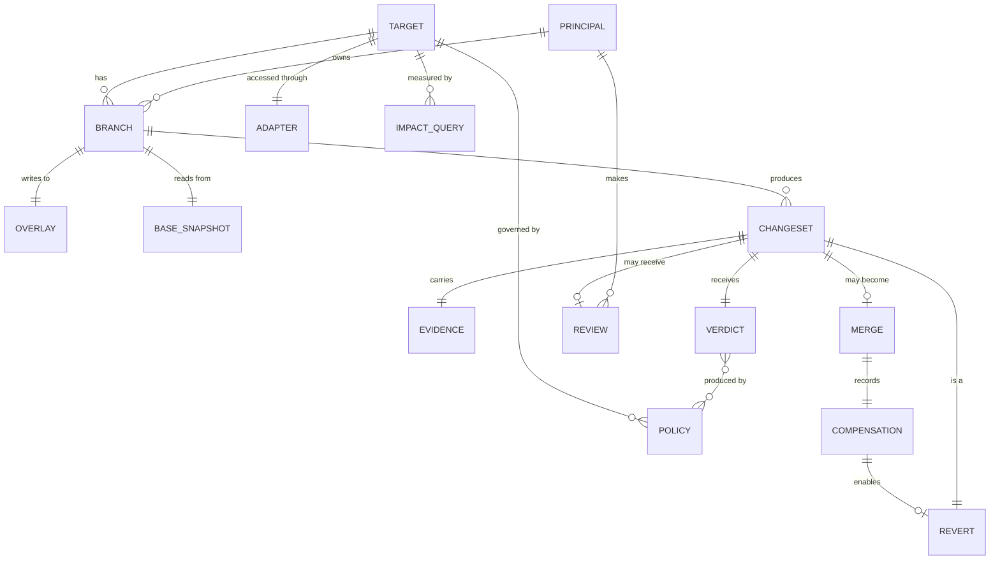

# 02 — Glossary and domain model

**Status:** Draft
**Owner:** Founding team
**Last updated:** 2026-10-15

The vocabulary of Steward and how the pieces relate. Every name in code, API, UI, and documentation uses these terms exactly. If a term here is wrong, change it here first and then everywhere else. Terms are listed in the order you need them, not alphabetically; an alphabetical index is at the end.

## 1. Core entities

### Target
A production dataset that agents want to change: a Postgres database, a Snowflake schema, an Iceberg table, a Salesforce org. A target is registered once with Steward through an **adapter**. Steward never owns a target; it only mediates writes to it.

### Adapter
The connector that lets Steward talk to one kind of target. An adapter knows how to read a snapshot and apply a changeset; it supplies rows (`readRows`, `currentRows`) and the changeset engine computes compensation from them. Adapters are the only code that varies by backend.

### Branch
An isolated, short-lived overlay on a target. Reads fall through to the target as of the branch's **base snapshot**; writes land in the branch's **overlay**. A branch belongs to exactly one target and one **principal**. Branches are cheap enough to create one per agent task and are expected to live minutes to hours, not days.

A branch has a **lifecycle** (doc 13): `open → proposed → (merging | rejected | abandoned) → merged | closed`. A branch in `merging` may return to `proposed` if the merge fails before its checkpoint (for example, a stale base). Doc 13 is authoritative for every transition.

### Base snapshot
The point-in-time view of the target that a branch was created from. Every read through the branch that is not shadowed by the overlay returns data as of this snapshot. How the snapshot is realised depends on the adapter (a Postgres copy-on-write branch, an Iceberg snapshot ID, a timestamp for a CRM).

### Overlay
The set of writes made on a branch since its base snapshot. Stored by Steward in the **data plane**, in a columnar format the changeset engine can diff. The overlay is the only thing a branch owns; everything else is borrowed from the target.

### Principal
Who is acting: an agent, a human, or a service. Every branch, changeset, review decision, and policy edit is attributed to a principal. Agents are first-class principals with their own identity, not users borrowing a human's credentials.

### Changeset
The semantic diff of a branch: what would change in the target if the branch were merged, summarised in terms a reviewer can act on. A changeset is computed from the overlay by the **changeset engine** and has three layers:

1. **Row delta** — the precise set of inserts, updates, and deletes.
2. **Summary** — counts, distributions, and aggregates per table and column ("214 rows updated in `prices`, median change −3%").
3. **Impact** — derived metrics that policies and reviewers care about ("2 rows now below cost", "revenue forecast −2.1%"), computed by **impact queries** registered on the target.

A changeset is immutable once computed. If the branch changes, a new changeset is computed; the old one is kept for audit.

### Evidence
What the principal did before and while writing: queries run, rows read, external calls made, and the stated rationale. Evidence is attached to a changeset and shown to reviewers. It is captured by the write proxy automatically (queries, reads) and supplied by the agent explicitly (rationale, via the SDK). Evidence is never used by policy; it is for humans.

### Policy
A rule that evaluates a changeset and produces a **verdict**. Policies are written as SQL assertions against the changeset's row delta and summary, with a YAML envelope for scope and outcome. A policy belongs to a target and is versioned; every verdict records which policy version produced it.

### Verdict
The outcome of evaluating all applicable policies against a changeset. Exactly one of:

- **auto-merge** — no policy objected; the changeset merges without human review.
- **hold** — at least one policy requires human review; the changeset enters the **review queue**.
- **block** — at least one policy forbids the change; the changeset cannot be merged by anyone until the policy is changed.

Verdicts carry the list of policies that fired and why, so the reviewer and the agent both see the reasons.

### Review
A human decision on a held changeset. One of **approve**, **reject**, or **edit** (approve a modified subset of the row delta). A review is attributed to a principal and is permanent. Approving does not bypass **block** verdicts.

### Review queue
The ordered list of held changesets awaiting review for a target or a team. In M0 there is one queue per target; team-level queues are an open question (see §7). The queue is the primary human interface. Its size over time is a health metric: a shrinking queue means policies are capturing what humans decide.

### Merge
Applying a changeset's row delta to the target through its adapter. A merge is atomic per target where the backend allows it, and **checkpointed** where it does not (doc 13). Every merge produces a **compensation record** before it is considered complete.

### Compensation
The inverse of a merge: the row-level operations that would restore the target to its state before the merge was applied. Computed at merge time from the base snapshot and the row delta, stored in the **compensation log**. Compensation is what makes **revert** a single, always-valid operation.

### Revert
Applying a compensation record to the target. A revert is itself a changeset and goes through policy, so a revert can be auto-merged, held, or blocked like any other change. Reverting a merge that has since been overwritten by later merges produces a changeset showing the conflict; it does not silently clobber.

## 2. Infrastructure terms

### Control plane
The part of Steward operated by Steward: branch coordination, changeset computation requests, policy evaluation, review queue, API, UI, billing. Holds metadata only. Depends on central, single-region components and is never on the query hot path.

### Data plane
The part of Steward deployed next to the customer's targets, in their cloud account: the **write proxy**, overlay storage, the compensation log, and adapters. Holds row data. Never depends on the control plane for a query to succeed.

### Write proxy
The data-plane component agents connect to. Speaks the target's wire protocol (Postgres, a REST shim for CRMs), resolves which branch a connection belongs to, routes reads to the base snapshot and writes to the overlay, and captures evidence. The proxy must answer every query from local state; the control plane is consulted only asynchronously.

### Changeset engine
The component that computes a changeset from an overlay and a base snapshot. Runs in the data plane (row data never leaves), embeds DuckDB, and returns the summary and impact layers to the control plane; the row delta stays in the data plane and is served on demand.

### Heartbeat
A periodic message from each data-plane branch to the control plane carrying the branch's state and receiving the authoritative state back. Heartbeats are how the two planes reconcile after a failure. A branch whose heartbeat reports a state the control plane does not recognise corrects itself to the control plane's view.

### Checkpoint
A point in a multi-step flow after which the flow is considered to have happened even if later steps fail. Each flow in doc 13 names its checkpoint. Steps after a checkpoint are best-effort and are repaired by heartbeat.

### Impact query
A SQL query registered on a target that computes a business metric from a changeset ("sum of margin over changed rows"). Impact queries produce the impact layer of changesets and are the inputs policies reason about. They are owned by the customer, not by Steward.

## 3. Relationships

Key cardinalities:

- A branch has at most one *current* changeset but keeps all prior ones.
- A changeset has exactly one verdict; re-evaluation (after a policy change) produces a new changeset, not a new verdict on the old one.
- A merge produces exactly one compensation record. A compensation record is consumed by at most one *merged* revert; a rejected or abandoned revert releases it.

## 4. State summaries

Full state machines are in doc 13. For reference:

| Entity | States |
|--------|--------|
| Branch | `open`, `proposed`, `merging`, `merged`, `rejected`, `abandoned`, `closed` |
| Changeset | `computing`, `evaluated`, `superseded` |
| Verdict | `auto-merge`, `hold`, `block` |
| Review | `approved`, `rejected`, `edited` |
| Merge | `pending`, `applied`, `compensated`, `failed` |

The compensation record status `consumed` (doc 09) corresponds to merge state `compensated`; doc 12 formalises the mapping.

## 5. Naming rules

- Code uses these terms as identifiers: `Branch`, `Changeset`, `Verdict`, not `DataBranch`, `Diff`, `Decision`.
- "Pull request" and "PR" appear in marketing and in the analogy to Git. In code and UI they do not; the thing is a *changeset* awaiting *review*.
- "Fork" is never used. Branches merge back; forks diverge.
- "Approve" is a human act on a held changeset. "Auto-merge" is a policy outcome. Do not say a policy "approved" something.
- The customer's system is a *target*, never "the database", because it may be a CRM.

## 6. Alphabetical index

Adapter · Base snapshot · Branch · Changeset · Changeset engine · Checkpoint · Compensation · Control plane · Data plane · Evidence · Heartbeat · Impact query · Merge · Overlay · Policy · Principal · Revert · Review · Review queue · Target · Verdict · Write proxy

## 7. Open questions

| Question | Owner | Needed by |
|----------|-------|-----------|
| Do we need a **Team** entity (a group of principals who share a review queue) in M0, or is one queue per target enough? | Product | Doc 07 |
| Is **edit** as a review outcome in M0, or do we ship approve/reject only and treat edit as "reject, agent retries"? | Product | Doc 13 |
| Should evidence be structured (typed events) or a free-form log in M0? | Architecture | Doc 04 |
