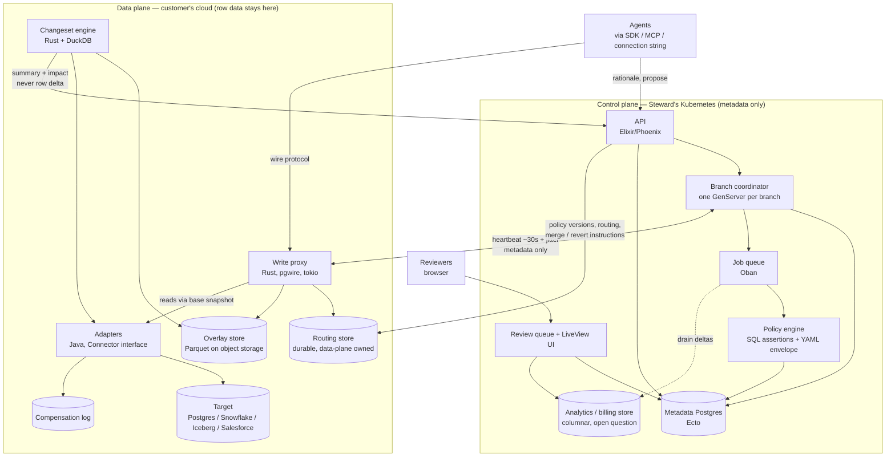

# 03 — Architecture overview

**Status:** Draft
**Owner:** Founding team
**Last updated:** 2026-10-15

Steward is split into a control plane that Steward operates and a data plane that runs in the customer's cloud. The control plane holds metadata and runs the review loop; the data plane holds row data and answers every query from local state. This document names the components, says which language each is written in and why, draws the trust boundary, walks the key flows at overview level, and states the nine principles that every later design must satisfy. Component details are in docs 04–09; the full lifecycle state machine is in doc 13. Nothing here is binding until the status is `Accepted`.

## 1. Summary

Three decisions shape everything below:

1. **Two planes, one boundary.** Row data never leaves the customer's cloud. Only metadata crosses to Steward. This is a product promise (doc 01 §7), so the line is enforced by what the inter-plane APIs can carry, not by configuration.
2. **The data plane must never wait on the control plane.** A query through the write proxy is answered from a durable local routing store. The control plane's Postgres is the source of truth for every entity in doc 02, but it is consulted asynchronously, through heartbeats.
3. **Checkpoints and heartbeats instead of distributed transactions.** Every multi-step flow names one checkpoint after which it has happened. Later steps are best-effort; the heartbeat repairs whatever did not finish.

The languages follow the jobs: Elixir/Phoenix for the control plane, because a branch is naturally a supervised process and the review UI is naturally LiveView; Rust for the write proxy and changeset engine, because they sit on the hot path and embed DuckDB; Java for adapters, because that is where the JDBC, Iceberg, Snowflake, and Salesforce client libraries are mature.

## 2. Planes and trust boundary

| | Control plane | Data plane |
|---|---|---|
| Operated by | Steward, on Steward's Kubernetes | Customer, in their cloud account, via our Helm chart and Terraform module (doc 14) |
| Holds | Metadata only: targets, branches, changeset summaries and impact, policies, verdicts, reviews, principals, billing meters | Row data: overlays, base snapshot access, row deltas, compensation records, evidence payloads |
| Scale unit | Customers | Branches per customer |
| Region | One region per deployment of the control plane | One region per customer; sits next to the targets |
| Availability requirement | May be down without blocking any query | Must answer every query from local state |
| Source of truth for | Every entity in doc 02 | Nothing durable except the overlay, compensation log, and evidence; the routing store is a derived, owned copy |

**What crosses the boundary, and in which direction.**

Data plane → control plane: heartbeats (branch id, observed state, overlay size, last write time), changeset summary and impact layers, evidence *metadata* (query count, tables read, rationale text supplied by the agent), merge and revert outcomes, billing deltas. Control plane → data plane: authoritative branch state, policy versions and bodies, routing assignments (branch → connection credentials reference, never the credentials themselves), merge and revert instructions, impact query definitions.

What never crosses: row deltas, overlay contents, compensation records, query text that could contain row values, and target credentials. A reviewer who wants the row delta of a changeset is served it from the data plane directly, through a short-lived signed grant the control plane mints and the customer's data plane honours. The control plane never proxies row data, even for display.

The split costs us a reconciliation protocol (heartbeats, §7), a second store (the routing store), and a deployment surface in the customer's account. Those are the costs this document accepts; §10 says why the simpler single-plane option was rejected.

## 3. Component map

The two arrows between the subgraphs are the whole inter-plane contract: the heartbeat, and the metadata that rides on it or on the API. Doc 15 enumerates what each may carry.

## 4. Component responsibilities

Each subsection says the language, what the component owns, and what it must never do. Forward links go to the component specs.

### API (control plane, Elixir/Phoenix) — doc 10
Owns the REST and gRPC surface agents and SDKs call for non-query operations: create branch, attach rationale, propose, fetch verdict, list changesets. Authenticates principals. Never touches row data and never sits on the query path; an agent that only reads and writes through its connection string need not call the API until it proposes.

### Branch coordinator (control plane, Elixir) — doc 07
One supervised GenServer per `open` or `proposed` branch. Owns lifecycle transitions, schedules the heartbeat as a periodic self-message, and reconciles the data plane's reported state with Postgres. Process state is a cache of Postgres state and never holds anything that must survive a restart (doc 18 §2). Never calls a remote system while holding an Ecto transaction.

### Policy engine (control plane, Elixir) — doc 06
Owns policy storage, versioning, orchestration of evaluation, and the verdict. A policy is a YAML envelope (scope, outcome, version) around SQL assertions. The SQL assertions **must** execute in the data plane, run by the changeset engine against the changeset's row delta, summary, and impact layers, because the row delta never crosses the boundary; the data plane returns only each assertion's result (pass/fail and a count) to the control plane, which combines them into exactly one verdict per changeset. This split keeps doc 02's rule that policies are "SQL against the row delta and summary" while keeping row data local. The policy engine never reads evidence (doc 02: evidence is for humans) and never receives row data.

### Review queue and LiveView UI (control plane, Phoenix LiveView) — doc 07
Owns the ordered list of held changesets per target, the approve/reject/edit actions, and the rendering of summary, impact, verdict reasons, and evidence. Reads pre-aggregated counters, never live `SUM`s. Never renders row data from control-plane storage; row-delta views come from the data plane under a short-lived grant.

### Metadata Postgres (control plane, Ecto) — doc 12
The source of truth for every doc 02 entity, plus the deltas and totals tables for counters (§7, principle 6). Never on the query hot path; a data-plane query must succeed with this database unreachable.

### Job queue (control plane, Oban) — doc 07
Owns every piece of control-plane work that must complete: changeset evaluation requests, counter drains, billing rollups, policy re-evaluation after a policy edit, heartbeat-triggered repairs. Fan-out to NATS JetStream is deferred until a job needs more than one consumer. Never used for anything the proxy waits on.

### Write proxy (data plane, Rust) — doc 04
The component agents connect to. Speaks the Postgres wire protocol via pgwire (and a REST shim for CRM targets), resolves the branch for a connection from the routing store, routes reads to the base snapshot and writes to the overlay, and records evidence. Owns the routing store. Must answer every query from local state and never calls the control plane synchronously.

### Changeset engine (data plane, Rust + DuckDB) — doc 05
Computes the row delta, summary, and impact layers from an overlay and a base snapshot, and runs impact queries. Returns summary and impact to the control plane; serves the row delta on demand inside the data plane. Never ships row data across the boundary. In-process versus sidecar is open (§11).

### Overlay store (data plane, Parquet on the customer's object storage) — doc 05
Holds each branch's writes since its base snapshot; the only thing a branch owns. Retained after merge for audit with a per-target retention window. Never readable by the control plane.

### Compensation log (data plane) — doc 09
Append-only record, per merge, of the row-level inverse computed at merge time. Written before a merge is considered complete; that write is the merge's checkpoint. Never consulted by policy: a revert is a new changeset that goes through policy like any other.

### Routing store (data plane, durable embedded store owned by the proxy) — doc 04
What the proxy needs per query: branch → base snapshot reference and overlay path, branch state, current policy version, credential references. Populated and corrected by heartbeat. Durable, not a cache: it survives restarts and is never purged wholesale. Never treated as source of truth by the control plane.

### Adapters (data plane, Java, `Connector` interface) — doc 08
One per target kind: JDBC for Postgres and MySQL, an Iceberg reference implementation, Snowflake, Salesforce. An adapter reads a base snapshot, applies a row delta, and produces inverses. Adapters are the only code that varies by backend and the only code that holds target credentials. They never contain policy, lifecycle, or routing logic.

### Target (customer's system) — doc 08
Registered once; never owned. Steward never becomes the system of record (doc 01 §6).

## 5. The three operation classes

Every operation Steward performs falls into one class, and the class fixes what it may depend on. A design that needs an operation to depend on something outside its column must change the class, not the rule.

| Class | Examples | May depend on | Must not depend on |
|---|---|---|---|
| **Data-plane queries** | Any read or write through the proxy; evidence capture; overlay append | Routing store, overlay store, adapter to the target | Control plane, metadata Postgres, job queue, network outside the customer's cloud |
| **Control-plane API operations** | Create branch, propose, fetch verdict, submit review, edit policy | Metadata Postgres, branch coordinator, policy engine | Synchronous completion of any data-plane step beyond the flow's checkpoint |
| **Background and async** | Changeset evaluation, counter drains, billing rollups, policy re-evaluation, heartbeat repair, analytics | Job queue, analytics store, both planes via heartbeat | Being on the latency path of either of the other two classes |

The first row protects the product: an agent mid-task keeps working through a control-plane outage. The second row is where human-visible latency lives and should stay under a second. The third row may be minutes late and must be idempotent.

## 6. Key flows at overview level

Each flow names its checkpoint. The state machine, conflict rules, and failure matrix are in doc 13; this section does not repeat them.

**Create branch.** The agent (or SDK) calls the API; the branch coordinator writes the `open` branch row to Postgres, which is the checkpoint. The coordinator then asks the data plane, by immediate push or next heartbeat, to realise the base snapshot through the adapter and register the branch in the routing store. If the agent connects before that lands, the proxy refuses with a retryable error rather than guessing.

**Write and evidence capture.** The proxy resolves the branch from the routing store, serves reads from the base snapshot shadowed by the branch's own writes, and appends writes to the overlay as Parquet; the durable overlay append is the checkpoint. Evidence (queries, tables touched) is recorded alongside; rationale supplied through the SDK goes to the API as metadata.

**Propose.** The coordinator moves the branch to `proposed` in Postgres (checkpoint) and enqueues a changeset computation. The changeset engine computes the three layers in the data plane, runs the current policy version's SQL assertions locally, and returns summary, impact, and per-assertion results; the policy engine combines the results into one verdict. A later write on the branch produces a new changeset and supersedes the old one.

**Review.** A held changeset appears in the review queue; a reviewer approves, rejects, or edits. The review row in Postgres is the checkpoint and is permanent. Approval does not override a `block` verdict; the policy must change, which re-evaluates as a new changeset.

**Merge and compensation.** On auto-merge or approval the branch moves to `merging`; the data plane computes the compensation record from the base snapshot and row delta and appends it to the compensation log before applying anything. That append is the checkpoint. The adapter then applies the row delta to the target; a partial application is repaired by heartbeat, and the compensation record guarantees repair is possible in either direction.

**Revert.** A revert is a new branch whose overlay is the compensation record. It goes through propose, policy, and review like any other change, so it can be auto-merged, held, or blocked. If later merges have overwritten the rows, the changeset shows the conflict rather than silently clobbering.

**Heartbeat reconciliation.** Every ~30 seconds with jitter, each branch's data-plane side reports its observed state (routing entry present, overlay size, last merge step reached); the coordinator compares it to Postgres, replies with the authoritative state, and the data plane corrects itself. Every post-checkpoint step above is finished this way. A branch the control plane does not recognise is told to close and release its overlay after a grace period.

## 7. Guiding principles

These are adapted from Cloudflare's D1 control-plane write-up (blog.cloudflare.com/d1-control-plane, October 2026). They are stated as Steward's principles; later designs must either satisfy them or say in an "Alternatives considered" section why not.

1. **Design every process for failure and idempotency.** Every job, heartbeat handler, and adapter operation must be safe to run twice. Branch creation takes a client-supplied idempotency key; overlay appends are keyed by write sequence; merge application is keyed by compensation record id. No operator ever fixes state by hand after a crash; the system keeps making progress.
2. **No centralised single-region component on the data-plane hot path.** The proxy answers every query from the routing store, overlay store, and adapter. If Steward's control plane is down, agents keep writing to branches; only proposing waits.
3. **Routing metadata lives in a durable store the data plane owns.** The routing store is not a cache in front of Postgres. A purgeable cache would turn a control-plane blip into a thundering herd of refills, the metastable failure the D1 team describes. Postgres is the source of truth; it is simply never asked at query time.
4. **Heartbeats are the reconciliation mechanism.** Each branch is an Elixir GenServer whose heartbeat is a periodic self-message with jitter. The data plane sends its state, the coordinator sends back the authoritative state, the data plane corrects itself. There is no separate repair job; the heartbeat is that job, and it runs whether or not anything failed.
5. **Checkpoints, not distributed transactions.** Every flow in §6 names the one write after which it has happened. Nothing holds an Ecto transaction open while calling the data plane, an adapter, or a billing system. Steps after the checkpoint are best-effort and repaired by principle 4.
6. **Pre-aggregate with a change log.** Per-customer counters (open branches, pending reviews, metered reviewed changesets) are rows in a deltas table, drained by an Oban job into a totals table that the queue header and the billing meter read. Never a `SUM` over all rows at read time; never a contended increment on one row per customer.
7. **Right store per job.** Postgres for transactional metadata; a columnar store (ClickHouse or DuckDB over Parquet, open) for analytics and billing events; the data-plane routing store for routing; Parquet on object storage for overlays. Nothing goes into Postgres only because it is already there.
8. **Eventual consistency and queues where strong consistency is not needed.** Analytics, billing, policy re-evaluation, and overlay cleanup go through Oban and later NATS JetStream. The control plane's view of a branch may lag by one heartbeat interval, and the UI says "as of" rather than pretending otherwise. Only the checkpoint writes of §6 are strongly consistent.
9. **Load-test with realistic agent write patterns before optimising.** Agents write in bursts: hundreds of small `UPDATE`s in a loop, or one large `INSERT ... SELECT`, interleaved with heavy reads. `tools/fixtures` must generate these patterns and doc 17 must run them against the proxy before any hot-path optimisation is accepted.

**What does not transfer from D1.** D1 places databases at the edge in Durable Objects and scales across the planet. Steward deploys per customer, usually in one region next to one set of targets, and its scale axis is branches per customer, not databases per planet. We borrow the control-plane discipline and none of the placement model.

## 8. Language boundaries and how they talk

| Boundary | Mechanism | Why |
|---|---|---|
| Elixir ↔ changeset engine (Rust) in the control plane, if any in-process use is needed (e.g. policy tests against fixture changesets) | Rustler NIF | Avoids a process hop for small, frequent calls; must be a dirty NIF or run on a dedicated scheduler so DuckDB never blocks the BEAM |
| Write proxy (Rust) ↔ changeset engine (Rust) | In-process crate dependency, or a separate binary over a local Unix socket | Same language; the choice is isolation versus latency (§11) |
| Control plane ↔ data plane | HTTPS with mTLS; gRPC for the heartbeat and streaming changeset results, REST for the agent-facing API | Crosses the trust boundary, so it must be an explicit wire contract that can be audited for what it carries (doc 15) |
| Write proxy (Rust) ↔ adapters (Java) | gRPC over a local socket; the adapter host is a thin JVM process | Keeps JVM startup and heap out of the proxy's latency path; adapters are libraries with no framework (doc 18 §2) |
| Agents ↔ write proxy | Postgres wire protocol (pgwire) or the target's REST shape | Agents do not change (doc 01 §3) |
| Agents ↔ control plane | REST via the SDK or MCP server (doc 11) | Non-query operations only |

All protobuf and OpenAPI definitions live in `contracts/` and are the only thing more than one language directory may depend on (doc 18 §1). A change to `contracts/` is a public contract change and requires asking before proceeding (doc 18 §5). Generated code is checked in per language so each directory builds without the others' toolchains.

## 9. What we deliberately borrow versus build

| Concern | Borrow | Build | Reason |
|---|---|---|---|
| Postgres copy-on-write branching | Neon open-source storage, Ardent, or Xata (open, §11) | — | Doc 01 §8: our value is policy, evidence, and the queue; branching is commodity and the substrates are moving up-stack, so partner rather than compete |
| Warehouse branching | Iceberg native branches and tags | — | Already the native primitive; Snowflake exposes it |
| In-process diff and aggregation | DuckDB | Overlay layout, diff queries, impact query runner | DuckDB reads Parquet and computes summaries cheaply; the semantic layer on top is ours |
| Wire protocol | pgwire crate, tokio | Branch resolution, routing, evidence capture | Protocol handling is solved; what the proxy does with a resolved branch is the product |
| Review UI | Phoenix LiveView | Queue model, changeset rendering, policy authoring | No separate front-end stack until a doc proves LiveView cannot do it (doc 18 §2) |
| Jobs and events | Oban, then NATS JetStream, Kafka only on customer demand | — | Postgres-backed queue is enough at M0 volumes and keeps the dependency count low |
| Policy language | SQL with a YAML envelope | Evaluation harness, policy tests as data | Reviewers and DBAs already write SQL; a DSL would need teaching and tooling |
| Deployment | Helm, Terraform | The chart and module themselves | Customers' platform teams already operate these |

## 10. Alternatives considered

**Single-plane SaaS.** Everything, including row data, hosted by Steward. Simpler to build and operate, and no heartbeat protocol. Rejected: the buyer is the person accountable for the data (doc 01 §2), and residency is the first question they ask. The split is the cost of being purchasable.

**Building our own Postgres branching.** Full control over snapshot semantics, no dependency on a substrate's roadmap. Rejected: doc 01 §6 says we do not build a database, and the substrates exist and improve faster than a founding team could match. The risk that a substrate adds its own review layer is handled by partnering, not by owning storage.

**A custom policy DSL.** Could express "hold if more than N rows change" more tersely than SQL and be statically checked. Rejected: a second language for reviewers to learn, and the hard cases (joins against reference data, distribution checks) are where SQL is already stronger. The YAML envelope covers scope and outcome, the part SQL cannot express.

**Go for the control plane.** Mature, easy to hire for, single binary. Rejected for M0: one supervised process per branch with a periodic self-message is what the BEAM gives us for free; LiveView removes a front-end stack; Oban removes a queue dependency. Reconsider if BEAM memory per branch becomes the scale limit, which principle 9 will reveal before it matters.

## 11. Open questions

| Question | Owner | Needed by |
|---|---|---|
| Postgres branching substrate for M0: Neon open-source storage, Ardent, or Xata. Criteria: self-hostable in the customer's account under our Helm chart, snapshot creation latency, licence | Architecture | Doc 04 and doc 08, before M0 |
| Analytics and billing store: ClickHouse (separate service to operate) or DuckDB over Parquet (no new service, weaker concurrency) | Architecture | Doc 12 |
| Does the changeset engine run in-process with the write proxy (lowest latency, shared failure domain) or as a sidecar binary (DuckDB memory isolated from the hot path)? | Proxy lead | Doc 05 |
| Multi-region data planes for one customer: supported at M0, or one region per customer with multi-region deferred until a customer's targets span regions? | Founding team | Doc 14 |
| Which embedded store backs the routing store (RocksDB, sled, or SQLite in WAL mode) | Proxy lead | Doc 04 |
| How evidence metadata is scrubbed so query text never carries row values across the boundary | Architecture | Doc 15 |
