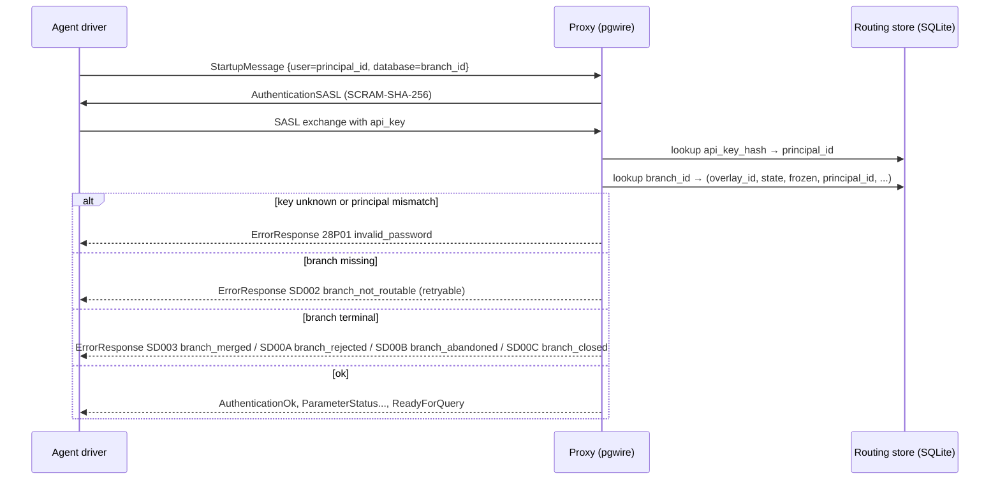
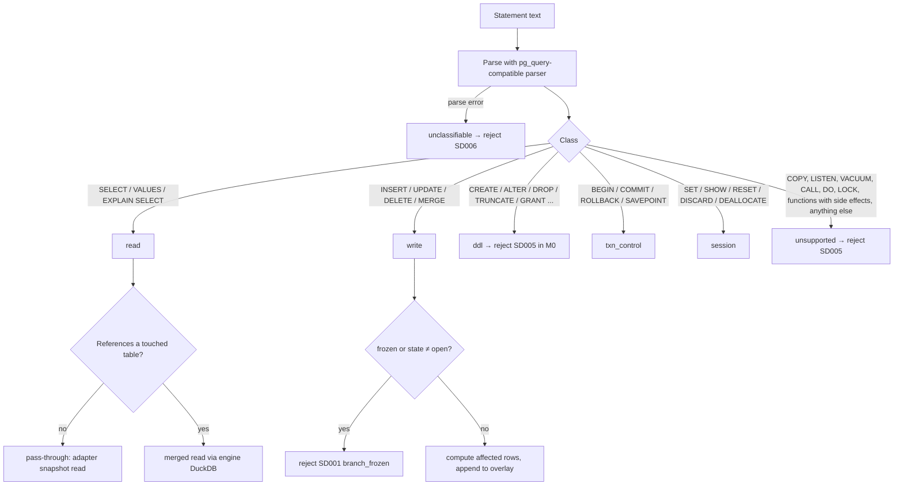

# 04 — Write proxy

**Status:** Draft
**Owner:** Founding team
**Last updated:** 2026-10-15
**Language / runtime:** Rust (tokio, pgwire)

The write proxy is the data-plane component agents connect to. It speaks the target's wire protocol, resolves which branch a connection belongs to from a durable local routing store, classifies every statement, routes reads to the base snapshot (shadowed by the branch's own writes) and writes to the overlay, enforces the freeze on `proposed` branches, and appends evidence to a local per-branch log. It answers every query from local state and never calls the control plane synchronously (doc 03 §5, doc 13 invariant 15). It is not responsible for computing changesets (doc 05), evaluating policy (doc 06), holding target credentials or talking to targets directly (doc 08), deciding branch state (doc 07 and doc 13), or recording compensation (doc 09).

## 1. Responsibilities

- Terminate agent connections over the Postgres wire protocol (M0) and, in later milestones, the MySQL wire protocol and a REST shim for CRM-shaped targets.
- Authenticate each connection by per-principal API key and resolve it to exactly one `(branch_id, overlay_id)` pair from the routing store.
- Classify every statement into one of `read`, `write`, `ddl`, `txn_control`, `session`, `unsupported`, or `unclassifiable`, and route it accordingly. Fail closed: anything not positively classified is rejected.
- Serve reads with read-your-writes semantics: overlay ∪ base snapshot for touched tables, pass-through to the base snapshot for untouched tables.
- Append writes durably to the branch's overlay before acknowledging them (doc 13 §6.2 checkpoint), in connection order, keyed by write sequence.
- Map `BEGIN` / `COMMIT` / `ROLLBACK` onto overlay batch semantics.
- Learn the freeze on `proposed` (and every other non-`open` state), write the freeze marker into the overlay, and reject writes afterwards with a stable error.
- Own the routing store: populate it from control-plane pushes and heartbeat replies, never purge it wholesale, and treat it as durable derived state (doc 03 §4, principle 3).
- Capture evidence per statement into a local append-only log per branch, and carry the agent-supplied rationale from the session into that log.
- Report per-branch facts (overlay size, freeze acknowledged, evidence gap, `base_snapshot_gone`) to `steward-engine` over the local socket; the engine sends the per-branch heartbeat (doc 13 §6.8) and relays the authoritative state, which the proxy adopts.
- Emit the metrics in §9.

## 2. Non-goals

| Not this component's job | Who does it |
|---|---|
| Realising the base snapshot (CoW branch, Iceberg snapshot ID, CRM timestamp) and reading from it | Adapters, doc 08 |
| Holding target credentials | Adapters, doc 08; the proxy holds only credential *references* |
| Overlay file format, compaction, diffing, summary and impact | Changeset engine, doc 05 |
| Executing merged (overlay ∪ snapshot) query plans | Changeset engine's DuckDB, doc 05; the proxy rewrites and dispatches, it does not plan |
| Branch state transitions | Control plane, doc 07; the proxy only reports and adopts (doc 13 §6.8) |
| Policy, verdicts, review | Docs 06 and 07 |
| Merge, compensation, revert | Docs 08 and 09; the merge worker lives in the data plane but is not the proxy process |
| Propose-time rationale that crosses to the control plane | SDK → API, doc 11 and doc 10 |
| Scrubbing rules for what may cross the plane boundary | Doc 15; this document only says what the proxy never writes |

## 3. Interfaces

### 3.1 Inbound

**Agents, Postgres wire protocol (M0).** Via the `pgwire` crate on tokio. Simple query protocol and extended query protocol (Parse/Bind/Execute) are both accepted, because psycopg3, asyncpg, JDBC, and npgsql use the extended protocol by default even for one-shot statements. SCRAM-SHA-256 and cleartext-over-TLS password authentication are supported; the "password" is the principal's API key.

**Decision: the database name in the connection string is the branch ID.** The control plane returns, at create (doc 13 §6.1 step 8), a connection string of the form `postgresql://<principal_id>:<api_key>@<proxy-host>:5432/<branch_id>?sslmode=require`. Rationale: every Postgres driver, ORM, `psql`, and BI tool can set the database name; the alternative, a startup parameter (`options=-c steward.branch=...`), is dropped or disallowed by several JDBC and ODBC paths and by some connection poolers. The branch ID is a UUID, which is a legal database name. An agent therefore "connects to a database" and nothing in its code changes (doc 01 §3). Listed in §11.

**Agents, MySQL wire protocol.** Not in M0; targeted for the milestone that ships the MySQL adapter (doc 19). Statement classification and routing are protocol-independent and are written against an internal `Statement` type so the second protocol adds a front end, not a second router.

**Agents, REST shim for Salesforce / HubSpot.** Not in M0; targeted with the CRM adapters. The agent calls a Steward endpoint shaped like the target's own REST API (e.g. `PATCH /services/data/vXX/sobjects/Account/<id>`), with the branch carried in a header `Steward-Branch: <branch_id>` and the API key as a bearer token. Each REST call maps to one classified statement; the same routing, freeze, overlay, and evidence paths apply.

**Control plane, gRPC over mTLS (contracts in `contracts/`).** Three instructions only, delivered as `Instruction` messages on the data-plane session stream that `steward-engine` opens to the control plane (doc 10 §5; the control plane never dials into the data plane) and relayed to the proxy over the local socket: `RoutingUpsert` (branch → overlay, base snapshot reference, credential reference, state, policy version), `FreezeWrites` (doc 13 §6.3 step 2, synchronous with a short timeout), and `InitialiseOverlay` (doc 13 §6.1 step 2). None of these is on the query path. The heartbeat is sent by `steward-engine`, not the proxy; the engine relays heartbeat replies to the proxy over the local socket (§3.2, §5.6).

### 3.2 Outbound

| Dependency | Mechanism | Assumed latency | Availability assumption |
|---|---|---|---|
| Routing store (SQLite, WAL mode, local disk) | In-process, `rusqlite` on a dedicated blocking thread pool | < 100 µs per lookup; lookups are cached in-process after first hit per connection | Must be available; if it is not, the proxy refuses connections (§6) |
| Overlay store (per-branch write-ahead log on the data plane's persistent volume, rolled into Parquet segments on object storage per doc 05) | In-process append + `fsync` | p99 < 2 ms for the local append; object-storage roll is asynchronous and never on the ack path | Local volume must be available; object storage may be down for minutes without failing writes |
| Evidence log (local append-only file per branch) | In-process append, batched fsync | < 1 ms | Best-effort; failure increments `evidence_gap` (doc 13 §6.2 failure 4) |
| Adapter host (Java) | gRPC over a local Unix socket; one `SnapshotRead` stream per statement | p50 1 ms + target latency | Required for any read that touches the snapshot; absence fails reads, not overlay writes |
| Changeset engine (`steward-engine`, DuckDB) | `view()` and the overlay WAL writer are in-process through the shared `steward-overlay` crate; everything else is gRPC over a local Unix socket to the separate `steward-engine` process (doc 05 §5.1), including the per-branch facts the engine folds into its heartbeat | 5–50 ms per merged read, estimate | Required for merged reads and for writes with a `WHERE` clause; absence fails those statements with a retryable error |
| Control plane | None directly on the outbound side: the session stream and heartbeat are owned by `steward-engine`; the proxy only receives the instructions above, relayed over the local socket | Irrelevant to any query | **May be down indefinitely.** No query waits on it |

The proxy **must not** open a network connection outside the customer's cloud; the only cross-boundary traffic it sees is the `contracts/`-defined control-plane instructions above, which arrive on the engine's outbound session stream (doc 10 §5).

## 4. State

| State | Where | Durability | Kind |
|---|---|---|---|
| Routing store: one row per `(branch_id, overlay_id)` with `target_id`, `base_snapshot_ref`, `overlay_path`, `credential_ref`, `believed_state`, `frozen`, `policy_version_set_hash` (doc 10 `RoutingUpsert`; the full version id list is fetched by the engine on `ComputeChangeset`), `principal_id`, `updated_at`, `last_heartbeat_reply_at`; one row per principal API key hash → `principal_id` | SQLite, WAL mode, on the data plane's persistent volume | Durable; survives restarts; rows are removed only on an authoritative terminal state or `unknown` from the control plane, never by eviction | Derived, data-plane owned (doc 03 §4) |
| Overlay write-ahead log per branch, with write sequence numbers and the freeze marker | Persistent volume, rolled into Parquet by the engine | Durable at `fsync`; this append is the write checkpoint | Source of truth for row data on the branch |
| Evidence log per branch | Persistent volume, append-only | Durable, best-effort | Source of truth for evidence |
| Touched-table set per branch | Derived from the overlay; persisted in the routing store row as a JSON array for fast startup | Durable, rebuilt from the overlay on mismatch | Derived |
| Per-connection session: principal, branch, open transaction buffer, `steward.rationale`, prepared statements | Process memory | Lost on restart; a restart aborts open transactions (§6) | Ephemeral |

**Decision: SQLite in WAL mode for the routing store.** Doc 03 §11 lists RocksDB, sled, and SQLite. SQLite is chosen for M0 because (a) the access pattern is a few thousand rows, point lookups, and a handful of writes per heartbeat cycle, where an LSM tree buys nothing; (b) WAL mode gives concurrent readers with one writer, which matches "many connections, one heartbeat task"; (c) it is inspectable with the `sqlite3` CLI during an incident, which neither alternative offers; (d) sled is pre-1.0 and its on-disk format has changed; (e) RocksDB adds a C++ build dependency to `proxy/`, which doc 18 §5 says to ask about. `rusqlite` with the bundled feature is the single dependency. Listed in §11.

**Unknown branch.** A connection whose database name is not in the routing store is refused at startup with `SD002 branch_not_routable`, a retryable error. The proxy **must not** queue the connection or ask the control plane; the SDK retries for up to 60 s (doc 13 §6.1 failure 6) and the next heartbeat reply or `RoutingUpsert` repairs the store.

## 5. Core flows

### 5.1 Connection and branch resolution



The principal in the routing row **must** equal the authenticated principal (doc 13 §7, one writer per branch); a mismatch is reported as an authentication failure, not as "branch exists but is not yours", so branch IDs cannot be probed. A branch in `proposed` or `merging` accepts the connection (reads are allowed) and rejects writes per §5.4.

Failure at each step: routing store unreadable → connection refused with `SD007 proxy_unavailable` and the instance marks itself unready (§6); SCRAM failure → standard `28P01`; everything else above.

### 5.2 Statement classification and routing



Classification uses the statement's abstract syntax tree, not regular expressions, so `WITH x AS (DELETE ...) SELECT ...` is a write, `SELECT nextval(...)` is unsupported, and a comment-wrapped `UPDATE` is still an `UPDATE`. A statement is classified once at Parse (extended protocol) or on receipt (simple protocol); bind parameters never change the class. Multi-statement simple-query strings are split and each statement is classified independently; a string containing any rejected statement is rejected as a whole before any part executes.

**Touched table** means a table with at least one overlay row on this branch. The set is maintained in memory per branch and persisted (§4).

**Pass-through read (M0).** The statement is sent verbatim to the adapter's snapshot connection for the branch, results are streamed back unchanged. This is the path the p99 < 5 ms requirement in §7 applies to.

**Merged read (M0).** The proxy rewrites the statement so each touched table reference is replaced by a view maintained by the changeset engine: `overlay_view(t) = (snapshot rows of t not deleted or updated in the overlay) ∪ (overlay inserts and updated rows of t)`, keyed on the table's primary key. The engine executes the rewritten statement in DuckDB. Snapshot rows for a touched table are fetched through the adapter with the statement's single-table predicates on that table pushed down; when no predicate can be pushed down the whole table is fetched, subject to the caps in §7. Untouched tables referenced in the same statement are also fetched through the adapter into DuckDB with pushdown. Postgres-specific functions and types that DuckDB does not implement fail with `SD005` and a message naming the function.

**What is unsupported in M0 and returns `SD005 unsupported_statement`:** DDL of any kind; `COPY`; `LISTEN`/`NOTIFY`; `LOCK`; `SELECT ... FOR UPDATE/SHARE` (no row locks on a snapshot); writes to tables without a primary key (the overlay is keyed by primary key; see doc 05); writes through views; writes with `ON CONFLICT` whose arbiter is not the primary key; triggers and `RETURNING` of trigger-modified columns (triggers do not run on a branch); sequences and `DEFAULT` values that depend on sequences (the agent **must** supply keys); server-side cursors; `SET TRANSACTION ISOLATION LEVEL`; multi-statement strings mixing reads and writes within one simple-query message. The error message says what was rejected and why; it never echoes literals.

**Writes.** A write is not forwarded anywhere. The proxy evaluates it against overlay ∪ snapshot for its table to produce the affected row set with full before and after images, and appends those as overlay rows: `INSERT` → insert rows (duplicate primary key against overlay ∪ snapshot is `23505 unique_violation`); `UPDATE` → updated rows; `DELETE` → delete rows; `MERGE` → the corresponding mix. A write whose `WHERE` or `SET` references other tables (`UPDATE ... FROM`, `INSERT ... SELECT`) is evaluated entirely in DuckDB under the merged-read rules. Writes **must** be appended in connection order and the proxy **must not** acknowledge a write before the overlay append is durable (doc 13 §6.2 failure 2). Row counts in the `CommandComplete` tag reflect the affected set.

### 5.3 Transactions

**Decision:** on a branch, a transaction is a batch of overlay writes committed atomically; rollback discards the batch. `BEGIN` opens a per-connection buffer; writes inside it are evaluated immediately (so the connection sees its own uncommitted rows in subsequent reads, which the engine serves by layering the buffer on top of the overlay view) but are not appended to the overlay; `COMMIT` appends the whole buffer as one overlay batch under one write sequence number and one fsync, then acknowledges; `ROLLBACK` drops the buffer. Autocommit statements are batches of one. `SAVEPOINT` / `ROLLBACK TO` are supported by marking buffer positions. Statements from other connections on the same branch do not see the buffer until commit (doc 13 §7 serialises by append order). A buffer larger than the per-transaction ceiling in §7 fails the next write with `SD008 transaction_too_large`; the transaction is then in the aborted state until `ROLLBACK`, as Postgres would do. If the branch becomes frozen while a transaction is open, `COMMIT` fails with `SD001` and the buffer is discarded; the writes never reach the overlay.

```mermaid
sequenceDiagram
    participant A as Agent
    participant P as Proxy
    participant E as Engine (DuckDB)
    participant OV as Overlay WAL
    participant EV as Evidence log

    A->>P: BEGIN
    P-->>A: ok (buffer opened)
    A->>P: UPDATE prices SET p = p*0.97 WHERE cat = $1
    P->>P: classify = write; frozen? no
    P->>E: affected rows from overlay ∪ snapshot ∪ buffer
    E-->>P: 214 rows (before, after)
    P->>P: append to buffer
    P-->>A: UPDATE 214
    P->>EV: write event (scrubbed text, prices, 214, timing)
    A->>P: COMMIT
    P->>OV: append batch seq=N, fsync — CHECKPOINT
    P-->>A: COMMIT
    P->>EV: commit event seq=N
```

Failure at each step: engine unavailable → `SD007` and the transaction is aborted; overlay append fails → `COMMIT` returns `SD007`, buffer discarded, the agent retries the whole transaction (nothing partial is in the overlay); evidence append fails → still acknowledged, `evidence_gap` incremented; proxy crash mid-transaction → buffer lost, nothing in the overlay, the agent sees a dropped connection, which is exactly Postgres's semantics.

### 5.4 Freeze

The proxy learns of a freeze two ways: the synchronous `FreezeWrites` instruction at propose (doc 13 §6.3 step 2) and the heartbeat reply with `freeze: true` or an authoritative state other than `open` (doc 13 §6.8 table). In both cases the proxy, in one step, sets `frozen = true` in the routing store row and appends the freeze marker to the overlay WAL at the current sequence number, then acknowledges. The changeset engine reads only up to the marker (doc 13 §6.2 failure 6). After the marker, every write and every `COMMIT` on the branch returns `SD001 branch_frozen` with the message `branch <id> is proposed; writes are frozen until it returns to open`. Reads continue to work. Unfreeze (`proposed → open`, doc 13 §2.1) clears the flag and appends an unfreeze marker; the engine treats the span between markers as excluded. Writes in flight when the freeze lands are either before the marker (in the overlay, part of the changeset) or after (rejected); there is no third case because marker append and flag set happen under the branch's overlay append lock.

### 5.5 Evidence capture

Per statement, after the response is sent, the proxy appends one record to the branch's evidence log: `{seq, ts, principal_id, connection_id, class, statement_fingerprint, tables, rows_read, rows_written, duration_us, route (pass_through | merged | overlay), rationale, error_code?}`. `statement_fingerprint` is the statement text with every literal replaced by `$n` and bind parameter values omitted; the raw text and parameter values are never written anywhere. `rows_read` for pass-through reads is the count of rows streamed, not their content.

**Decision: rationale arrives as `SET steward.rationale = '<text>'`.** The SDK issues it on the connection before a unit of work; the proxy stores the value in session state and stamps it on every subsequent evidence record until it is reset. A `SET` is chosen over a comment convention because comments are stripped by several ORMs and poolers, and because `SET` is visible in the extended protocol as its own statement, so it can never be mistaken for part of a query. The value **must** be under 4 KB and is the only agent-supplied free text in the evidence log. The propose-time rationale (doc 13 §6.3) still goes through the API as metadata and is the only rationale that crosses the plane boundary. Evidence is never sent synchronously anywhere; at propose, the changeset references the log by location and digest (doc 13 §6.2).

### 5.6 Heartbeat and routing-store maintenance

The heartbeat to the control plane is sent by `steward-engine` (doc 13 §6.8), which holds merge progress and compensation status. One tokio task per proxy instance reports the proxy's per-branch facts for every routed branch, `{branch_id, overlay_id, believed_state, overlay_size, freeze_acknowledged, evidence_gap, base_snapshot_gone?}`, to the engine over the local Unix socket at ~30 s ± 20 %, and receives back the authoritative state the engine obtained from the control plane. The reply is applied to the routing store per the doc 13 §6.8 table. `unknown` and `closed` remove the row and schedule overlay GC; terminal states keep the row with `believed_state = done` until retention so a late connection gets the per-state terminal code (`SD003 branch_merged`, `SD00A branch_rejected`, `SD00B branch_abandoned`, `SD00C branch_closed`) rather than `SD002`. Engine or control-plane unavailability is a non-event for queries: the task logs, backs off to 60 s, and the routing store is untouched.

## 6. Failure modes

| Failure | Detection | Impact | Recovery |
|---|---|---|---|
| Routing store corruption (SQLite integrity check fails at open, or `SQLITE_CORRUPT` at runtime) | `PRAGMA integrity_check` at startup; error codes at runtime | Instance refuses new connections with `SD007`; existing sessions keep their in-memory resolution and continue | Instance renames the file aside and starts empty; routing rows are rebuilt from the next heartbeat replies and `RoutingUpsert` pushes within ~30–60 s. Overlays and evidence are untouched because they are separate files. Alert fires |
| Routing store disk full | Write error on heartbeat apply | Queries unaffected (reads of the store still work); state updates stall, so freezes learned by heartbeat are delayed | Alert; operator frees space. The synchronous `FreezeWrites` instruction still sets the in-memory flag and appends the marker, so propose is not blocked |
| Overlay store unreachable (persistent volume gone or read-only) | Append returns error | Every write and `COMMIT` on every branch fails with `SD007`; reads continue | Writes are not acknowledged, so nothing is lost; the agent retries. Alert. Branch state is not affected |
| Object-storage roll of overlay segments failing | Roll task error, `overlay_roll_lag_seconds` gauge | None on the query path; WAL grows | Retry with backoff; alert when lag > 15 min or WAL > ceiling |
| Snapshot connection lost mid-transaction (adapter restarts, CoW branch dropped) | gRPC stream error from adapter | The current statement fails with `SD007` (retryable) or `SD004 base_snapshot_gone` (not retryable); an open transaction's buffer is kept so the agent can retry the statement; if `SD004`, the branch is reported in the next heartbeat and the control plane abandons it (doc 13 §6.2 failure 3) | Adapter host restarts and re-establishes the snapshot connection pool; for `SD004`, the principal creates a new branch |
| Changeset engine (DuckDB) unavailable or over memory | Call error / `SD008` | Merged reads and `WHERE`-bearing writes fail with `SD007`; pass-through reads and key-only writes continue | `steward-engine` is a separate process (doc 05 §5.1); its supervisor restarts it and the proxy is unaffected |
| Control plane unreachable | Engine reports no authoritative state in its replies | **None.** Every query continues from local state. Freezes and unfreezes requested during the outage land when the engine's heartbeats resume | Nothing to do; the engine's heartbeat backs off and resumes |
| Proxy restart with open connections | Process exit | All sessions drop; open transaction buffers are lost and were never in the overlay; committed batches are durable. Drivers see a closed socket | Kubernetes restarts the pod; routing store is reopened; agents reconnect (the SDK retries). Target time to ready: < 5 s |
| Evidence log append fails | I/O error | Write still acknowledged; `evidence_gap` incremented, reported to the engine, and carried in its heartbeat | Alert; reviewer sees the gap on the changeset |
| Classification error (parser crash on valid SQL) | Panic caught per connection | That statement is rejected `SD006`; connection stays up | Bug; counter `statements_unclassifiable_total` alerts above zero |
| Slow target (snapshot read takes seconds) | Latency histogram | Pass-through reads are slow; the proxy adds no timeout of its own beyond the driver's `statement_timeout` | None; this is the target's latency, reported as such |
| Too many connections | Accept loop hits ceiling | New connections get `53300 too_many_connections` | Raise `max_connections` / vertical resize in M0 (single-pod data plane, doc 14); multi-replica proxy is M1 (doc 19), and connections are stateless across instances except open transactions |

## 7. Performance and capacity

| Measure | Value | Requirement or estimate |
|---|---|---|
| Added latency, pass-through read on Postgres, p99 (proxy in, proxy out, excluding target time) | < 5 ms | Requirement (doc 01 §9 risk 1; doc 18 §2 benchmark gate) |
| Added latency, pass-through read, p50 | < 1 ms | Estimate |
| Merged read on a touched table with pushdown, ≤ 100 k snapshot rows fetched, p99 | < 50 ms | Estimate; benchmark before accepting |
| Merged read requiring a full-table fetch | Bounded by the cap below; typically 200 ms–2 s | Estimate |
| Single-row write (autocommit), p99 added latency | < 5 ms including WAL fsync | Requirement |
| Overlay write throughput per branch | 2,000 single-row writes/s sustained; 20,000 rows/s in batched transactions | Estimate; `tools/fixtures` burst patterns (doc 03 principle 9) are the benchmark |
| Concurrent client connections per proxy instance | 1,000 | Requirement for M0 |
| Routed branches per instance | 5,000 | Estimate; routing store size ≈ 2 MB |
| Memory ceiling per branch (overlay index + touched-table metadata + evidence buffer) | 256 MB resident | Requirement; the engine's DuckDB working set is separately capped per doc 05 |
| Per-transaction buffer ceiling | 64 MB or 1 M rows, whichever first | Requirement (M0; spill-to-disk is a later milestone) |
| Snapshot rows fetched into DuckDB per merged statement | 1 M rows or 512 MB | Requirement; beyond this the statement fails `SD009 statement_too_large` with advice to add a predicate |
| Instance resource envelope | 2 vCPU, 4 GB for the above | Estimate |

Hot-path rule, stated exactly: for one statement the proxy reads (1) the per-connection session struct, (2) the routing row for the branch (cached in-process after connect, invalidated by heartbeat apply), (3) the branch's touched-table set, (4) the branch's frozen flag, and (5) for merged reads, the overlay view through the engine. It writes (6) the overlay WAL for writes and (7) the evidence log. Nothing else; no DNS, no control plane, no object storage.

## 8. Security

The proxy sits on the boundary between agents (untrusted, authenticated) and the customer's data plane (trusted). It authenticates principals by API key, stored in the routing store as unsalted `SHA-256(secret)`, the same hash the control plane keeps (doc 15); keys are provisioned by the control plane through `RoutingUpsert` and revoked the same way. mTLS between agents and the proxy **may** be enabled in M0 and is off by default; TLS with server certificate is required by default (`sslmode=require` in the issued connection string). The control-plane gRPC link is mTLS always (doc 03 §8).

The proxy never holds primary target credentials: a routing row carries a `credential_ref` the adapter host resolves (doc 03 §4). For pass-through reads it uses an ephemeral, read-only, snapshot-scoped credential minted by the adapter (doc 08 §5.1), which expires with the branch and grants nothing on the primary. A compromised proxy process therefore yields overlays, evidence, and read access to open branch snapshots, not production access.

Never logged, at any level: statement text with literals, bind parameter values, result rows, API keys, `steward.rationale` values (they go to the evidence log, not to the process log), connection strings. Logs are structured JSON with branch ID, principal ID, statement class, fingerprint hash, timing, and error code (doc 18 §2, doc 15).

SQL injection in the agent's own statements is not the proxy's concern: the agent is the principal and the branch is its sandbox. Statement classification errors are the proxy's concern, because a write misclassified as a read would escape the overlay. The classifier therefore fails closed: a statement that cannot be parsed into a known class is rejected (`SD006`), and the classifier's tests (§10) treat any false negative on the write class as a release blocker.

## 9. Observability

Metrics, all labelled by `target_id` unless noted; `branch_id` is never a metric label (doc 16): per-branch detail lives in logs and traces.

- `proxy_statements_total{class, route, outcome}` — counter.
- `proxy_statement_duration_seconds{class, route}` — histogram of added latency; the p99 of `{class="read", route="pass_through"}` is the §7 requirement.
- `proxy_overlay_bytes` and `proxy_overlay_rows` — gauges.
- `proxy_freeze_rejections_total` — counter of `SD001`.
- `proxy_unroutable_connections_total`, `proxy_unsupported_statements_total{reason}`, `proxy_unclassifiable_statements_total` — counters, the last alerting above zero.
- `proxy_evidence_gap_total` — counter.
- `proxy_heartbeat_age_seconds` (per instance) and `proxy_routing_rows` — gauges.
- `proxy_connections{state}` — gauge.
- `proxy_overlay_roll_lag_seconds` — gauge.

Traces: one span per statement with class, route, and child spans for the adapter and engine calls; sampled at 1 % by default, 100 % for errors. Spans carry the fingerprint hash, never text.

The three signals on call looks at first: `proxy_statement_duration_seconds` p99 for pass-through reads (is the proxy adding latency?), `proxy_statements_total{outcome="error"}` by error code (what are agents hitting?), and `proxy_heartbeat_age_seconds` (is the data plane drifting from the control plane, which is tolerable, or is something else wrong?).

## 10. Testing

- **pgwire conformance.** `proxy/tests/integration` runs a driver matrix against a proxy in front of a fixture Postgres: `psql`, psycopg3, asyncpg, SQLAlchemy (sync and async), JDBC, npgsql, node-postgres, Go `pgx`. Each driver runs the same script: connect, simple and extended queries, a transaction with savepoint, a frozen-branch write, a `SD002` reconnect loop. Adding a driver is a new directory, not new test logic.
- **Statement classification property tests.** `proptest` generates SQL from a grammar covering the Postgres statement forms the parser knows, with random comments, whitespace, CTEs, and casing; the property is that classification equals the class of the AST's top-level node, and that every statement containing a data-modifying node anywhere is `write`. A corpus of real agent-generated SQL (synthetic, from `tools/fixtures`) is a regression set.
- **Read-your-writes tests.** For a fixture table set: apply a random sequence of writes on a branch, then compare every read through the proxy against the same sequence applied to a scratch Postgres database. Any difference on a supported statement form is a failure; an unsupported form **must** produce `SD005`, not a wrong answer.
- **Replay harness.** `tools/loadgen replay` (the `replay` subcommand of the `tools/loadgen` load driver; `tools/fixtures` is the synthetic data generator) feeds recorded agent sessions (statement sequences with timings, synthetic data) through the proxy and asserts overlay contents, evidence records, and latency histograms. This is also the load test required by doc 03 principle 9 and the benchmark gate of doc 18 §3.
- **Failure injection.** Integration tests kill the adapter host mid-transaction, make the overlay volume read-only, corrupt the routing store, and stop the control-plane stub, asserting the behaviour in §6.
- **Benchmarks.** `proxy/benches/` covers connect, classify, pass-through read, single-row write, and merged read; CI fails on > 5 % regression.

## 11. Alternatives considered

- **Postgres extension instead of a proxy.** An extension (hooks on the executor, a branch GUC) would avoid the wire layer and get planning for free. Rejected: it only works for Postgres, needs superuser installation on the customer's instance (the buyer's DBA will refuse), and puts Steward code inside the system of record, against doc 01 §6. The branching substrates (doc 03 §9) also sit outside the server.
- **PgBouncer fork.** Mature connection handling in C. Rejected: PgBouncer does not parse statements, so classification and rewriting would be bolted on; it is single-threaded; and `pgwire` plus tokio gives the same protocol coverage in the language the engine is in.
- **Running the proxy in the control plane.** One deployment, no routing store, no heartbeat. Rejected by doc 03 §2 and §10: row data would cross the boundary and a control-plane outage would stop agents writing.
- **Startup parameter instead of database name for branch resolution.** Cleaner separation ("database" could then be the target's real name). Rejected for driver coverage, as above; the target name is not needed because a branch belongs to exactly one target.
- **Comment convention for rationale** (`/* steward: ... */`). Rejected: stripped by ORMs and poolers, and ambiguous inside multi-statement strings.
- **Appending every write directly to Parquet on object storage.** No local WAL, simpler durability story. Rejected: a per-statement object-storage round trip is 20–100 ms and would break the write latency requirement; the local fsync'd WAL is the checkpoint and the Parquet roll is asynchronous. Doc 05 owns the format; doc 03's "Parquet on object storage" is read as the at-rest form.
- **RocksDB or sled for the routing store.** See §4.
- **Routing reads entirely through DuckDB for all statements.** Uniform path, no classification of touched versus untouched. Rejected: it would put DuckDB and an adapter fetch on every read and make the 5 ms requirement unreachable.

## 12. Open questions

| Question | Owner | Needed by |
|---|---|---|
| DDL support: should a branch be allowed to `ALTER TABLE` / `CREATE TABLE`, with the overlay carrying schema changes and the changeset showing them? Recommendation: not in M0; reject with `SD005` and measure how often agents hit it | Proxy lead, Product | M3 (doc 19) |
| MySQL wire protocol timeline, and whether the MySQL front end shares the Postgres parser (dialect differences in classification) | Proxy lead | Doc 19 |
| Prepared statements in M0: extended-protocol unnamed and named statements are supported as described; are SQL-level `PREPARE` / `EXECUTE` / `DEALLOCATE` in scope, and must named statements survive across a freeze? Recommendation: support `PREPARE`/`EXECUTE` by classifying at `PREPARE` time; otherwise reject | Proxy lead | Before M0 driver matrix |
| Exact merged-read support envelope for M0 (which Postgres functions, types, and join shapes DuckDB must cover before an agent-facing error is acceptable) | Proxy lead with engine lead | Doc 05 |
| Tables without a primary key: reject writes (this document) or support a Steward-managed row identity? | Engine lead | Doc 05 |
| Which Postgres branching substrate realises the base snapshot (doc 03 §11); affects whether the "snapshot connection" is a CoW branch endpoint or a `REPEATABLE READ` snapshot on the primary | Architecture | Doc 08, before M0 |
| Steward error class: `SD` is proposed for Steward-specific SQLSTATEs; confirm it does not collide with any driver's expectations and record the code table in doc 10 | Proxy lead | Doc 10 |
| Spill-to-disk for large transactions instead of `SD008` | Proxy lead | After M0 |
