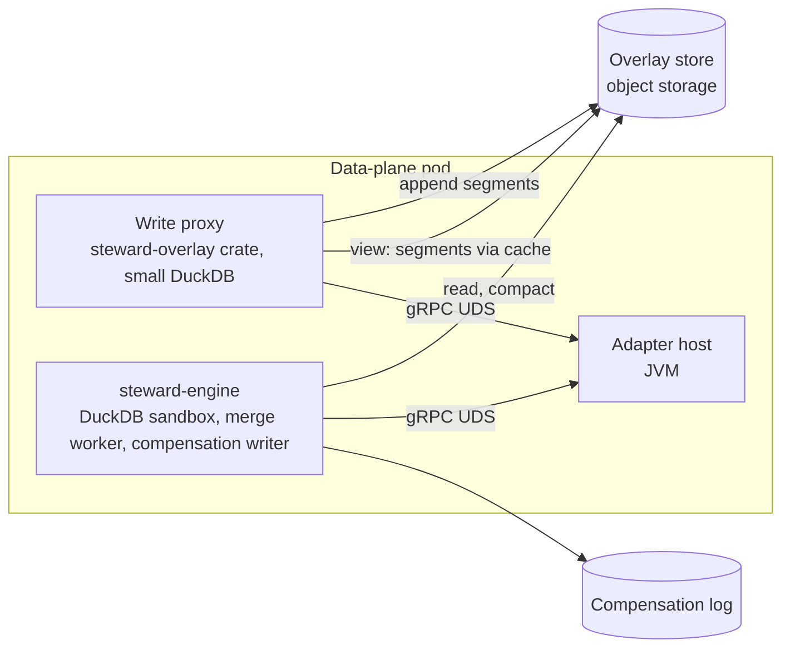
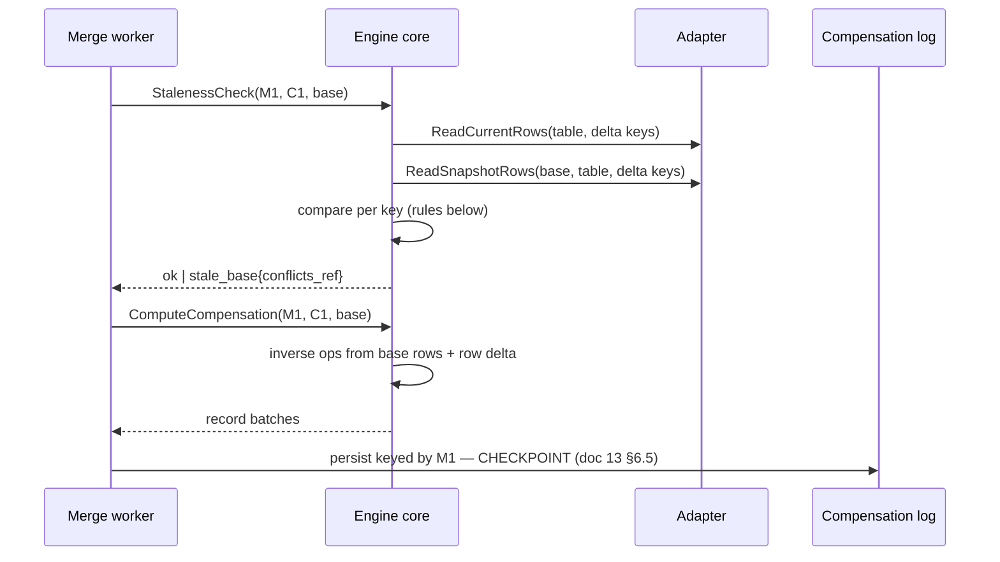

# 05 — Changeset engine

**Status:** Draft
**Owner:** Founding team
**Last updated:** 2026-10-15
**Language / runtime:** Rust (edition 2024, tokio) with embedded DuckDB; overlays as Parquet on the customer's object storage

The changeset engine is the data-plane component that turns a branch's overlay plus its base snapshot into a changeset: the row delta, the summary, and the impact layers of doc 02. It also runs the customer's SQL in the data plane so row data never crosses the boundary: impact queries, and the policy assertions of a policy version (doc 03 §4). At merge time it performs the staleness check and computes the compensation record (doc 13 §6.5). It owns the overlay's on-disk format and its compaction, and it provides the `view(branch, table)` relation the write proxy uses for read-your-writes. It is not responsible for deciding verdicts (policy engine, doc 06), applying rows to a target (adapters, doc 08), storing compensation records (compensation log, doc 09), or any lifecycle transition (doc 13).

## 1. Responsibilities

- Define and own the overlay format: the local write-ahead log (the durable per-write checkpoint), the Parquet segment schema, the manifest, the freeze marker, the WAL-to-Parquet roll, and compaction.
- Send the per-branch heartbeat to the control plane (doc 13 §6.8), folding in merge progress, compensation status, revert outcomes, retention acknowledgements, and the per-branch facts the proxy reports over the local socket; relay the authoritative state back to the proxy.
- Compute the row delta from an overlay (net-op collapsing), persist it locally keyed by changeset ID, and serve it on demand inside the data plane.
- Compute the summary layer and run registered impact queries to produce the impact layer; return both to the control plane.
- Execute a policy version's SQL assertions against the changeset and return per-assertion results.
- Compute the `conflicts` section for `stale_base` and revert changesets (doc 13 §6.5, §6.6).
- Perform the staleness check and compute the compensation record at merge time; hand the record to the compensation log.
- Expose `view(branch, table)` to the proxy for reads that must see the branch's own writes.
- Sandbox every piece of customer-authored SQL (impact queries, assertions) in a read-only, access-restricted DuckDB instance.

## 2. Non-goals

- Writing to the overlay on the query path: the write proxy (doc 04) appends to the WAL, using the writer from this component's shared crate; this component owns the format and the roll, not the hot-path append.
- Reading base snapshots from targets directly: every base read goes through the adapter's snapshot interface (doc 08). The engine holds no target credentials.
- Combining assertion results into a verdict, storing policies, or versioning them: policy engine (doc 06).
- Applying a row delta, computing per-row apply progress, or holding the merge lease: adapters (doc 08) and the control plane (doc 07, doc 13 §7).
- Storing compensation records durably: compensation log (doc 09).
- Deciding branch state. The engine reports outcomes; the control plane transitions.
- Evidence capture or interpretation. The engine carries evidence references (doc 13 §6.3 step 7) as opaque digests and locations.

## 3. Interfaces

### 3.1 Inbound

The engine is a separate process in the data plane (`steward-engine`, see §5.1 Decision) exposing gRPC on a local Unix domain socket within the data-plane pod, and on mTLS TCP for the control plane's compute requests relayed through the data-plane gateway (doc 14). Protobuf definitions live in `contracts/engine/` (doc 18 §1).

| RPC | Caller | Contract |
|---|---|---|
| `ComputeChangeset{changeset_id, branch_id, overlay_id, base_snapshot, impact_query_ids[], policy_version, revert_of?}` | Control plane (via gateway), doc 13 §6.3 step 4 | Blocks on the freeze marker; returns `{summary, impact, assertion_results[], evidence_refs[], row_delta_digest}` or a typed error. Idempotent for a given `(changeset_id, overlay_id)`: a recompute overwrites the local row delta with identical content. |
| `GetRowDelta{changeset_id, table, page}` | Reviewer UI through a short-lived signed grant (doc 03 §2); merge worker | Pages of the persisted row delta. Never called by the control plane for storage. |
| `StalenessCheck{merge_id, changeset_id, base_snapshot}` | Merge worker, doc 13 §6.5 step 4–5 | Returns `ok` or `stale_base{conflict_keys_ref}`. |
| `ComputeCompensation{merge_id, changeset_id, base_snapshot}` | Merge worker, doc 13 §6.5 step 6 | Returns the compensation record as a stream of overlay-format batches for the compensation log to persist keyed by `merge_id`. |
| `Compact{overlay_id, table?}` | Data-plane maintenance timer; proxy after a flush that crosses the segment threshold | Returns the new manifest version. |
| `ReleaseOverlay{overlay_id}` | Data-plane GC after the heartbeat reply says `closed` or `unknown` (doc 13 §9) | Deletes segments, manifest, local caches, and the row deltas of the branch's changesets. |
| `view(branch_id, table) -> Relation` | Write proxy, in-process through the `steward-overlay` crate | Overlay ∪ base snapshot with the overlay winning on key (§5.5). |

### 3.2 Outbound

| Dependency | Mechanism | Assumption |
|---|---|---|
| Overlay store (customer object storage: S3, GCS, Azure Blob) | `object_store` crate; range GETs, conditional PUT on the manifest | Durable, read-after-write consistent for new objects, conditional writes supported. p50 GET first byte 20–80 ms. Unavailable means computation fails and is retried; the proxy's appends are its own concern (doc 04). |
| Adapter host (Java, doc 08) | gRPC over local socket: `ReadSnapshotRows(snapshot, table, keys[]) -> Arrow IPC stream`, `ScanSnapshot(snapshot, table, columns[]) -> Arrow IPC stream`, `ReadCurrentRows(table, keys[]) -> Arrow IPC stream` (includes `last_modified` where the target exposes it) | Key reads are batched 10k keys per call. Latency is the target's: tens of ms for Postgres, seconds for Snowflake, seconds plus rate limits for CRMs. The adapter may answer `base_snapshot_gone`. |
| Compensation log (doc 09) | In-process call in the same binary (§5.1) | Append is durable before it returns; that append is the merge checkpoint. |
| Local disk | Segment cache, row delta store, DuckDB temp directory | Node-local NVMe or equivalent; losing it loses only caches and row deltas, which are recomputable from the overlay (doc 13 §6.3 failure 4). |

The engine's only outbound call to the control plane is the per-branch heartbeat (doc 13 §6.8; gRPC over mTLS, ~30 s ± 20 %), which carries metadata only. Compute results are returned in the RPC reply; the control plane retries a lost reply with the same changeset ID.

## 4. State

| State | Where | Durability | Role |
|---|---|---|---|
| Overlay write-ahead log per branch | Data plane's persistent volume, appended and `fsync`'d by the proxy through the `steward-overlay` crate | Durable at `fsync`; this append is the write checkpoint (doc 13 §6.2) | Source of truth for writes not yet rolled |
| Overlay segments and manifest | Object store, `steward/targets/<target_id>/overlays/<overlay_id>/tables/<table>/segments/seg-<first_seq>-<last_seq>.parquet`, `.../<overlay_id>/manifest.json` | Durable; the branch's only owned data (doc 02); the at-rest form | Source of truth for the branch's rolled writes |
| Freeze marker | `.../<overlay_id>/freeze.json` = `{frozen_at, last_seq, proxy_instance}` written by the proxy | Durable | Upper bound on the sequence numbers a changeset includes (doc 13 §6.2 failure 6) |
| Row delta per changeset | Local disk, `<data_dir>/changesets/<changeset_id>/<table>.parquet`, plus a digest | Derived; recomputable from the frozen overlay | Served to reviewers and the merge worker |
| Assertion samples | Local disk beside the row delta, `<changeset_id>/assertions/<policy_id>/<assertion_id>.parquet` | Derived | Served under grant; never sent to the control plane (§5.4) |
| Segment cache | Local disk LRU, default 10 GiB | Cache | Avoids repeated GETs |
| DuckDB | In-memory instance per computation, temp directory on local disk | Ephemeral | Compute only; no persistent DuckDB database file exists |

The engine holds no state that must survive a node loss. The overlay and the compensation log are the only durable artefacts, and the log belongs to doc 09.

### 4.1 Overlay segment schema

One Parquet file set per overlay per table. Every segment has exactly this schema; `before` and `after` are structs with one field per column of the target table at the base snapshot's schema, in the adapter's canonical Arrow types.

| Column | Parquet / Arrow type | Meaning |
|---|---|---|
| `seq` | INT64, required | Overlay-wide, strictly increasing sequence number assigned by the proxy at append; the write's idempotency key (doc 03 §7 principle 1) |
| `op` | UTF8 dictionary, required: `insert` / `update` / `delete` | Row operation |
| `key` | STRUCT of the table's primary key columns, required | Row identity. Tables without a primary key or unique key are not branchable (doc 08) |
| `key_hash` | FIXED_LEN_BYTE_ARRAY(16), required | xxh3-128 of the canonical key encoding; join and bloom-filter column |
| `before` | STRUCT, nullable | Full row image before the op, as seen through the branch (base snapshot shadowed by earlier overlay ops). Null for `insert`; null for `update`/`delete` only when the adapter cannot provide it (§12) |
| `after` | STRUCT, nullable | Full row image after the op. Null for `delete` |
| `touched` | LIST<UTF8>, required | Columns the statement assigned. For `insert` and `delete`: every column |
| `ts` | TIMESTAMP(MICROS, UTC), required | Proxy wall clock at append |
| `stmt_id` | UTF8, required | Evidence correlation ID. Never the statement text |

Writer settings: zstd level 3, row groups of 65,536 rows, column statistics on `seq`, `key_hash`, `ts`; a bloom filter on `key_hash`. **The WAL and the roll.** The durable per-write checkpoint is a local fsync'd write-ahead log on the data plane's persistent volume, one per branch, whose record format is owned by the shared `steward-overlay` crate and written by the proxy; Parquet on object storage is the at-rest form. The crate rolls the WAL into Parquet segments asynchronously at a size or time threshold (10,000 ops, 16 MiB, 2 s idle, or on freeze), never on the acknowledgement path, and truncates the WAL only once the segment PUT and the manifest update have succeeded; `view()` and `ComputeChangeset` read the unrolled WAL tail together with the segments so no acknowledged write is ever invisible. Segments are immutable once written. The manifest lists the live segments per table with their `[first_seq, last_seq]`, the table's schema fingerprint, and `compacted_through_seq`; it is updated by conditional PUT, so a stale writer loses and re-reads.

### 4.2 Compaction

A table is compacted when it has more than 64 live segments or when live bytes exceed four times the estimated net size. Compaction reads every live segment with `last_seq <= compacted_through_seq'`, applies the net-op collapse of §5.2 per key, writes `compact-<last_seq>.parquet` with the same schema (one row per key; `seq` = the key's last seq, `before` = its first before-image, `after` = its last after-image, `touched` = the union), then updates the manifest. Segments appended by the proxy after compaction started are untouched because compaction only ever replaces segments it listed. Old segments are deleted 10 minutes after the manifest update so an in-flight reader finishes. A frozen overlay is compacted once, fully, after its changeset is computed; this is what keeps reviewer paging and merge reads cheap.

## 5. Core flows

### 5.1 Deployment shape

**Decision:** the engine runs as its own process in the data plane, `steward-engine`, next to the proxy and the adapter host in one pod, speaking gRPC over a Unix domain socket (the "separate binary over a local socket" option of doc 03 §8). A shared Rust crate, `steward-overlay`, holds the segment schema, the writer, the net-op reader, and the `view()` relation; the proxy depends on it and opens its own small DuckDB instance for read-your-writes. The merge worker of doc 13 §6.5 and the compensation log writer of doc 09 are modules of the same binary (doc 09 may move the log's storage elsewhere; the write path stays here). Because this process holds merge progress and compensation status, it is also the sender of the per-branch heartbeat (doc 13 §6.8): the proxy reports its per-branch facts (overlay size, freeze acknowledged, evidence gap) to the engine over the local socket, and the engine relays the authoritative state back.

Reason: a 10M-row changeset drives DuckDB to several GiB and can spill; a runaway impact query must be killable by process-level limits. Neither may take down the proxy, which must answer every query from local state (doc 03 §5). The latency cost is one local hop on a path that is already seconds long. The Rustler NIF into the control plane (doc 18 §1) is used only for policy SQL static validation and policy tests against fixture changesets; the computation itself is not in-process with either the proxy or the control plane.



### 5.2 Compute changeset

```mermaid
sequenceDiagram
    participant CP as Control plane
    participant CE as steward-engine
    participant OS as Overlay store
    participant AD as Adapter
    participant DB as DuckDB (sandbox)

    CP->>CE: ComputeChangeset(C1, O1, base, impact ids, policy version)
    CE->>OS: 1. poll freeze.json (until present, or 120s)
    CE->>OS: 2. read manifest; fetch live segments with first_seq <= last_seq
    CE->>DB: 3. net-op collapse per table → row delta
    CE->>AD: 4. ReadSnapshotRows(base, table, keys of delta)
    AD-->>CE: Arrow batches
    CE->>DB: 5. build before / after / delta relations; summary
    CE->>DB: 6. run impact queries (sandbox, timeouts)
    CE->>DB: 7. run policy assertions (sandbox, timeouts)
    CE->>CE: 8. persist row delta + samples under C1; digest
    CE-->>CP: 9. {summary, impact, assertion results, evidence refs, digest}
```

**Step 1, freeze marker.** The engine **must not** read the overlay before `freeze.json` exists (doc 13 §6.2 failure 6). It polls every 2 s for up to 120 s (four heartbeat intervals), then fails with `freeze_marker_missing`; the control plane retries the compute (doc 13 §6.3 failure 3). Only ops with `seq <= freeze.last_seq` are read.

**Step 3, row delta.** The row delta is one net op per `(table, key)`. Ops are ordered by `seq` and folded left to right:

| Prior net op | Next op | Result |
|---|---|---|
| none | insert / update / delete | that op |
| insert | update | insert, `after` = update's after |
| insert | delete | no-op: the key is removed from the delta |
| update | update | update, `before` = first before, `after` = last after, `touched` = union |
| update | delete | delete, `before` = first before |
| delete | insert | update, `before` = delete's before, `after` = insert's after, `touched` = all |
| insert | insert; delete | delete; update | delete | `overlay_invalid`: the proxy must have rejected it (doc 04); the computation fails |

A net update whose `before` equals `after` on every touched column is dropped as a no-op and counted in `summary.tables.noop_updates`. Keys are compared by canonical encoding, not by `key_hash` alone.

**Step 4, base rows.** The engine reads base rows only for the delta's keys, in batches of 10,000, with up to 8 batches in flight per table. A full `ScanSnapshot` is issued only when an impact query or assertion references `base.<table>` (§5.3), and only for the columns it references, capped at 10M rows per target (`impact_scan_too_large` otherwise).

**Step 5, the SQL-visible contract.** For every table `t` touched by the delta, the sandbox exposes these relations. Table names are the target's; where a target spans schemas the name is `<schema>__<table>`. This contract is what impact queries and policy assertions are written against and is a public contract (doc 18 §5).

| Relation | Columns | Rows |
|---|---|---|
| `delta.t` | `op VARCHAR`, `seq BIGINT`, `ts TIMESTAMPTZ`, `touched VARCHAR[]`, the key columns under their own names, `before STRUCT(<all columns>)`, `after STRUCT(<all columns>)` | One per net op |
| `before.t` | The table's columns | Base-snapshot rows for the delta's keys that exist in the base: updates and deletes |
| `after.t` | The table's columns | Post-merge rows for the delta's keys: inserts and updates (`after` image) |
| `base.t` | The table's columns | The whole base snapshot, lazily scanned; only if referenced |
| `summary.tables` | `table_name, inserts, updates, deletes, noop_updates, invalid_before_images` | One per table |
| `summary.columns` | `table_name, column_name, changed_count, null_delta, numeric_delta_min, numeric_delta_max, numeric_delta_median, numeric_pct_median, distinct_before, distinct_after, distinct_values STRUCT(value, count_before, count_after)[]` | One per (table, column) touched by an update |
| `impact.metrics` | `name VARCHAR, value DOUBLE, error VARCHAR` | One per impact metric; populated before assertions run |
| `conflicts.t` | key columns, `expected STRUCT`, `actual STRUCT`, `last_modified TIMESTAMPTZ` | Only for `stale_base` and revert changesets |

`before.price` inside `delta.t` is the before-image column; `before.prices` at schema level is the relation. DuckDB resolves both; documentation examples use the struct form: `SELECT count(*) FROM delta.prices WHERE op = 'update' AND after.price < before.price`.

**Summary definition.** Per table: counts by op. Per column, over net updates: `changed_count` = rows where `before.c IS DISTINCT FROM after.c`; `null_delta` = nulls in `after.c` minus nulls in `before.c` over the table's delta rows (inserts and deletes included); for numeric columns, min, max, and median of `after.c - before.c` over changed rows, and the median of `(after.c - before.c) / before.c` where `before.c <> 0`; `distinct_before` / `distinct_after` = distinct counts over the delta rows. `distinct_values` is populated only when the column has at most 50 distinct values across `before` ∪ `after` and the target configuration lists the column in `summary_values_allowed`. **Decision:** that allow-list defaults to empty, because distinct values are row data and the summary crosses the plane boundary (doc 13 invariant 9); without it the control plane sees the distinct counts only. The whole summary is capped at 256 KiB; beyond that, per-column rows are dropped lowest-`changed_count` first and `summary.truncated = true`.

**Steps 6–7** are §5.3 and §5.4. **Step 8** writes the row delta as Parquet in overlay schema, one file per table, and `row_delta_digest` = SHA-256 over the files in table order; the digest is what the control plane stores and what `GetRowDelta` verifies against.

Failure at any step before 9 leaves nothing durable that matters: the row delta directory is written to a temp path and renamed at the end, so a crash leaves at most a stale temp directory, cleaned on start. The control plane retries with the same `changeset_id` (doc 13 §6.3 failure 3–4). Typed errors returned instead of a result: `freeze_marker_missing`, `overlay_unreadable{segment}`, `overlay_invalid`, `base_snapshot_gone`, `impact_scan_too_large`, `object_store_unavailable`, `adapter_unavailable`, `resource_exhausted`. All are retryable except `overlay_invalid` and `base_snapshot_gone` (§6).

### 5.3 Impact queries

An impact query is customer-authored SQL registered on the target (doc 02) and delivered with the compute request. **Decision:** an impact query **must** be a single `SELECT` returning exactly one row whose columns are numeric, boolean, or null; each column becomes one metric named `<query_name>.<column>`. A query returning a string column, more than one row, or a non-`SELECT` statement is recorded as `impact.metrics.error` for that query and the changeset still completes; the policy engine decides what an errored metric means (doc 06; doc 13 §6.3 failure 5 implies at least `hold`). Each query has a timeout (default 30 s) and runs inside the sandbox instance's memory cap (§8). Timeout or cap → `interrupt()`, the error is recorded, the next query runs.

### 5.4 Policy assertions

Input: the policy version's assertion list `[{policy_id, assertion_id, sql}]`, delivered with the compute request so the engine never fetches policies itself. **Decision:** an assertion is a `SELECT` whose result rows are violations; it passes when it returns zero rows. The row set may select any columns; if it includes the key columns of a `delta.t` relation, those are used as sample keys.

Output per assertion, persisted in the data plane:

```
{policy_id, assertion_id, passed: bool, count: int, sample_keys: [up to 20], duration_ms, error?: {code, message}}
```

`count` is the violation count up to a cap of 1,000,000 (`count_capped: true` beyond). On timeout (default 30 s per assertion), memory cap, or SQL error: `passed = false`, `error` set, `count = 0`. An error is never a pass. The whole assertion list has a budget of 5 minutes; assertions not reached are reported with `error.code = budget_exhausted`.

**Decision on what crosses the boundary:** the message to the control plane carries every field except `sample_keys`, plus `sample_ref = <changeset_id>/<policy_id>/<assertion_id>`. Sample keys are primary-key values, which are row data under doc 13 invariant 9; the review UI fetches them from `GetRowDelta`-style paging under the same short-lived grant as the row delta (doc 03 §2). This departs from the brief's "results go to the control plane" in that one field only.

### 5.5 Read-your-writes view

`view(branch_id, table)` returns a DuckDB relation computed as: net ops of the overlay for `table` (through `compacted_through_seq` from the compact segment, then live segments in `seq` order), left-anti-joined on `key_hash` and key against the base snapshot rows the proxy supplies for the query, with the overlay's `after` winning and net deletes removed. The proxy owns the base read and pushes the predicate; the crate owns the overlay side. Target latency for the overlay side, excluding the base read: p50 ≤ 5 ms, p99 ≤ 25 ms for overlays up to 100k net rows with segments in the local cache; p99 ≤ 200 ms on a cache miss (one GET per uncached segment). These are estimates to be confirmed by `proxy/benches/` (doc 18 §2). Above 100k net rows the proxy **should** trigger `Compact` so the view reads one compact segment plus a short tail. The proxy's DuckDB instance has `memory_limit = 512 MiB` and `threads = 2`.

### 5.6 Staleness check and compensation at merge



**Staleness, "differ" defined.** For every key in the row delta:

- net `insert`: the key **must not** exist in the target now.
- net `update` or `delete`: the row **must** exist, and for every column in `touched` ∪ key, `current.c IS NOT DISTINCT FROM base.c` under canonical comparison: timestamps as UTC microseconds, decimals by value, floats bit-equal with NaN equal to NaN, strings byte-equal after the adapter's canonical encoding, binary and large objects by SHA-256 when over 1 MiB.
- where the adapter supplies `last_modified`, additionally `current.last_modified <= base_snapshot.timestamp` for updates and deletes.

Any key failing is a conflict; the `conflicts.t` relation (expected = base row, actual = current row) is persisted under a new changeset ID the control plane supplies on the `stale_base` retry (doc 13 §6.5), and its row count is what the summary carries as `conflicts_count`. Doc 13 says the summary "lists the keys that changed and the before/after values"; **Decision:** those values stay in `conflicts.t` in the data plane and the summary carries the count plus a reference, for the same invariant-9 reason as §5.4. Comparing touched columns only is deliberate: the adapter applies only `touched` columns for an update (doc 08 **must** honour this), so a concurrent edit to an untouched column is neither clobbered nor a conflict.

**Compensation, inverse rules.** Computed from base snapshot rows read fresh through the adapter at merge time (authoritative) plus the net row delta; overlay before-images are not trusted for this. The record is in overlay segment schema so that a revert branch's overlay (doc 13 §6.6) is the record itself:

| Net op (k) | Inverse op | `before` (expected current after M1) | `after` (restore image) | `touched` |
|---|---|---|---|---|
| insert(k, A) | delete | A | null | all |
| update(k, B→A, touched T) | update | A restricted to T, other columns from base | base row | T |
| delete(k, B) | insert | null | B (base row) | all |

Because the inverse's `before` is exactly what M1 wrote, the revert changeset's conflict detection (doc 13 §6.6) is the ordinary staleness check run against the revert branch's overlay: any key whose current target row differs from `before` on `touched` was changed by a later merge or out of band. The property `apply(compensation) ∘ apply(delta) = identity` on the touched columns is a tested invariant (§10).

### 5.7 Release

`ReleaseOverlay` deletes the overlay's objects, local caches, and row deltas and samples for the branch's changesets, in that order, and is idempotent. It is only called after the heartbeat reply is `closed` or `unknown` (doc 13 §9); the engine does not check state itself.

## 6. Failure modes

| Failure | Detection | Impact | Recovery |
|---|---|---|---|
| Corrupt or truncated Parquet segment | Footer or checksum error on read; schema fingerprint mismatch with manifest | Changeset computation fails `overlay_unreadable{segment}`; `view()` returns an error to the proxy for that table | Retry once from the object store bypassing the cache; if still corrupt, non-retryable. Control plane exhausts its budget, marks the changeset `superseded` with `compute_failed`, branch returns to `open` (doc 13 §6.3 failure 3). The proxy's write ack guarantees the object was fully PUT, so this indicates store corruption or a writer bug; alert. |
| Object store unavailable | GET/PUT errors past 5 retries with backoff (max 30 s) | `object_store_unavailable`, retryable; `view()` serves from cache or fails | Control plane retries compute; proxy behaviour per doc 04 |
| Impact query or assertion runs away | Per-statement timer; DuckDB `memory_limit` | `interrupt()` after timeout; the statement reports `error`; others continue | Nothing to repair; the result is reported, never a pass |
| Sandbox instance exceeds its memory cap | DuckDB out-of-memory error | That statement errors; the sandbox instance is dropped and recreated for the next statement | Same |
| Whole computation exceeds the engine's memory ceiling | cgroup limit; process OOM-killed | The RPC fails; the proxy is unaffected (separate process) | Supervisor restarts the engine; control plane retries with the same ID; after the budget, `compute_failed` and an alert with the overlay size |
| Base snapshot gone (substrate GC'd the CoW branch; Iceberg snapshot expired) | Adapter returns `SNAPSHOT_LOST` | Computation fails `base_snapshot_gone`, non-retryable | Control plane marks the branch `abandoned` from any non-terminal state with reason `snapshot_lost` (doc 13 §2.1, §6.2 failure 3). |
| Freeze marker never appears | 120 s poll exhausted | `freeze_marker_missing`, retryable | Heartbeat delivers `proposed` to the proxy, which writes the marker; control plane retries |
| Adapter host down or slow | gRPC errors or per-batch timeout (60 s Postgres/Iceberg, 300 s CRM) | `adapter_unavailable`, retryable | Control plane retries; alert after budget |
| Local disk full | Write errors on row delta, cache, or DuckDB temp | Computation fails `resource_exhausted` | Cache eviction runs; row deltas of `closed` branches purged; alert on free space < 10% |
| Manifest conditional PUT conflict during compaction | Precondition failed | Compaction aborts; nothing changed | Retried on the next timer tick |
| Engine crash mid-compaction | New segments written but manifest not updated | Orphan `compact-*.parquet` | Startup sweep deletes compact files not referenced by any manifest after 10 minutes |
| Schema fingerprint differs between segments of one table | Manifest check | `overlay_invalid` | Target schema changed while the branch was open; the branch cannot be computed. Doc 04 should refuse writes after a schema change (§12) |
| Stale `steward-overlay` crate in the proxy reads a newer manifest version | Manifest `version` field | `view()` errors `manifest_version_unsupported` | Deploy the pod together; the manifest format is versioned and readers reject newer majors |

## 7. Performance and capacity

Targets assume a data-plane node with 8 vCPU, 32 GiB RAM, local NVMe, and an object store in the same region. Base reads are through the adapter and depend on the target; figures separate them.

| Overlay (net rows) | Overlay read + delta + summary | Base key reads (Postgres / Snowflake) | Total, excluding customer SQL | Kind |
|---|---|---|---|---|
| 1k | ≤ 300 ms | 50 ms / 3 s | ≤ 1 s / ≤ 5 s | Requirement |
| 100k | ≤ 4 s | 1 s / 15 s | ≤ 10 s / ≤ 30 s | Requirement |
| 10M | ≤ 4 min | 90 s / 5 min | ≤ 10 min / ≤ 15 min | Estimate; must be measured under doc 17 before being promoted |

The 10M figure assumes about 1 KiB per row image, so 10–20 GiB of Parquet before compaction and roughly 2 GiB compacted, read at 16 concurrent 8 MiB range GETs (about 1 GiB/s aggregate). Customer SQL is additional and bounded by its own timeouts.

Resource ceilings (requirements, all configurable per data plane):

- Engine process memory limit 16 GiB (cgroup); DuckDB `memory_limit` 8 GiB for the computation instance, 2 GiB per sandbox instance (impact and assertions), with `temp_directory` on local disk capped at 40 GiB for spilling.
- DuckDB `threads` = min(8, vCPUs − 2) for the computation instance, 2 per sandbox instance; at most 2 computations run concurrently per engine, others queue (the control plane's compute request has a 15-minute deadline).
- Object store: 16 concurrent GETs per computation, 8 MiB range reads, 4 concurrent PUTs for compaction output.
- Segment cache 10 GiB LRU; row delta store 50 GiB with eviction of `closed` branches first.
- `view()` latency as in §5.5.
- Compaction: 64 segments or 4× net bytes triggers; lag (live segments beyond the threshold) **should** stay under 10 minutes.

Doc 18 §2 requires a benchmark under `benches/` for anything the proxy touches per query: `view()` has one; the computation path has a benchmark on fixtures of 1k, 100k, and 1M rows with the 5% regression gate of doc 18 §3.

## 8. Security

The engine sits inside the data plane's trust boundary and executes SQL authored by the customer's own users. Its job is to make sure that SQL can only see changeset relations.

- The engine holds no target credentials; the adapter host does (doc 03 §4). It authenticates the control plane's compute requests by the data-plane gateway's mTLS identity and the proxy and merge worker by Unix socket peer credentials.
- Every customer statement is parsed first and **must** be a single `SELECT` (DuckDB statement type check); anything else is rejected before execution. Statements run on a dedicated in-memory DuckDB instance per computation, created with: `enable_external_access = false` (no filesystem, HTTP, or remote reads from SQL), `disabled_filesystems = 'LocalFileSystem'`, `autoinstall_known_extensions = false`, `autoload_known_extensions = false`, `allow_unsigned_extensions = false`, `allow_community_extensions = false`, `allow_persistent_secrets = false`, `enable_progress_bar = false`, `memory_limit`, `threads`, and `temp_directory` set, then `lock_configuration = true` so SQL cannot `SET` any of them back. The relations of §5.2 are registered as Arrow and Parquet views before locking; no attached databases, no `COPY`, no `ATTACH`.
- The relations are read-only by construction (views over immutable Parquet and Arrow buffers); the sandbox has no writable table.
- The engine **must never** log row values, key values, statement text that could contain values, or sample keys. Logs carry IDs, counts, durations, table names, column names, and error codes only (doc 18 §2). Error messages from DuckDB are scrubbed of literal values before logging and before being returned across the boundary; the full message is kept locally under the changeset for the grant-holding reviewer.
- Row delta paging is served only against a signed grant minted by the control plane (doc 03 §2); doc 10 defines the grant.

## 9. Observability

Metrics (Prometheus, labels never include IDs beyond `target_id`):

- `engine_changeset_duration_seconds{phase=read|delta|base|summary|impact|assertions|persist, overlay_bucket=1k|10k|100k|1m|10m}` histogram
- `engine_duckdb_memory_high_water_bytes{instance=compute|sandbox}` gauge per computation
- `engine_sql_timeouts_total{kind=impact|assertion}` and `engine_sql_errors_total{kind, code}`
- `engine_compaction_lag_segments{target_id}` and `engine_compaction_duration_seconds`
- `engine_object_store_requests_total{op, outcome}`, `engine_object_store_latency_seconds`
- `engine_base_read_rows_total{target_id, kind=keys|scan}` and `engine_base_read_duration_seconds`
- `engine_view_latency_seconds` (emitted by the proxy from the crate)
- `engine_computations_inflight`, `engine_queue_depth`, `engine_failures_total{code}`

Traces: one span per `ComputeChangeset` with child spans per phase and per customer statement (statement ID, not text), propagated from the control plane's request. Logs: structured JSON, one line per phase completion and per failure.

The three signals on call looks at first: `engine_changeset_duration_seconds` p95 by `overlay_bucket` against the §7 table; `engine_failures_total` by code (a rise in `object_store_unavailable` or `adapter_unavailable` points outside the engine); and `engine_compaction_lag_segments` (a growing lag makes `view()` slow before anything else breaks).

## 10. Testing

- **Golden tests for net-op collapsing.** Every row of the §5.2 fold table, and sequences of 3–5 ops per key, as fixture segments with expected row deltas checked in under `engine/tests/golden/`.
- **Property tests** (`proptest`): for random overlays and random base tables, `apply(compensation(delta, base), apply(delta, base)) == base` on touched columns, and `collapse(a ++ b) == collapse(collapse(a) ++ b)` (compaction is associative with appends).
- **Contract tests** for the SQL-visible schema: a fixture changeset and a set of impact queries and assertions whose results are pinned, so a change to the relations breaks a test before it breaks a customer's policy. These fixtures are also what `control/test/policies/` runs through the Rustler binding (doc 18 §7).
- **Sandbox escape tests:** statements that attempt `COPY ... TO`, `read_parquet('/etc/passwd')`, `ATTACH`, `INSTALL`, `LOAD`, `SET memory_limit`, `CREATE SECRET`, `read_text`, HTTP reads, `PRAGMA`, and multi-statement input; each **must** be refused, and the test asserts no file or socket was opened using a syscall trace in CI.
- **Timeout and memory tests:** a cross join that would never finish is interrupted within timeout + 1 s; a statement exceeding the sandbox cap errors without the engine process growing.
- **Staleness tests** against the local stack's sample Postgres (doc 18 §8): concurrent edits to touched, untouched, and key columns; `last_modified` paths with a CRM stub adapter.
- **Integration** under `engine/tests/integration/`: compute against a MinIO-backed overlay store and the Postgres adapter; corrupt-segment, missing-marker, and snapshot-gone paths; compaction racing with appends.
- **Load**: `tools/fixtures` generates agent-shaped overlays (doc 03 §7 principle 9) at 1k, 100k, 1M, and 10M rows; doc 17 runs them to validate §7.

## 11. Alternatives considered

- **In-process with the proxy via a shared crate (doc 03 §11).** Lowest latency and one fewer process. Rejected: DuckDB memory spikes and runaway customer SQL would share the proxy's failure domain, violating "answer every query from local state". The latency saved is one local hop on a multi-second path. The shared crate keeps the hot path (`view()`) in-process anyway.
- **Polars or DataFusion instead of DuckDB.** Both are Rust-native and avoid a C++ dependency. Rejected: the product promise is SQL that reviewers and DBAs already write, with the sandbox being a SQL engine; DuckDB's SQL coverage, Parquet reader, and the `enable_external_access` / `lock_configuration` controls are mature, and doc 03 §9 already chose it. DataFusion is the fallback if DuckDB's threading or memory accounting proves unmanageable; the SQL-visible contract is engine-neutral by design.
- **Delta Lake or Iceberg table format for overlays instead of raw Parquet plus a manifest.** Gives ACID appends, compaction, and time travel for free. Rejected for M0: those formats add a metadata layer tuned for long-lived tables, while an overlay lives minutes to hours and has one writer. The manifest with conditional PUT is 200 lines of code. Revisit if customers want to query overlays with their own tools.
- **Computing summaries incrementally in the proxy at write time.** Would make propose nearly instant. Rejected: summaries depend on net ops, which change as later writes land, and the proxy must stay allocation-light per request (doc 18 §2). The proxy does keep a per-table op counter for the heartbeat's `overlay_size`, which is the only incremental statistic needed.
- **Assertions as boolean scalars rather than violation sets.** Simpler, but gives the reviewer a verdict with no rows to look at. The violation-set form yields `count` and samples for free and a scalar can be expressed as `SELECT 1 WHERE NOT (...)`.

## 12. Open questions

| Question | Owner | Needed by |
|---|---|---|
| Before-image availability on targets without a real snapshot (CRMs with a timestamp base): the proxy reads the record before writing, but a concurrent edit between that read and the write is invisible; is "read before write" an acceptable before-image, and how is `invalid_before_images` surfaced in the queue? | Adapters lead | Doc 08 |
| Large-object columns (bytea, CLOB, attachments): store full images in the overlay (cost) or a digest plus an out-of-line object (complexity for compensation)? Recommendation: digest in the image, full value in `.../<overlay_id>/blobs/<sha256>`, cap 64 MiB per value. | Engine lead | Doc 12 |
| Schema drift between base snapshot and target at merge time (column added, type changed, column dropped): fail `stale_base` for the whole merge, or only when a touched column is affected? Recommendation: adapter reports `schema_changed`; merge fails to `proposed` with a schema conflict section; doc 04 refuses writes on an `open` branch once drift is detected. | Adapters lead, proxy lead | Doc 04, doc 08 |
| Resolved: doc 13 §2.1 now moves a branch with a lost base snapshot to `abandoned` from any non-terminal state, reason `snapshot_lost` (adapter error code `SNAPSHOT_LOST`); it is no longer a reason for `merging → proposed`. | Control plane lead | Done |
| Doc 13 invariant 9 versus the brief's `sample_keys` and §6.5's conflict before/after values in the summary: confirm the decision in §5.4 and §5.6 that keys and values stay in the data plane behind the grant. | Founding team | Doc 06, doc 10 |
| Is the merge worker a module of `steward-engine` (as decided in §5.1) or its own process? | Proxy lead | Doc 09 |
| Resolved: doc 02 §7's open question on evidence shape (structured events or free-form log) is reassigned to doc 04; the engine treats evidence as opaque references. | Architecture | Doc 04 |
| Per-target overrides for sandbox timeouts and memory caps (a Snowflake-backed `base.t` scan legitimately needs minutes). | Engine lead | Doc 14 |
