# 06 — Policy engine

**Status:** Draft
**Owner:** Founding team
**Last updated:** 2026-10-15
**Language / runtime:** Elixir (control plane: policy storage, versioning, evaluation orchestration, verdict). SQL assertions execute in the data plane's changeset engine (doc 05, Rust + DuckDB). Static SQL validation and policy tests use the engine crate in-process via Rustler NIF (doc 03 §8).

The policy engine is the control-plane component that turns a changeset into exactly one verdict. It owns the policy language (a YAML envelope around SQL assertions), policy storage and versioning, the lifecycle `draft → active → retired`, policy tests, and the orchestration of evaluation: selecting the applicable active policy versions for a changeset, sending their assertions to the data plane, and combining the per-assertion results into `auto-merge`, `hold`, or `block`. It is explicitly not responsible for executing SQL (the changeset engine does, against row data that never leaves the customer's cloud), for what happens after a verdict (the branch coordinator, doc 07), or for evidence (doc 02: evidence is for humans, and this component never reads it).

## 1. Responsibilities

- Define and validate the policy language (§4.1): YAML envelope, assertion forms, `expect` semantics.
- Store policies and their immutable versions; assign version numbers on save.
- Enforce the policy lifecycle and the `policy_admin` capability on activation.
- Select the applicable policies for a changeset from its scope (tables, columns, principals, time windows).
- Orchestrate evaluation: supply the pinned policy versions' assertions to the changeset engine's `ComputeChangeset` (which returns assertion results in `ChangesetReport`), or `RunAssertions` for re-evaluation only (§5.3), collect results, compute the verdict.
- Record the verdict and every fired assertion, pinned to the policy versions used, so a verdict is reproducible for audit.
- Run policy tests on save and in CI; refuse activation of a version with failing tests.
- Capture review features (M0) so policy suggestions (M2+) can be computed later.
- Enqueue re-evaluation of held changesets when a policy version is activated or retired.

## 2. Non-goals

- **Executing assertion SQL.** The changeset engine (doc 05) runs assertions in the data plane. The policy engine receives pass/fail and counts, never rows.
- **Branch state transitions.** The branch coordinator (doc 07) consumes the verdict and moves the branch per doc 13 §4. The policy engine never writes a branch row.
- **The review UI and queue.** Doc 07. The policy engine supplies verdict reasons; it does not render them.
- **Impact queries.** Registered on the target and run by the changeset engine (doc 05). Policies read the impact layer; they do not define it.
- **Evidence.** Never read, never used in a verdict (doc 02, doc 03 §4).
- **Sandboxing customer SQL.** The sandbox is the data plane's (doc 05). The control plane does a static check only (§8).
- **Compensation and revert decisions.** A revert is a changeset like any other (doc 02); the engine treats it identically except for the conflicts rule in doc 13 §6.6, which the branch coordinator applies after the verdict.

## 3. Interfaces

### 3.1 Inbound

| Caller | Mechanism | Operation | Contract |
|---|---|---|---|
| API (doc 10) | Elixir function calls from Phoenix controllers | `create_policy`, `save_version`, `activate`, `retire`, `run_tests`, `get_verdict`, `list_verdicts` | REST shapes in doc 10; every mutating call carries an idempotency key (doc 13 §8) |
| Branch coordinator (doc 07) | Elixir function call from an Oban job | `evaluate(changeset_id)` | Returns `{:ok, verdict}` or `{:error, reason}`; idempotent per changeset (§5.1) |
| Oban (doc 07) | `Steward.Policy.ReevaluateJob` | Re-evaluation after activation/retirement | §5.3 |
| LiveView policy editor (doc 07) | Elixir function calls | Same as API, plus `validate_draft` for inline errors | Validation only; no evaluation |

`evaluate/1` is the only call on a human-visible latency path (propose, doc 13 §6.3 step 8). Everything else is a control-plane API operation or background work (doc 03 §5).

### 3.2 Outbound

| Dependency | Mechanism | Assumption |
|---|---|---|
| Changeset engine `ComputeChangeset` (assertions folded in, results in `ChangesetReport`) and `RunAssertions` (re-evaluation only), doc 05 / doc 10 §5 | `Instruction` on the data-plane session stream (doc 10 §5), results reported on the same stream | Available most of the time; unreachable for minutes during a customer deploy. Latency dominated by DuckDB; budgeted in §7. Returns per-assertion `{assertion_id, status, count, sample_ref}` and nothing else |
| Changeset engine `validate` (doc 05) | Rustler NIF, in-process, dirty scheduler | Pure function over SQL text; no I/O; < 5 ms |
| Changeset engine test mode (doc 05) | Rustler NIF, in-memory DuckDB over fixture Parquet | Used only for policy tests with synthetic fixtures (doc 18 §7); never touches a target |
| Metadata Postgres (doc 12) | Ecto | Source of truth for everything in §4; strongly consistent |
| Oban | Ecto | At-least-once; every job idempotent (doc 03 §7 principle 1) |

The policy engine never calls an adapter, the write proxy, or the target.

## 4. State

All state is in metadata Postgres and is source of truth; nothing is cached in process state. Doc 12 formalises the schema; the tables below are the proposal.

### 4.1 The policy language

A policy is a YAML document:

```yaml
id: prices-below-cost              # stable slug, unique per target
target: prod-postgres              # the target this policy belongs to
version: 4                         # assigned on save; immutable; read-only in the editor
name: Block prices below cost
description: >
  A sale price below the recorded unit cost is never acceptable
  without a finance ticket, so it cannot be merged at all.
scope:
  tables: [prices]                 # required; a changeset touching none of these skips the policy
  columns: [price, cost]           # optional; the changeset must touch at least one
  principals: []                   # optional; empty = any principal
  time_windows: []                 # optional; empty = always (see example 4)
outcome: block                     # hold | block, applied when any assertion fails
assertions:
  - id: price-below-cost
    description: Any changed or inserted price row where price < cost
    sql: |
      SELECT key, after.price, after.cost
      FROM delta.prices
      WHERE after.price < after.cost
    expect: zero_rows
```

**Relations.** Assertion SQL is a single `SELECT` against the relations the changeset engine exposes (doc 05 is authoritative; summarised here so the examples read): `delta.<table>` with columns `op` (`insert`, `update`, `delete`), `key` (struct of primary-key columns), `before` (struct, null for inserts) and `after` (struct, null for deletes); `before.<table>` (the base snapshot) and `after.<table>` (base snapshot with the overlay applied), both restricted to the tables the changeset touches; `summary.tables`, `summary.columns` (the summary layer); and `impact.metrics` (`name`, `value`, computed by impact queries). Nothing else may be referenced (§8).

**`expect` forms.**

| `expect` | Passes iff | Count reported |
|---|---|---|
| `zero_rows` | the query returns no rows. The idiomatic form: write the query that finds the bad rows. | rows returned |
| `max_rows: N` | the query returns at most N rows | rows returned |
| `max_fraction: F` | rows returned ÷ rows in `delta.<table>` for every table the query references ≤ F (0 ≤ F ≤ 1) | rows returned |
| `true` | the query returns exactly one row with one boolean column that is true | 0 or 1 |

An assertion **must** have exactly one `expect`. A query that returns a shape incompatible with its `expect` (two rows for `true`, a non-boolean column) is an evaluation error, not a failure (§5.1).

**Scope.** `tables` is required and non-empty. A changeset applies to a policy iff it touches at least one scoped table, at least one scoped column if `columns` is set, its branch's principal matches `principals` if set (principal ids or `kind: agent | human | service`), and `proposed_at` falls inside a `time_windows` entry if set. Outside scope the policy is skipped and does not appear in the verdict.

**Outcome.** A policy contributes `hold` or `block` iff at least one of its assertions fails. A policy whose assertions all pass contributes nothing. There is no `auto-merge` outcome to write: auto-merge is the absence of `hold` and `block`.

### 4.2 Worked examples

**1. Price below cost → block.** The example above.

**2. Bulk change above N rows → hold.**

```yaml
id: prices-bulk-change
scope: { tables: [prices] }
outcome: hold
assertions:
  - id: more-than-500-rows
    description: Hold any changeset touching more than 500 price rows
    sql: SELECT * FROM delta.prices
    expect: { max_rows: 500 }
```

**3. Delete customers with open invoices → block.** Joins the delta to the base snapshot of another table.

```yaml
id: customers-delete-with-open-invoices
scope: { tables: [customers] }
outcome: block
assertions:
  - id: open-invoice
    sql: |
      SELECT d.key
      FROM delta.customers d
      JOIN before.invoices i ON i.customer_id = d.key.id
      WHERE d.op = 'delete' AND i.status = 'open'
    expect: zero_rows
```

Note `before.invoices` is referenced although the changeset does not touch `invoices`; doc 05 makes every table referenced by an *active, in-scope* policy available in `before`, which is why activation (§5.4) pins the relation list.

**4. A specific agent on a specific table outside business hours → hold.** The envelope carries the condition; the assertion is trivially "anything changed".

```yaml
id: ledger-bot-after-hours
scope:
  tables: [ledger_entries]
  principals: [agent:ledger-reconciler]
  time_windows:
    - { timezone: Europe/London, outside: "Mon-Fri 08:00-18:00" }
outcome: hold
assertions:
  - id: any-change
    sql: SELECT * FROM delta.ledger_entries
    expect: zero_rows
```

**5. Distribution check: median price change above 10% → hold.**

```yaml
id: prices-median-shift
scope: { tables: [prices], columns: [price] }
outcome: hold
assertions:
  - id: median-change
    sql: |
      SELECT median(abs(after.price - before.price) / before.price) <= 0.10
      FROM delta.prices
      WHERE op = 'update' AND before.price > 0
    expect: true
```

**6. Allowlist pattern ("auto-merge only if").** A reviewer wants: "the pricing bot's changes auto-merge only if every change is within ±5% and nothing else fires." The second clause is already how verdicts work (§5.1), so the policy expresses only the first, negated:

```yaml
id: pricing-bot-small-changes-only
scope: { tables: [prices], principals: [agent:pricing-bot] }
outcome: hold
assertions:
  - id: change-outside-5pct
    sql: |
      SELECT key FROM delta.prices
      WHERE op <> 'update' OR abs(after.price - before.price) > 0.05 * before.price
    expect: zero_rows
```

**Decision:** there is no separate allowlist or auto-merge policy concept. An allowlist is a `hold` policy whose assertion finds the rows outside the allowed shape. Adding an "allow" outcome would require precedence rules between allows and holds, and the product brief's model (doc 01 §3: "policy auto-merges the boring majority") is exactly "nothing objected".

### 4.3 Tables

| Table | Columns (key in bold) | Notes |
|---|---|---|
| `policies` | **id** (uuid), target_id, slug, created_by, created_at, active_version_id (nullable), archived_at | One row per policy identity. `slug` unique per target. |
| `policy_versions` | **id** (uuid), policy_id, **version** (int, unique with policy_id), state (`draft`, `active`, `retired`), yaml (text), scope (jsonb, parsed), outcome, referenced_relations (text[]), saved_by, saved_at, activated_by, activated_at, retired_at, tests_passed_at | Immutable except `state` and the activation/retirement columns |
| `policy_assertions` | **id** (uuid), policy_version_id, assertion_id (slug), description, sql, expect (jsonb), position | One row per assertion so fire rates are per assertion (§9) |
| `verdicts` | **id** (uuid), changeset_id (unique), outcome (`auto-merge`, `hold`, `block`), reason (`policies`, `policy_error`, `no_policy_coverage`, `revert_conflict`), policy_version_ids (uuid[]), evaluated_at, control_plane_ms, data_plane_ms | Exactly one per changeset (doc 13 invariant 4) |
| `verdict_assertions` | **verdict_id**, **policy_assertion_id**, status (`passed`, `failed`, `error`), count, denominator (for `max_fraction`), sample_ref (text), error_code, duration_ms | One row per assertion evaluated, including passes, so fire rates have a denominator |
| `policy_tests` | **id**, policy_id, name, fixture (jsonb: tables, rows, principal, proposed_at), expected_outcome, expected_fired (text[]), last_run_version_id, last_result, last_run_at | Tests belong to the policy, not the version, so they carry forward |
| `review_features` | **review_id**, changeset_id, target_id, decision, reviewer_principal_id, branch_principal_id, tables (text[]), columns (text[]), row_counts (jsonb per table/op), summary_stats (jsonb), impact (jsonb), fired_assertion_ids (uuid[]), proposed_dow, proposed_hour, decided_at | Written by the review flow (doc 07) through this component's `record_review_features/1`; read only by the M2+ suggestion job |

`sample_ref` is a locator for sample keys that live in the data plane (§5.1), not the keys themselves.

## 5. Core flows

### 5.1 Evaluate a changeset

Called at doc 13 §6.3 step 8 and at §5.3 here.

```mermaid
sequenceDiagram
    participant BC as Branch coordinator (Oban job)
    participant PE as Policy engine
    participant PG as Metadata Postgres
    participant CE as Changeset engine (data plane)

    BC->>PE: evaluate(changeset_id)
    PE->>PG: 1. load changeset summary, branch principal, proposed_at; existing verdict?
    PE->>PG: 2. load active policy versions for target
    PE->>PE: 3. scope filter → applicable versions (may be empty)
    PE-->>BC: 4. applicable assertion set [{assertion_id, sql, expect}], budget
    BC->>CE: 4'. ComputeChangeset carries the assertion set (RunAssertions on re-evaluation); sent by the branch coordinator GenServer (doc 07 §5.2)
    CE-->>BC: 5. ChangesetReport.assertion_results {assertion_id, status, count, denominator, sample_ref, error_code}
    PE->>PE: 6. combine → outcome + reason
    PE->>PG: 7. tx: insert verdict + verdict_assertions (unique on changeset_id)
    PE-->>BC: {:ok, verdict}
```

**Step 1.** If a verdict already exists for the changeset, return it; this makes the call idempotent under Oban retries (doc 13 §6.3 failures 5–6). If the changeset is not `computing`, return `{:error, :changeset_not_computing}`; the branch coordinator decides what to do.

**Step 3, no coverage.** If no active policy is in scope, the verdict is decided by the target setting `uncovered_changeset_verdict`.

**Decision:** default `hold` with reason `no_policy_coverage` for M0, flippable per target to `auto-merge`. Justification: doc 01 §10 counts an unreviewed changeset reaching production that policy should have held as an incident, and a target with no policy yet is exactly where the buyer has not said what is safe. Holding costs one human look; auto-merging an uncovered table on day one costs trust. A customer who has consciously decided a target is low-risk flips the setting. The queue UI **should** label these entries "no policy covers this change" and offer "create a policy from this changeset", which is the first step of the queue shrinking itself.

**Step 4.** The policy engine selects the applicable assertion set; the branch coordinator GenServer (doc 07 §5.2) sends the `ComputeChangeset` instruction (one per changeset, carrying every applicable assertion, with the data-plane budget (§7)) and their results come back in `ChangesetReport`, which the coordinator hands to the policy engine for step 6; `RunAssertions` is used only for re-evaluation against an existing row delta (§5.3). The engine runs assertions concurrently as it sees fit and streams results as they finish. Sample keys for a failed assertion (up to 20 by default) are persisted in the data plane beside the row delta, keyed by `(changeset_id, assertion_id)`; the control plane receives only the `sample_ref`, and the queue UI fetches samples through the same short-lived grant used for the row delta (doc 03 §2). Keys are row data and do not cross the boundary.

**Step 6, combination.** Precedence is `block > hold > auto-merge`:

1. Any assertion with status `error` (syntax error at run time, missing relation or column, timeout, incompatible result shape) → `hold`, reason `policy_error`, per doc 13 §6.3 failure 5. The erroring assertion is listed with its `error_code`. A `block` from another assertion still wins: `block` is recorded with `policy_error` noted on the erroring row.
2. Any failed assertion in a policy with `outcome: block` → `block`.
3. Else any failed assertion in a policy with `outcome: hold` → `hold`.
4. Else `auto-merge`.

The verdict lists every assertion evaluated with its status and count; the API and UI show the fired ones first.

**Step 7.** The insert is one transaction and is the policy engine's part of the propose checkpoint (doc 13 §6.3 step 9, performed by the coordinator in the same transaction or immediately after; doc 07 decides). `policy_version_ids` pins every version that was in scope, fired or not, so a verdict can be re-read against exactly the policies that produced it.

Failures per step: 1–2 Postgres unavailable → `{:error, :unavailable}`, Oban retries; 4–5 data plane unreachable or budget exceeded → §6; 7 unique violation → another worker won; load and return that verdict.

### 5.2 Save, test, activate

```mermaid
stateDiagram-v2
    [*] --> draft : save (version N assigned)
    draft --> draft : save creates version N+1; N stays draft or is discarded
    draft --> active : activate (policy_admin; tests pass; static check passes)
    active --> retired : activate N+1, or retire
    retired --> [*]
```



- **Save** parses the YAML, runs the static check (§8) through the engine's `validate` NIF, records `referenced_relations`, assigns `version = max(version) + 1` for the policy, and stores the version in `draft`. Save never changes an `active` version; editing an active policy creates a new draft version. Save then runs the policy's tests against the new version (§5.5) and stores the result; failing tests do not prevent save, they prevent activation.
- **Activate** requires the calling principal to hold the `policy_admin` capability on the target (doc 10 defines capabilities; doc 15 the audit). Preconditions: version is `draft`; static check recorded as passed; `tests_passed_at` is set for this version and the policy has at least one test (**Decision:** a policy with zero tests cannot be activated; a `block` policy with no test is a production incident waiting to happen, and one test is cheap). Effects, in one transaction: version → `active`, previous active version → `retired`, `policies.active_version_id` updated, re-evaluation job enqueued (§5.3). Activation is idempotent on the idempotency key. When `target_settings.separate_approval = true` (default, doc 12) and the target has ≥ 2 `policy_admin`s, the activating principal **must** differ from the version's author (`saved_by`), else `409 policy_activation_refused`; this is the setting's M0 meaning (doc 15 §3.3).
- **Retire** with no successor leaves the policy with no active version; also enqueues re-evaluation, since held changesets may now auto-merge.
- Versions are never deleted. A policy may be archived (`archived_at`), which retires its active version.

### 5.3 Re-evaluation after a policy change

An Oban job (`ReevaluateJob`, keyed by `{target_id, policy_version_id}`, unique) selects every branch on the target in state `proposed` whose non-superseded changeset is `evaluated` with verdict `hold` and no `merge_wait` flag. For each, it asks the branch coordinator to create a new changeset in `computing` and mark the old one `superseded` in the same transaction (doc 13 §3), then evaluates per §5.1, using the `RunAssertions` instruction (doc 10 §5) against the existing row delta instead of a fresh `ComputeChangeset`. The overlay is frozen and the base snapshot unchanged, so the row delta is identical; the changeset engine **may** serve the new changeset's row delta by aliasing the old one's digest rather than recomputing (doc 05). The old verdict and its queue entry history are kept for audit; the queue entry is replaced only if the new verdict is still `hold`.

Changesets with verdict `block` are not re-evaluated: their branch is already `rejected`, which is terminal (doc 13 §4), and the principal re-proposes from a new branch. Changesets with `auto-merge` are already `merging`.

The job is idempotent: a changeset that is no longer the branch's non-superseded `evaluated` changeset is skipped.

### 5.4 Relation pinning at activation

At activation the engine records `referenced_relations` for the version (from `validate`) and the control plane pushes the active policy set for the target to the data plane's routing store on the next heartbeat (doc 03 §3: "policy versions and bodies" cross downward). The changeset engine uses the union of referenced `before.*` relations across active policies to decide which base-snapshot tables to expose (example 3). A policy that references a table absent from the target's catalog fails the static check at save with `unknown_relation` when a catalog snapshot is available; if the table is dropped later, the assertion errors at run time and §5.1 rule 1 applies.

### 5.5 Policy tests

A test is data (doc 18 §7), stored in `policy_tests` and mirrored as YAML under `control/test/policies/<target>/<policy>/<test>.yaml`:

```yaml
policy: prices-below-cost
name: one row below cost blocks
fixture:
  principal: agent:pricing-bot
  proposed_at: 2026-10-14T10:00:00Z
  tables:
    prices:
      key: [sku]
      columns: { sku: text, price: numeric, cost: numeric }
      before: [{ sku: A1, price: 10, cost: 8 }, { sku: A2, price: 12, cost: 9 }]
      after:  [{ sku: A1, price: 7,  cost: 8 }, { sku: A2, price: 12, cost: 9 }]
expect:
  outcome: block
  fired: [price-below-cost]
  counts: { price-below-cost: 1 }
```

The harness builds the `before`/`after`/`delta` relations in an in-memory DuckDB through the engine's test mode (Rustler NIF; no data plane involved; synthetic data only), runs the policy's assertions, and combines them with the same code path as §5.1 step 6 but with only this policy in the set. `expect.outcome` is what this policy alone would produce (`auto-merge` meaning "did not fire"). Tests run on every save, on `run_tests`, and in CI over the mirrored files. A version with any failing test **must not** be activated.

### 5.6 Review features and policy suggestions

**M0 captures; M2+ suggests.** On every review decision the review flow (doc 07) calls `record_review_features/1`, which writes the `review_features` row in §4.3 from data already in the control plane (summary, impact, fired assertions, principal, time of day). No row data is involved. In M2+ a background job mines this table for candidates of the form "in the last 30 days, 100% of the N ≥ 20 held changesets on `prices` by `agent:pricing-bot` with every fired assertion in {X} and max |price change| ≤ 5% were approved" and writes them as `draft` versions with a generated test, attributed to `system:suggestions`, for a `policy_admin` to review and activate. The suggestion job never activates anything.

## 6. Failure modes

| Failure | Detection | Impact | Recovery |
|---|---|---|---|
| Data plane unreachable during `ComputeChangeset` / `RunAssertions` | gRPC connect/deadline error | No verdict; changeset stays `computing`; branch stays `proposed`; agent's propose call returns pending | Oban retries `evaluate` with backoff (30 s × 2ⁿ, cap 10 min, 12 attempts); then coordinator applies doc 13 §6.3 failure 3 (`compute_failed`) |
| Single assertion exceeds its timeout | Engine returns status `error`, `error_code: timeout` | Verdict `hold`, reason `policy_error`; reviewer sees which assertion | Author rewrites the assertion; version marked `broken` in the UI until a later evaluation passes |
| Whole policy set exceeds the data-plane budget | Engine cancels remaining assertions, returns them as `error: budget_exceeded` | Same as above | Raise `assertion_budget_s` for the target or split policies |
| Assertion references a dropped table or column | `error_code: unknown_relation` / `unknown_column` | `hold`, `policy_error`; policy shown as broken in the policy list with the error | Author saves a new version; static check against the current catalog catches it at save |
| Assertion result shape mismatch (`true` returns 2 rows) | `error_code: bad_shape` | `hold`, `policy_error` | As above |
| Metadata Postgres unavailable | Ecto error | `evaluate` returns `{:error, :unavailable}`; no API writes | Oban retry; API returns 503 |
| Verdict insert races with a retry | Unique violation on `changeset_id` | None | Load and return the existing verdict |
| Re-evaluation job runs while a reviewer is deciding | Review tx fails `changeset_superseded` (doc 13 §6.4) | Reviewer sees the new changeset | None needed |
| Policy YAML on disk (CI mirror) diverges from Postgres | CI job compares digests | CI fails | Regenerate mirror from Postgres via `mix steward.policies.export` |
| Data-plane routing store holds a stale policy set | Heartbeat reply carries active version ids; mismatch logged | None for correctness: `ComputeChangeset` / `RunAssertions` always carry the SQL bodies they need | Heartbeat repairs within ~30 s |
| Activation by a principal without `policy_admin` | Capability check | Refused with `forbidden`; audited | None |
| Oban queue backlog | `oban_jobs` age metric | Verdict latency grows | Scale control-plane workers; §9 alert |

## 7. Performance and capacity

| Quantity | Value | Kind |
|---|---|---|
| Control-plane evaluation latency (steps 1–3 and 6–7 of §5.1), p99 | < 500 ms, excluding data-plane time | Requirement |
| Data-plane assertion budget per policy set | Default 60 s total, per-target setting `assertion_budget_s`; per-assertion default 20 s, per-policy setting | Requirement (configurable) |
| Policy save including static check and tests | p95 < 2 s for ≤ 10 tests with ≤ 1,000 fixture rows | Requirement |
| Active policies per target | Designed for 500; UI and selection tested at 1,000 | Estimate |
| Assertions per changeset | Typically 5–50 in scope; assertion payload in `ComputeChangeset` / `RunAssertions` < 1 MB | Estimate |
| Evaluations per customer per day | 100–10,000 at M0 | Estimate |
| Re-evaluation fan-out after activation | ≤ held-queue size (hundreds); one Oban job per changeset, concurrency 10 per target | Estimate |
| Verdict rows | One per changeset, indefinite retention (doc 13 §9); ~2 KB each plus ~200 B per `verdict_assertions` row | Estimate |

The control plane does no SQL parsing or DuckDB work on the evaluate path; the 500 ms budget is Postgres round trips, scope filtering, and gRPC framing. The NIF-based `validate` and test mode run on dirty schedulers so DuckDB never blocks the BEAM (doc 03 §8).

## 8. Security

- **Policy SQL is customer-authored and executes in the customer's data plane.** The sandbox (read-only DuckDB over Parquet and snapshot reads, no extensions, no filesystem or network functions, memory and time limits) belongs to doc 05. The control plane's static check is defence in depth, not the boundary.
- **Static check.** `validate` parses the statement with the `sqlparser` crate (DuckDB dialect) inside the engine crate and rejects anything that is not exactly one `SELECT` (with CTEs allowed); any relation outside `delta.*`, `before.*`, `after.*`, `summary.*`, `impact.*`; any table function other than an allowlisted set of aggregates and scalar functions; `ATTACH`, `COPY`, `PRAGMA`, `SET`, `INSTALL`, `LOAD`, `read_*`, and `glob`. The same function runs again in the data plane before execution so a tampered control plane cannot smuggle SQL past the sandbox. **Decision:** parsing lives in the engine crate and is reached from Elixir through the NIF rather than through an Elixir SQL parser, so the control plane and data plane use one parser and one allowlist.
- **Authorisation.** Read and draft policies: any principal whose API key carries the scope `policy:read` / `policy:write` (these are API-key scopes in doc 10's `resource:verb` list, not membership capabilities). Activate and retire: the membership capability `policy_admin` (doc 07). Agents **must not** hold `policy:write` or `policy_admin` in M0 (an agent that can edit the policy that gates it is the failure mode the product exists to prevent); the capability model is doc 10's, the audit trail doc 15's.
- **Trust boundary.** Downward: policy version ids and SQL bodies (customer-authored, no row data). Upward: assertion status, counts, denominators, error codes, sample refs. Sample keys never cross (§5.1).
- **Never logged:** assertion result rows, sample keys, fixture rows from policy tests (synthetic, but the habit matters), target credentials. Policy SQL text (assertions, impact queries) is **never** logged, at any level including debug (doc 15); logs carry the policy version id and assertion id only.

## 9. Observability

Metrics (Prometheus via Telemetry, labelled by target unless noted):

- `steward_verdicts_total{outcome, reason}` and the derived **auto-merge rate** over time (doc 01 §10's 80% target).
- `steward_review_queue_held_total` trend: the product health metric (doc 01 §9), owned by doc 07 but read here for the suggestion job.
- `steward_assertion_results_total{policy, assertion, status}`: fire rate per assertion; an assertion that fires on 100% of changesets is probably wrong, one that never fires is probably dead.
- `steward_policy_error_rate` = error verdict share; alert at > 1% over 1 h.
- `steward_evaluate_duration_ms{phase=control|data}` histograms; alert on control p99 > 500 ms.
- `steward_reevaluation_jobs{state}` after activations.
- `steward_policies_broken_total`: active versions whose last evaluation produced an `error`.

Logs: one structured line per evaluation (`changeset_id`, `verdict_id`, outcome, reason, policy version ids, fired assertion ids, durations), one per lifecycle transition with the acting principal.

Traces: `evaluate` is one span with a child span for `ComputeChangeset` / `RunAssertions` carrying the data-plane trace id, so a slow verdict can be attributed to one assertion.

**The three signals on call looks at first:** `policy_error_rate` (are policies breaking?), `evaluate_duration_ms` data-plane p99 (are assertions timing out?), and the held-queue trend per target (is the product working?).

## 10. Testing

- **Unit (ExUnit):** YAML parsing and scope matching (property tests over principals and time windows across DST boundaries); verdict combination over every status matrix, including `block` with `policy_error`; lifecycle transitions and capability checks; idempotency of `evaluate` and `ReevaluateJob`.
- **Policy test harness:** itself tested with a fixture suite under `control/test/policies/_harness/` covering every `expect` form, inserts/updates/deletes, joins to `before.*`, and the six worked examples in §4.2, each with a passing and a failing fixture.
- **Golden verdicts:** `tools/fixtures` generates synthetic changesets with agent write patterns (doc 03 §7 principle 9); their verdicts under a reference policy set are checked in as golden files and diffed in CI so a change to combination or scope logic is visible.
- **Static validator fuzzing:** a `cargo fuzz` target in `engine/` feeds generated and mutated SQL to `validate`; any input that passes validation but references a non-allowlisted relation or function in the resulting AST, or that panics, fails the build. A corpus of known-bad statements (`COPY ... TO`, `read_csv`, `ATTACH`, nested CTE smuggling) is a regression suite.
- **Integration (`control/test/integration`):** `evaluate` against the local stack (doc 18 §8) with a real changeset engine; data plane killed mid-evaluation to verify `computing` is retained and retried; activation triggering re-evaluation and superseding.
- **Performance:** a benchmark that evaluates 1,000 changesets against 200 active policies and asserts the control-plane p99 budget.

## 11. Alternatives considered

- **Rego/OPA.** Mature policy engine with tooling and tests. Rejected: Rego over row deltas means shipping rows to the evaluator or reimplementing joins and aggregates in Rego; reviewers and DBAs already write SQL (doc 03 §9); "median change over changed rows joined to a reference table" is a one-liner in SQL and awkward in Rego.
- **CEL.** Small, safe, fast. Rejected for the same reason: no joins, no aggregates, no notion of a relation; would push distribution checks into impact queries and make policies trivial comparisons against precomputed numbers.
- **Hand-rolled DSL.** Rejected in doc 03 §10. The YAML envelope captures what SQL cannot (scope, outcome, principals, time windows); everything else stays SQL.
- **Evaluating policies in the control plane against shipped row deltas.** Simplest implementation and no gRPC hop. Rejected: violates doc 03 §2 and doc 13 invariant 9, the residency promise the product is sold on.
- **Sample keys stored in the verdict.** Convenient for the UI and for the API. Rejected: keys are row data; a `sample_ref` resolved under a short-lived grant costs one extra fetch and keeps the boundary clean.
- **An explicit `allow` outcome for allowlists.** Rejected (§4.2 example 6).
- **Auto-merge on no coverage.** Rejected as the default (§5.1); available per target.
- **Elixir-side SQL parser for the static check.** Rejected: no maintained Elixir parser covers DuckDB syntax; one parser in the engine crate, used by both planes, is fewer disagreements.

## 12. Open questions

| Question | Owner | Needed by |
|---|---|---|
| No-coverage default: confirm `hold` with reason `no_policy_coverage`, flippable per target (§5.1). | Product | Doc 07 queue UI, before M0 |
| Shared policy libraries across targets (a `block prices below cost` template applied to three Postgres targets with different column names): template with per-target bindings, or copy-and-own? Recommendation: copy-and-own in M0; a `derived_from` column on `policies` so a library can be built later. | Product | Doc 12 |
| Whether `edit` reviews re-run policies on the edited delta. Doc 13 §5 says yes if edit exists; edit is out of M0 (doc 13 §12). Nothing here changes if edit arrives: an edit creates a new changeset and §5.1 applies. | Product | When edit is scheduled |
| Should a policy with zero tests be activatable (§5.2 says no)? | Founding team | Before M0 |
| Per-assertion default timeout (20 s) and set budget (60 s) are guesses; Snowflake-backed `before.*` reads may be slower. Should budgets default per adapter kind? | Adapters lead | Doc 05, doc 08 |
| Are `summary.*` and `impact.*` relation shapes defined in doc 05 or here? Recommendation: doc 05 defines all relations; this doc consumes them. | Engine lead | Doc 05 |
| Does policy evaluation count toward billing (doc 01 §11)? If yes, `verdicts` needs a billing delta row (doc 03 §7 principle 6). | Founding team | Before first contract |
| M2+ suggestion job: minimum support (N ≥ 20?) and whether suggestions may propose `block`, or only `hold`. Recommendation: `hold` only. | Product | M2 planning |
