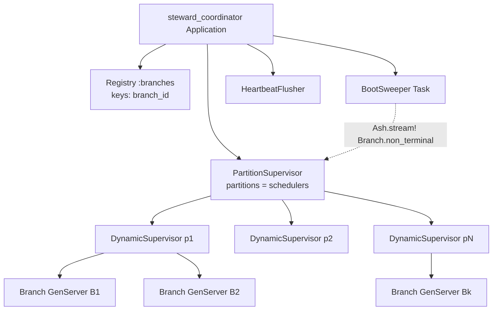
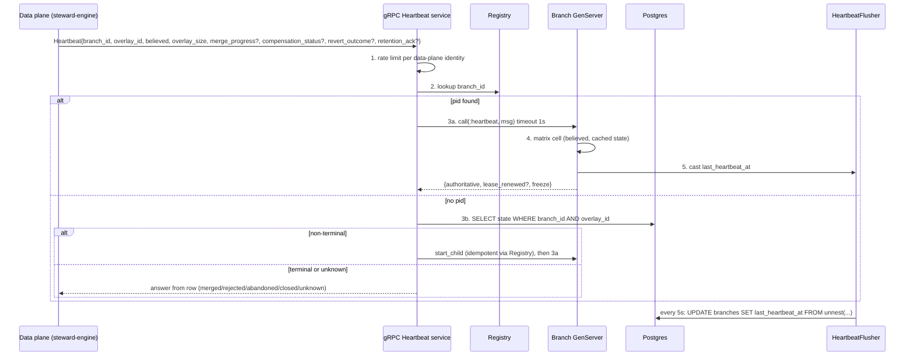

# 07 — Control plane and review queue

**Status:** Draft
**Owner:** Founding team
**Last updated:** 2026-10-15
**Language / runtime:** Elixir / Phoenix with Ash 3 (AshPostgres, AshStateMachine, Reactor, AshOban, Ash.Policy), LiveView

The control plane is the one deployable unit Steward operates: the branch coordinator (one GenServer per non-terminal branch), the review queue and its LiveView UI, the API host for agents and the gRPC host for data planes, heartbeat handling, counters, the domain-event backbone, and the Oban job queue. It is the source of truth for every entity in doc 02 and holds metadata only. It is explicitly not responsible for policy semantics (doc 06), the shape of the REST/gRPC contract (doc 10), the schema in detail (doc 12), or anything that touches row data, which stays in the data plane (docs 04, 05, 09). Doc 13 is authoritative for every lifecycle transition and for the heartbeat matrix; this document says how the control plane implements them.

## 1. Responsibilities

- Own the branch resource in metadata Postgres and perform every state transition in doc 13 §2.1 as one Ash action (an `AshStateMachine` transition on the `Branch` resource) whose single transaction writes the row and appends a domain event (§5.0).
- Run one supervised GenServer per non-terminal branch, boot-swept from Postgres, that caches the `Branch` resource record, answers heartbeats, re-sends merge instructions, and retries post-checkpoint steps by calling Ash actions; it never writes the row itself.
- Accept heartbeats from data planes over gRPC and answer with the authoritative state per doc 13 §6.8; flag `heartbeat_lost`.
- Hold and renew the per-target merge lease (doc 13 §7) and alert on expiry.
- Maintain the review queue read model (`queue_entries`) and serve approve / reject / reject-with-retry with concurrency safety.
- Serve the LiveView UI: queue, changeset detail, policy pages, target settings, audit log.
- Mint short-lived signed grants so a reviewer's browser can fetch a row delta from the data plane directly.
- Maintain pre-aggregated counters (`counter_deltas` → `counters`) and the billing meter.
- Append every domain event to the `events` table from a change on each mutating Ash action, inside the action's transaction, and dispatch consumers through AshOban.
- Host the Phoenix router for the REST API (doc 10), whose controllers call exactly one Ash action each, and the gRPC server for data-plane traffic.
- Enforce org isolation on every query through Ash multitenancy, authorise every action through `Ash.Policy`, and authenticate every principal.

## 2. Non-goals

| Not this component | Where it lives |
|---|---|
| Deciding a verdict, storing or versioning policies, running assertions | Policy engine, doc 06 (runs inside the same BEAM, as the `Steward.Policies` Ash domain in `steward_core`, but its rules are its own doc) |
| The REST and gRPC contract (paths, fields, error codes, auth model) | Doc 10; this doc names the host and library |
| Column-level schema | Doc 12; tables named here are the ones whose shape this component's behaviour depends on |
| Row deltas, overlays, compensation, evidence payloads | Data plane, docs 04, 05, 09 |
| Serving or proxying row data to a browser | Never; the browser fetches from the data plane under a grant (§5.6) |
| Edit as a review outcome | Not in M0 per doc 13 §5 |
| Analytics and billing *store* | Open per doc 03 §11; this component only exports events |

## 3. Interfaces

### 3.1 Inbound

| Caller | Protocol | Contract | Handled by |
|---|---|---|---|
| Agents and SDKs (doc 11) | REST over HTTPS, API-key auth | Doc 10 | `steward_web` Phoenix router |
| Data planes (proxy, changeset engine, merge worker) | One bidirectional gRPC `Session` stream over mTLS, opened by the data plane (doc 10 §5): `Heartbeat`, `ChangesetReport`, `MergeOutcome`, `InstructionResult` arrive on it | Doc 10, protobuf in `contracts/` | `steward_web` gRPC endpoint |
| Reviewers and admins | HTTPS, WebSocket (LiveView), SSO session | This doc §5.5 | `steward_web` LiveView |
| Reviewer's browser → data plane | HTTPS with a grant JWT (§5.6) | Doc 10 grant endpoint | Verified by the data plane, not by us |

**Decision: gRPC library is `grpc` (elixir-grpc) with `protobuf` (elixir-protobuf) for codegen.** It is the only maintained Elixir server implementation, supports mTLS through its Cowboy adapter, and its generated stubs are checked in per doc 03 §8. The gRPC listener is a separate port (`50051`) under the same `steward_web` application so Phoenix and gRPC share supervision and config but not a socket.

### 3.2 Outbound

| Dependency | Mechanism | Assumption |
|---|---|---|
| Metadata Postgres | AshPostgres (Ecto underneath), pool of 20 connections per node | Single-primary, synchronous replica, p99 simple-statement < 5 ms in-region. Unreachable means transitions refuse (§6). |
| Data plane (per customer) | `Instruction` messages sent on the data-plane-opened `Session` stream (doc 10 §5; the control plane never dials into the data plane): `InitialiseOverlay`, `FreezeWrites`, `ComputeChangeset`, `RunAssertions`, `Merge`, `Revert`, `CloseOverlay`, `RoutingUpsert`, `SetRetention` | May be unreachable for minutes; every call is after a checkpoint or before one and retried with fresh IDs (doc 13 §6). **Never called inside an Ash action's transaction** (doc 13 invariant 10); in a Reactor these are the steps on either side of the checkpoint step (§5.0). Call timeouts: freeze 2 s, overlay init 10 s, others 5 s. |
| Oban (same Postgres), via AshOban | Jobs inserted by the event-append change inside the state-changing action's transaction; scheduled scans declared as AshOban triggers | Jobs are durable with the state change; may be minutes late (doc 03 §5). |
| Analytics / billing store | AshOban export job reading `events` by cursor | Open (doc 03 §11); the export is write-only and idempotent by event id. |
| SSO provider | OIDC via `ueberauth` | Open provider list (§12). |

## 4. State

| State | Store | Durability | Kind |
|---|---|---|---|
| `branches`, `changesets`, `verdicts`, `reviews`, `merges`, `targets`, `principals`, `orgs`, `create_intents`, `idempotency_keys` | Postgres | Source of truth (doc 13 invariant 1) | Truth |
| `events` | Postgres, append-only, partitioned by month | Source of truth for audit | Truth |
| `queue_entries` | Postgres | Derived from events; rebuildable from `changesets` + `verdicts` + `branches` | Read model |
| `counter_deltas`, `counters` | Postgres | Deltas durable until drained; totals derived | Read model |
| `oban_jobs` | Postgres | Durable | Work queue |
| Branch GenServer state | BEAM process heap; caches the `Steward.Branches.Branch` Ash resource record (the struct an Ash read action returns), refreshed from each action's result | None; rebuilt from the row on start | Cache |
| Registry (branch id → pid), Presence (changeset → viewers) | BEAM, per node / pg | None | Cache |
| Idempotency results | Postgres, 24 h TTL (doc 13 §8) | Durable | Truth |

Every table carries `org_id` (§8). The `targets` row carries `merging_merge_id` and `lease_expires_at` (doc 13 §7). The `branches` row carries `last_heartbeat_at`, `heartbeat_lost`, `merge_wait`, `lock_version`. Every table in the "Truth" and "Read model" rows is an Ash resource (§5.0); process state is a cache of the resource record, never a second copy of truth.

**Process layout.**



**Decision: umbrella with four apps**, matching doc 18 §1's `control/` umbrella.

| App | Contains | Depends on |
|---|---|---|
| `steward_core` | The Ash domains `Steward.Targets` (targets, settings, memberships, impact queries), `Steward.Branches` (branches, changesets, verdicts, merges, reverts, create intents, idempotency keys, queue entries, counters), `Steward.Policies` (policies, versions, tests; doc 06), `Steward.Reviews` (reviews, review features, grants), `Steward.Audit` (events, audit log); their resources, actions, state machines, policies and changes; the `Repo` | — |
| `steward_coordinator` | Registry, supervisors, `Branch` GenServer, `BootSweeper`, `HeartbeatFlusher`, the `Steward.Lifecycle` Spark DSL, the Reactors (`CreateBranch`, `Propose`, `Merge`, `Revert`, `Abandon`), data-plane gRPC clients | `steward_core` |
| `steward_jobs` | AshOban configuration: every trigger and scheduled action, the cron config | `steward_core`, `steward_coordinator` |
| `steward_web` | Phoenix router, REST controllers (one Ash action per endpoint), gRPC services, LiveView with AshPhoenix forms, PubSub, Presence | all three |

The split earns its keep for one reason: dependency direction. `steward_core` cannot call a GenServer or render anything, so an Ash action cannot accidentally make a remote call or depend on a process being alive, which is exactly the property doc 13 invariant 10 requires; Reactors, which do make remote calls between actions, live one app up in `steward_coordinator`. Boundaries are enforced with `mix xref graph --fail-above` in CI, not trust. All four deploy as one release; separate apps are a compile-time structure, not separate pods.

**Decision: one GenServer per non-terminal branch, not partitioned, with a measured ceiling.** At 100k open branches: ~100k processes at roughly 4 KB heap each plus a cached row of ~1 KB is about 500 MB per node for a cluster of three, well inside a 4 GB node. Boot sweep: an Ash read action `Branch.non_terminal` streamed (`Ash.stream!`) in batches of 1,000, starting processes through the partitioned DynamicSupervisor at ~10k/s, so 100k branches boot in ~10 s and the node reports ready only after the sweep. Processes are distributed across nodes by consistent hash of branch id (`:pg` scope per target partition); a heartbeat arriving at the wrong node is forwarded with one `GenServer.call`. The partitioned alternative (one process per target, branches as map entries) is kept in §11; the switch point is 500k non-terminal branches per node or a boot sweep over 60 s, both measured by doc 17's load test.

## 5. Core flows

The lifecycle flows are specified in doc 13 §6; each subsection below says only what this component adds. Common rule: every transition is one Ash update action on the `Branch` resource, run in a transaction, containing (1) the `AshStateMachine` transition guarded by `state` and `lock_version` (`UPDATE branches ... WHERE id = ? AND state = ? AND lock_version = ?`), (2) sibling writes as changes on the same action or as nested actions in the same transaction (changeset superseded, review row, queue entry delete), (3) the `events` append from the `AppendEvent` change, (4) one Oban job per consumer, inserted by the same change. A zero-row update aborts with `stale_transition`. Nothing remote happens inside.

### 5.0 Domain layer: Ash

**Decision: the control plane's domain layer is Ash 3.x.** Every doc 12 entity is an `Ash.Resource` with the `AshPostgres` data layer, grouped into the five domains of §4 (`Steward.Targets`, `Steward.Branches`, `Steward.Policies`, `Steward.Reviews`, `Steward.Audit`) in `steward_core`. Actions are the only write path: application code **must not** build an `Ecto.Changeset` or call `Repo.insert/update/delete` outside migrations and explicitly reviewed read-model queries (doc 18 §2). Ecto remains underneath Ash; migrations are generated from the resources by `mix ash.codegen` and committed, and doc 12's DDL is the reference the generated migration **must** match, with the resources as source of truth (doc 12 §0). The pieces, and what each replaces in the earlier Ecto-context design:

| Concern | Ash piece | Where |
|---|---|---|
| Entity shape, CRUD, read models | `Ash.Resource` + `AshPostgres`; read actions for every query the GenServers, jobs and LiveViews need | `steward_core` |
| Branch lifecycle (doc 13 §2.1); changeset, merge, policy and policy_version lifecycles | `AshStateMachine`: `transitions` declared literally from the doc 13 table; the generated `state` attribute and transition guard replace hand-written `WHERE state = ?` checks | `steward_core` |
| Multi-step flows with a checkpoint (doc 13 §6) | `Reactor`, one per flow (below) | `steward_coordinator` |
| Scheduled and background work (scans, drains, consumers, export) | `AshOban` triggers and scheduled actions; consumers remain Oban jobs inserted in the action's transaction | `steward_jobs` |
| Capabilities and API-key scopes (doc 15 §3.2) | `Ash.Policy` authorizer on every action | `steward_core` |
| Org isolation (§8, doc 12 §10) | Ash multitenancy, attribute strategy on `org_id`; every call carries a tenant | `steward_core` |
| Review UI forms | `AshPhoenix.Form` over the same actions | `steward_web` |
| REST (doc 10) | Thin Phoenix controllers; **not** AshJsonApi (§11) | `steward_web` |
| Domain events | Hand-rolled `events` resource and an `AppendEvent` change; **not** AshEvents (§11) | `steward_core` |

**Events append rule.** Every mutating action on a truth resource declares `change Steward.Audit.AppendEvent, type: "..."`. The change registers an `after_action` hook that creates the `Steward.Audit.Event` row and the consumer Oban jobs *inside the action's transaction*, so a failed event insert rolls back the state change (§6, "events partition disk full"). This **must** be a change with an `after_action` hook, not an Ash notifier: notifiers run after commit and would break the atomicity doc 13 invariant 1 relies on. Read-model tables (`queue_entries`, `counters`) have no `AppendEvent` change.

**Reactor rule.** Each lifecycle flow is one Reactor module: `Steward.Coordinator.Reactors.CreateBranch`, `Propose`, `Merge`, `Revert`, `Abandon`. Every reactor has exactly one *checkpoint step*, which is the Ash action that writes the checkpoint row doc 13 §6 names for that flow. Steps before the checkpoint **must** declare `compensate` (and `undo` where they wrote something), so a failure before the checkpoint unwinds to "nothing happened" plus a terminal reason. The checkpoint step itself has no `undo`. Steps after the checkpoint are best-effort: they **must not** declare `undo`, are **never** unwound on failure, and are repaired by the heartbeat matrix (§5.3), the GenServer self-tick, or the minute reconciliation job. A reactor that fails after its checkpoint returns `{:ok, record}` to its caller with the failed step logged, because the flow *has* happened. Remote calls to the data plane are reactor steps, never changes inside an action (doc 13 invariant 10). The `Merge` reactor (doc 13 §6.5), as the pattern:

| Step | Kind | Compensable? |
|---|---|---|
| `acquire_lease` | Ash action `Target.acquire_merge_lease` (the conditional `UPDATE` of §5.4); zero rows → `merge_wait` and halt | yes: `undo` releases the lease if a later pre-checkpoint step fails |
| `start_merging` | Ash action `Branch.start_merge` (`proposed → merging`, creates the `merges` row `pending`) | yes: `undo` runs `Branch.return_to_proposed` with the failing step's reason |
| `check_staleness` | step calling the data plane `Merge` instruction's pre-flight; `stale_base` → compensate chain, new changeset | yes: `compensate` returns `:retry` for transient errors within the budget, else fails the reactor |
| `persist_compensation` | data-plane `Persist` of the compensation record (doc 09) | yes: `compensate` is a no-op on the control plane (the orphan header is GC'd per doc 13 §9) |
| **`checkpoint`** | Ash action `Merge.record_compensation_persisted` (sets `compensation_persisted_at`); the checkpoint | **no** |
| `send_apply` | data-plane `Merge` apply instruction | no; re-sent by the GenServer on heartbeat |
| `await_outcome` | returns on `MergeOutcome`; `applied` → Ash action `Branch.complete_merge` (`merging → merged`, lease release in the same action) | no; the heartbeat matrix cell (`merging`, `merging`) advances the row when progress completes |
| `routing_remove` | data-plane `RoutingUpsert` | no; retried on heartbeat |

`CreateBranch`'s checkpoint is `Branch.commit_create` (tx 2 of §5.1); `Propose`'s is `Changeset.record_verdict` (§5.2); `Revert`'s is the revert branch's `commit_create`, after which it runs `Propose` as a sub-reactor; `Abandon`'s is `Branch.abandon`, with every data-plane step after it. Reactor inputs are ids and the actor, never loaded records, so a reactor restarted by the GenServer re-reads state through actions.

**Heartbeat matrix as a Spark DSL.** The GenServer-per-branch coordinator is unchanged as a process (§4) and calls Ash actions for every transition it drives. Its reconciliation matrix (doc 13 §6.8) is declared, not hand-coded, with a small Spark extension `Steward.Lifecycle` whose one section lists cells; the extension's transformer compiles the cells to `Heartbeat.decide/3` and its verifier fails compilation unless all 40 `(believed, authoritative)` pairs are covered exactly once. The same declaration is the input to the matrix test in §10, so the doc table, the dispatch function, and the test cannot drift from one another.

```elixir
defmodule Steward.Coordinator.HeartbeatMatrix do
  use Steward.Lifecycle

  heartbeat do
    cell believed: :open,     authoritative: :open,     reply: :open,     actions: []
    cell believed: :open,     authoritative: :proposed, reply: :proposed, actions: []            # reply carries freeze: true
    cell believed: :open,     authoritative: :merging,  reply: :merging,  actions: [:resend_merge]
    cell believed: :merging,  authoritative: :merging,  reply: :merging,  actions: [:renew_lease, :advance_merged]
    cell believed: :merging,  authoritative: :open,     reply: :open,     actions: [:alert]
    cell believed: :done,     authoritative: :merged,   reply: :merged,   actions: []
    cell believed: :dead,     authoritative: :unknown,  reply: :unknown,  actions: []            # data plane GCs
    # ... 33 more; the verifier rejects a missing or duplicate pair
  end
end
```

`:alert` cells are the only ones whose action writes an event (`heartbeat.anomaly`, via the `Heartbeat.record_anomaly` action) and they never auto-repair, per doc 13.

**Authorization.** Every action declares its policies with `Ash.Policy`; doc 15 §3.2's capability × operation matrix is transcribed as those declarations, one `policy action(...)` block per row. Actors are either an `ApiKey` record with `scopes` (agents and services) or a `Principal` with loaded `memberships` (humans); a policy check such as `authorize_if actor_has_capability(:reviewer)` resolves through the same scope vocabulary doc 15 §3.1 names, so one check answers both actor kinds. A test enumerates every action in every domain with `Ash.Policy.Info` and fails if any action lacks a policy (§10); system jobs run with `authorize?: false` only in `steward_jobs`, reviewed.

### 5.1 Create branch (doc 13 §6.1)

The API controller runs the `CreateBranch` reactor: step 1 is the Ash action `CreateIntent.create` (tx 1, compensable by `CreateIntent.fail`), step 2 calls the data plane `InitialiseOverlay` outside any transaction, step 3 is `Branch.commit_create` (tx 2, the checkpoint), and a post-checkpoint step starts the Branch GenServer via `DynamicSupervisor.start_child` *after* commit; the GenServer's `init` re-reads the record, so a start before commit visibility is impossible. Step 7 (routing add) is a post-checkpoint step that `cast`s to the GenServer and is retried on heartbeat. Failures: as doc 13 §6.1; a GenServer start failure after commit is harmless because the next heartbeat or the periodic sweep (§6) starts it.

### 5.2 Propose (doc 13 §6.3)

The `Propose` reactor runs under the GenServer. Step 1 is the Ash action `Branch.propose` (`open → proposed`, creates the `computing` changeset; compensable by `Branch.return_to_open` with the failing reason); steps 2–8 are reactor steps for freeze, `ComputeChangeset`, and `RunAssertions`, each with a `compensate` that returns `:retry` inside its budget (compute: 3 attempts over 5 minutes; policy evaluation: 3 attempts) and fails the reactor past it. Before step 9, a pure step applies the revert conflict floor: for a branch with `revert_of` set whose changeset has a non-empty `conflicts` section (or `partial_keys`), a verdict of `auto-merge` is raised to `hold` with reason `revert_conflict` (doc 13 §6.6); this rule lives here, not in the policy engine (doc 06). Step 9 is the checkpoint, the Ash action `Changeset.record_verdict`, whose `AppendEvent` change inserts the `changeset.evaluated` event and in the same transaction the Oban jobs: `EnqueueQueueEntry` (hold), `StartMerge` (auto-merge, which runs the `Merge` reactor) or `RejectBranch` (block). Doc 13 §6.3 failure 7's reconciliation job (an AshOban scheduled action, every minute) is the belt-and-braces for a reactor that died between step 1 and step 9.

### 5.3 Heartbeat (doc 13 §6.8)



- **Sender.** The heartbeat for a branch is sent by `steward-engine` (doc 05 §5.1, doc 13 §6.8), which holds merge progress and compensation status and folds in the proxy's per-branch facts; the proxy never heartbeats the control plane directly. `revert_outcome` and `compensation_status` drive the merge row's `compensated` transition; the reply carries `retention_until` and legal-hold instructions, which the engine acknowledges with `retention_ack` on the next heartbeat.
- **Dispatch.** Registry lookup is the fast path. **Decision: a heartbeat for a non-terminal branch with no running GenServer starts the GenServer and then dispatches to it; a heartbeat for a terminal or unknown branch is answered straight from Postgres.** Terminal branches must have no process (§6 leak sweep), and starting one for them would recreate the leak.
- **Matrix.** The GenServer implements doc 13 §6.8's table as a pure function `Heartbeat.decide(believed, authoritative, merge_progress) :: {reply, actions}`, generated from the `Steward.Lifecycle` declaration in §5.0; actions are `:renew_lease`, `:advance_merged`, `:resend_merge`, `:alert`, each executed by calling the corresponding Ash action. Any `:alert` cell writes a `heartbeat.anomaly` event and pages (§9); it never auto-repairs, per doc 13.
- **Cost.** `last_heartbeat_at` is recorded in process state and flushed by a per-node `HeartbeatFlusher` every 5 s in one batched `UPDATE`, so 3.3k heartbeats/s become ~1 statement per node per 5 s instead of 3.3k row updates/s. Lease renewal and `merge_progress` changes write immediately because they are transitions, not telemetry.
- **Storms.** After a data-plane restart every branch heartbeats at once. The gRPC service holds a token bucket per data-plane identity sized at 3× that data plane's steady-state rate (`non_terminal_branches / 30 s`, minimum 100/s); over budget it answers `RESOURCE_EXHAUSTED` with `retry_after_ms` drawn uniformly from 0–30 s. Dropping a heartbeat is safe: the data plane keeps its last known state and no transition depends on a single heartbeat. Advice to the data plane (doc 05's `steward-engine` **should**): on start, delay each branch's first heartbeat by a uniform random 0–30 s, then apply doc 13's ±20% jitter.
- **`heartbeat_lost`.** The AshOban scheduled action `HeartbeatLostScan` runs every minute, as one bulk update action: `UPDATE branches SET heartbeat_lost = true WHERE state IN (open, proposed, merging) AND last_heartbeat_at < now() - interval '5 minutes' AND NOT heartbeat_lost RETURNING id, state`, emits `branch.heartbeat_lost` events, and for `merging` rows raises an alert (doc 13 §6.8: the lease is held past expiry). The flag is cleared by the next heartbeat. The GenServer also has a 30 s ± 20% self-tick (doc 03 principle 4) that re-sends a pending merge instruction and retries routing adds; detection of loss is deliberately in the job, which works even when the GenServer is not running.

### 5.4 Merge lease (doc 13 §7)

The lease is the first step of the `Merge` reactor (§5.0) and is held as columns on the `Target` resource, not as a state machine (§12). Acquire is the Ash action `Target.acquire_merge_lease`, an atomic update whose filter is `UPDATE targets SET merging_merge_id = $m, lease_expires_at = now() + interval '5 minutes' WHERE id = $t AND org_id = $o AND (merging_merge_id IS NULL OR lease_expires_at < now()) AND NOT EXISTS (SELECT 1 FROM merges WHERE id = targets.merging_merge_id AND status = 'pending')`. Zero rows means wait: the reactor halts, the branch stays `proposed` with `merge_wait = true`, and the `LeaseReleased` event consumer starts waiting merges (each a new `Merge` reactor run) in verdict/review time order. Renew is `Target.renew_merge_lease` (`UPDATE targets SET lease_expires_at = now() + interval '5 minutes' WHERE id = $t AND merging_merge_id = $m`), called by the GenServer when a `merging` heartbeat reports advancing progress. Release happens inside the `Branch.complete_merge` (`merging → merged`) or `Branch.return_to_proposed` (`merging → proposed`) action, in the same transaction as the transition. `ExpiredLeaseScan` (AshOban, every minute) finds `lease_expires_at < now() AND merging_merge_id IS NOT NULL`, emits `target.lease_expired`, and alerts; it **must not** clear the lease, per doc 13 §7.

### 5.5 Review and the queue

**Read model.** `queue_entries(org_id, target_id, changeset_id UNIQUE, branch_id, principal_id, hold_reasons jsonb, entered_at, priority int default 0)`. Rows are inserted by the `EnqueueQueueEntry` Oban job consuming `changeset.evaluated{verdict: hold}` (idempotent on the unique key, via the `QueueEntry.upsert` action) and deleted inside the deciding action's transaction (review, abandon, withdraw, TTL). It is a read-model resource with no `AppendEvent` change and is never a live join over `changesets`.

**Decision: ordering is oldest-first by `entered_at`, no priority bump in M0.** A reviewer's mental model is a FIFO; a bump for `block`-adjacent holds (e.g. `stale_base` conflicts, `policy_error`) is plausible but we have no evidence it helps, and `priority` is a column so adding it later is additive. The queue header shows "held longer than 7 days" from a counter (doc 13 §12).

**Decision: one queue per target in M0; reviewer eligibility is target membership.** `target_memberships(org_id, target_id, principal_id, capability)` decides who sees and may act on a target's queue. No Team entity (doc 02 §7 open question resolved for M0; §12).

**Concurrent reviewers.** The deciding transaction is the Ash action `Review.decide` on `Steward.Reviews`, whose changes run in order: insert the review row; `DELETE FROM queue_entries WHERE changeset_id = $c RETURNING id`; `UPDATE changesets SET lock_version = lock_version + 1 WHERE id = $c AND lock_version = $v AND status = 'evaluated' AND superseded_by IS NULL`; the branch state-machine transition. Zero rows from the delete is `already_reviewed` (doc 13 §6.4 failure 5); zero rows from the changeset update is `changeset_superseded` or a stale view. Its policies require `reviewer` on the target and forbid an actor who is the branch's owning principal. The second reviewer's LiveView receives the `queue:<target_id>` PubSub broadcast first in practice and shows "already decided by <principal>"; the lock is what makes it correct, not the broadcast. Reject-with-retry is the default button (doc 13 §5). Approve is refused with `verdict_block` if the verdict is `block` (invariant 12), and with `self_approval` if the reviewer is the owning principal.

### 5.6 LiveView UI and the row-delta grant

| Page | Reads | Live updates |
|---|---|---|
| Queue (`/targets/:id/queue`) | `queue_entries` keyset-paginated 50 per page on `(entered_at, id)`; header from `counters` | PubSub topic `queue:<target_id>`: `entry_added`, `entry_removed` |
| Changeset detail | summary, impact, verdict reasons, evidence metadata timeline, merge progress; row delta via grant | `changeset:<id>`: superseded, decided, merge progress; Presence on the same topic shows "N reviewers viewing" |
| Policy list / editor / test runner | `Steward.Policies` (doc 06) | `policies:<target_id>` |
| Target settings | TTLs, retention, memberships, impact queries | — |
| Audit log | `events` filtered by org/target, read-only | — |

No JS framework (doc 18 §2); the row-delta viewer is a LiveView component that issues a `fetch` from a tiny JS hook. **Grant: a JWT (ES256, key pair per control-plane deployment, public key delivered to data planes through configuration and rotated with a 24 h overlap) with claims `iss` = control plane, `aud` = data-plane id, `sub` = principal id, `org`, `cs` = changeset id, `scope` = `row_delta:read`, `jti`, `exp` = issue + 5 minutes.** Minted by `POST /v1/changesets/{id}/grants` (doc 10) only for a principal with `reviewer` on the target, logged as a `grant.issued` event. The data plane verifies signature, `aud`, `exp`, and that `cs` matches the requested changeset, then serves pages from its local row delta. The control plane never sees the response.

### 5.7 Domain events and consumers

`events(id bigserial, org_id, type, aggregate_type, aggregate_id, payload jsonb, occurred_at, inserted_at)` is the `Steward.Audit.Event` resource, written by the `AppendEvent` change in the same transaction as every state change (§5.0 events append rule). **Decision: consumers are Oban jobs inserted in that same transaction by the same change, one per interested consumer, not a poller.** Oban shares the Repo, so job and event commit atomically; each worker is an AshOban-managed job, idempotent keyed by `event_id` and the row it maintains. Consumers in M0: `EnqueueQueueEntry`, `CountersFromEvent` (writes `counter_deltas`), `NotifyPrincipal`, `AnalyticsExport` (cursor over `events`, batch 10k, destination open). This is doc 03's "event backbone is Postgres first"; NATS JetStream comes when a consumer needs fan-out beyond Oban.

### 5.8 Counters (doc 03 principle 6)

`counter_deltas(id bigserial, org_id, key text, scope jsonb, delta bigint, inserted_at)` and `counters(org_id, key, scope, value, updated_at, PRIMARY KEY (org_id, key, scope))`. `CounterDrain` is an AshOban scheduled job every minute, unique per queue, that loops for 60 s draining once per second with one reviewed raw statement (the one read-model exception doc 18 §2 allows): `WITH d AS (DELETE FROM counter_deltas WHERE id IN (SELECT id FROM counter_deltas ORDER BY id LIMIT 10000 FOR UPDATE SKIP LOCKED) RETURNING *) INSERT INTO counters ... SELECT org_id, key, scope, SUM(delta) FROM d GROUP BY 1,2,3 ON CONFLICT DO UPDATE SET value = counters.value + EXCLUDED.value`. One statement, atomic, no lost deltas. Counters in M0: `open_branches{target}`, `queue_depth{target}`, `changesets_by_verdict{target, verdict, day}`, `held_over_7d{target}`, `reviewed_changesets{org, month}` (the billing meter, doc 01 §7). A `CounterRebuild` job recomputes any counter from truth tables on demand for drift checks.

## 6. Failure modes

| Failure | Detection | Impact | Recovery |
|---|---|---|---|
| Control-plane node crash | k8s liveness; `steward_genservers_total` drops | GenServers on that node gone; in-flight transitions either committed or not (single action transaction, no partial state); a reactor dies before or after its checkpoint, never half-way through one; heartbeats to that node fail for one interval | Node restarts, boot sweep rebuilds processes from Postgres (~10 s at 100k); reactors are re-run from the record's state on the next self-tick or heartbeat (pre-checkpoint: from the start; post-checkpoint: only the best-effort steps) |
| Postgres primary failover | Ecto connection errors surfaced as `Ash.Error.Unknown`; `steward_pg_unavailable` | Transitions refuse with 503; the GenServer answers heartbeats from cached state with `stale: true` so the data plane keeps the overlay and does nothing destructive; proxies unaffected (doc 03 principle 2) | Pool reconnects; nothing to repair because no state lives only in memory |
| Postgres slow (p99 > 100 ms) | Ecto telemetry | API latency breaches §7; Oban lag | Pool queue timeouts surface 503 rather than pile up; alert |
| Data plane unreachable | gRPC client errors; `heartbeat_lost` rising for one data plane | Create/propose/merge calls fail per doc 13 §6; open branches keep writing | Retry budgets, then `data_plane_unreachable` to the principal; heartbeats resume |
| Heartbeat storm | Token bucket rejections metric | Some heartbeats delayed up to 30 s | Rate limit; nothing to repair |
| Oban backlog | `oban_queue_depth`, oldest job age | Queue entries and counters lag; verdicts and transitions do not (checkpoints are synchronous) | Scale workers; jobs are idempotent so replay is safe |
| GenServer leak (process for a terminal branch) | `steward_genservers_total` vs `COUNT(*) non-terminal` | Memory; terminal heartbeats answered by a process that should not exist | Every terminal transition calls `GenServer.stop` after commit; `TerminalProcessSweep` (Oban, every 10 min) stops any process whose row is terminal and starts any non-terminal row without one |
| Duplicate GenServer for one branch (two nodes) | Registry/`:pg` conflict on start | Double heartbeat handling, no state corruption (Postgres is truth; every write is conditional on state and `lock_version`) | Loser of the `:pg` registration stops itself |
| Counter drift | Weekly `CounterRebuild` diff | Wrong header numbers, wrong billing meter | Rebuild from truth tables; deltas table is never the only copy |
| Events partition disk full | Postgres disk alert | All transitions fail (events insert is in the tx) | Monthly partitions, 90-day retention after export; disk alert at 70% |
| Expired lease with pending merge | `ExpiredLeaseScan` | Merges on that target queue | Human escalation per doc 13 §6.5 failure 10; never auto-cleared |

## 7. Performance and capacity

| Measure | Value | Kind |
|---|---|---|
| Create branch, control-plane portion (tx 1 + tx 2 + GenServer start), p99 | ≤ 150 ms | Requirement |
| Create branch end to end incl. overlay init, p99 | ≤ 3 s (control-plane portion ≤ 150 ms; dominated by adapter `openSnapshot` ≤ 2 s on Neon, doc 08 §7) | Requirement; data-plane budget in docs 04 and 08 |
| Propose, control-plane portion (step 1 tx + step 9 tx + enqueue), p99 | ≤ 200 ms | Requirement |
| Review decision tx, p99 | ≤ 100 ms | Requirement |
| Heartbeat throughput | 100k branches × 1/30 s ≈ 3.3k/s cluster-wide; 2k/s per node sustained, 6k/s burst for 30 s | Estimate of load; per-node figure is a requirement for doc 17's load test |
| Heartbeat handling, p99 (gRPC receive to reply) | ≤ 20 ms | Requirement |
| Postgres write rate from heartbeats | ≤ 1 batched statement per node per 5 s | Design consequence |
| Boot sweep | 100k branches in ≤ 15 s; node not ready before | Requirement |
| Queue page mount with 10k entries | ≤ 200 ms server render, 50 rows per page, keyset pagination | Requirement |
| LiveView queue update fan-out | ≤ 500 ms from commit to every subscribed socket | Estimate |
| Memory per Branch GenServer | ~5 KB; 100k ≈ 500 MB | Estimate; measured by doc 17 |
| Postgres sizing, M0 | 4 vCPU / 32 GB / NVMe, synchronous replica; `events` ~1 KB/row, ~10 events per branch, 1M branches/month ≈ 10 GB/month before retention | Estimate |
| Connection pool | 20 per node, Oban uses its own 10 | Decision |

## 8. Security

- **Org isolation.** Every resource declares `multitenancy do strategy :attribute; attribute :org_id end`, so Ash raises `Ash.Error.Invalid.TenantRequired` on any action called without a tenant and filters every read and write by `org_id`; `global? true` is allowed only on `Org` itself, and `Ash.Query.set_tenant/2` bypass (`skip_org_check`) only in `steward_jobs` system scans, reviewed. An ExUnit test enumerates every resource in every domain with `Ash.Domain.Info.resources/1` and fails if its multitenancy strategy is not `:attribute` on `org_id`, with an allowlist of exactly `orgs`, `oban_jobs`, `schema_migrations` (doc 12 §10).
- **Policies on actions.** Every action carries `Ash.Policy` declarations (§5.0); a controller or LiveView passes `actor:` and `tenant:` and never checks a capability itself. The policy-coverage test (§10) is the guard against an unprotected action.
- **Principal auth.** Agents: API keys (`stw_<prefix>_<secret>`), stored as SHA-256 of the secret with the prefix indexed; scoped to one org and a set of targets. Humans: SSO via OIDC (provider list open, §12); sessions are Phoenix encrypted cookies. Data planes: mTLS client certificates issued per data plane by doc 14's installer; the certificate's SAN is the data-plane identity used for rate limiting and `aud`.
- **Capabilities** on `target_memberships`: `reviewer` (see queue, decide), `policy_admin` (edit policies, run policy tests), `target_admin` (settings, memberships, retention, revert). `org_admin` is on the principal. API keys carry `scopes`. Both are the actor an Ash action receives: an `ApiKey` with `scopes` or a `Principal` with `memberships`, resolved by one policy check (§5.0). Approve requires `reviewer`; self-approval is refused by a `forbid_if` on `Review.decide`.
- **Audit immutability.** `events` and `reviews` are written by the application's Postgres role, which has `INSERT` and `SELECT` only on them; a trigger raises on `UPDATE`/`DELETE` as a second guard; partition drop is a migration run by a separate role.
- **Never stored: row data.** Enforced three ways: the protobuf messages in `contracts/` have no field that can carry a row (summary is typed per-column aggregates, impact is `name → number`, evidence is counts and digests plus bounded rationale text, assertion results are pass/fail plus count); the embedded Ash resources for summary and impact (`Steward.Branches.Summary`, `Impact`, with `AshPostgres` embedded types; Ecto embedded schemas underneath) reject unknown keys; the row-delta viewer fetches from the data plane in the browser and the control plane never receives the bytes.
- **Never logged:** API key secrets, grant JWTs, policy SQL bodies (may name columns but is still customer IP), rationale text, anything from `payload` of events. Logs are structured JSON (doc 18 §2).

## 9. Observability

Three signals first: (1) `steward_heartbeat_lag_seconds` histogram (now − `last_heartbeat_at` across non-terminal branches) and its `heartbeat_lost` count; (2) Oban queue depth and oldest-job age per queue; (3) transition error rate (`stale_transition`, 503s) per transition type.

Also emitted: `steward_genservers_total{state}` vs non-terminal rows; `steward_heartbeats_total{result}` incl. rate-limited; heartbeat matrix cell counts with `alert` cells as a paging alert; `queue_depth{target}` from counters; transition rate by `from,to`; lease waits and expiries; `counter_deltas` backlog rows; LiveView mount duration by page; gRPC and Phoenix request latency; Ash action duration by domain and action (`[:ash, :action, :stop]` telemetry) and Ecto query time underneath it; Reactor step outcomes by reactor and step, with compensations and post-checkpoint failures as separate counters. Traces: one span per API request and per heartbeat, propagated to data-plane calls via the `trace_context` field on stream messages (doc 10 §5, W3C traceparent). Logs carry `org_id`, `branch_id`, `changeset_id`, `principal_id`, never payloads.

## 10. Testing

- **Unit (ExUnit, SQL sandbox).** Every Ash action, called through its domain with an actor and tenant; transitions assert on the written event.
- **Policy coverage.** `Steward.PolicyCoverageTest` walks every resource of every domain and every action of each resource with `Ash.Policy.Info.policies/1` and fails if an action has zero policies; a second assertion fails any resource that lacks the `Ash.Policy.Authorizer`. Together with a table-driven test that transcribes doc 15 §3.2 (each capability × operation cell as an actor and an expected `:ok` or `Ash.Error.Forbidden`), so a matrix change must change the test.
- **State-machine property test (StreamData).** Generates random sequences of triggers against a branch; asserts that every reachable transition is in doc 13 §2.1 and no other transition ever occurs (the test also asserts `AshStateMachine.Info.transitions/1` on `Branch` equals the doc 13 table literally), that invariants 2–4, 11 and 12 hold after every step, and that `lock_version` conflicts never produce a partial write.
- **Heartbeat matrix test, generated.** `Steward.Lifecycle` emits, from the same declaration that compiles `Heartbeat.decide/3`, a test module that enumerates all 40 cells (5 believed × 8 authoritative) of doc 13 §6.8 with expected replies and actions; the committed expectation table in `control/test/support/heartbeat_matrix.exs` is diffed against the doc table in review, so a doc change must change this table. The DSL verifier makes a missing or duplicate cell a compile error, not a test failure.
- **Reactor step tests.** Each of the five reactors has a test per pre-checkpoint step that injects a failure there (through the fake data plane) and asserts every earlier step's `undo` ran and the record is back at its starting state with the expected reason; and one test per post-checkpoint step that injects a failure and asserts nothing was undone, the checkpoint row is intact, and the next heartbeat or sweep repairs it.
- **Concurrency.** Two reviewers calling `Review.decide` in parallel tasks; exactly one `review` row; the other gets `already_reviewed`.
- **Migration drift.** CI runs `mix ash.codegen --check` and fails if the resources would generate a migration that is not committed; a second check diffs the generated schema against doc 12's DDL (doc 12 §0).
- **Fake data plane.** A gRPC stub under `control/test/support/fake_data_plane.ex` implementing the data-plane services with scripted behaviours (slow, lost reply, `stale_base`, crash before/after compensation checkpoint) for integration tests under `control/test/integration` covering every failure row of doc 13 §6.
- **Boot and storm.** 100k branch rows → boot sweep time and process count; 100k heartbeats in 1 s → rate-limit behaviour and no dropped transitions.
- **Org isolation test** (§8: every resource has attribute multitenancy on `org_id`; an action without a tenant raises; org A's actor gets `not_found` on org B's record) and a **row-data test** that feeds a summary with a stray `rows` key and asserts rejection.
- **Fixtures.** Synthetic only, from `tools/fixtures` (doc 18 §7). Policy tests are data under `control/test/policies/` (doc 06).

## 11. Alternatives considered

- **One GenServer per target, branches as map entries.** Fewer processes and one place to serialise merges, but it puts every branch on a target behind one mailbox (a slow heartbeat matrix step stalls others), loses per-branch crash isolation, and gains nothing until the per-branch model hits its ceiling. Kept as the fallback; switch criteria in §4.
- **Plain Ecto contexts (original design).** Ecto schemas, hand-written changesets, context modules per aggregate, and transition functions that each repeated the `state`/`lock_version` guard, the event insert and the Oban insert. Rejected: the design's shape (resources with declared lifecycles, a capability matrix, org-scoped everything, checkpointed sagas) is what Ash declares; the hand-written version would re-implement AshStateMachine, Ash.Policy, multitenancy and Reactor less uniformly, and the policy-coverage and matrix tests of §10 are only possible because the declarations are introspectable.
- **AshJsonApi for the REST surface.** Would generate doc 10's endpoints from the resources. Rejected: doc 10's shape (custom paths, the idempotency and rate-limit headers, the closed error enum, `details.reason` envelopes) is a public contract that must not move with the resources; thin controllers calling one action each keep the contract hand-owned and OpenAPI-first (doc 10 §8).
- **AshEvents for the event log.** Would record every action as an event and support replay. Rejected for M0: doc 12 §6's `events` row shape and partitioning, the per-consumer Oban insert in the same transaction, and the "events are audit, rows are truth" rule (doc 13 invariant 1) are all easier to keep with one small `AppendEvent` change than by adapting a replay-oriented log; revisit if replay becomes a requirement.
- **Commanded / EventStore instead of a hand-rolled `events` table.** Full event sourcing with projections. Rejected: branch state is row-shaped and already has a checkpoint discipline; event sourcing would make Postgres rows the projection and the event log the truth, inverting doc 13 invariant 1. The `events` table gives audit and consumers without the inversion.
- **Poller instead of in-transaction Oban inserts for consumers.** One cursor over `events`. Rejected for M0: the in-tx insert is simpler and atomic; the analytics export is the one poller because it is a cursor by nature.
- **Single Phoenix app instead of an umbrella.** Less ceremony. Rejected: doc 18 names an umbrella and the compile-time dependency direction is the cheapest enforcement of "no remote calls in a transition".
- **Separate frontend (React).** Rejected per doc 18 §2 until a doc proves LiveView cannot do it; the row-delta viewer is the only piece that needed JS and it is a hook, not a framework.
- **Priority ordering in the queue.** Deferred; see §5.5.
- **Writing `last_heartbeat_at` per heartbeat.** 3.3k row updates/s is within Postgres's reach but is pure write amplification for a 5-minute threshold; batched flush chosen.

## 12. Open questions

| Question | Owner | Needed by |
|---|---|---|
| Team entity: M0 ships one queue per target with membership-based eligibility. Is a cross-target team queue needed by the first three customers? | Product | M1 |
| SSO providers for M0: Okta and Google Workspace are the guess; Entra ID likely next | Founding team | Doc 15 |
| GenServer-per-branch ceiling: switch to per-target partitioning at 500k non-terminal branches per node or boot sweep > 60 s; needs doc 17's load test to confirm the memory estimate | Control plane lead | Before M1 scale target |
| Analytics export destination: ClickHouse or Parquet-on-S3 (doc 03 §11); affects only `AnalyticsExport` | Architecture | Doc 12 |
| Per-target `heartbeat_lost` threshold and lease interval for rate-limited CRM targets (doc 13 §12) | Control plane lead | Doc 08 |
| Grant delivery: is a browser-direct fetch to the data plane acceptable to customers' network policies, or do we need a data-plane-hosted viewer frame? Either way the control plane never proxies row data (doc 13 §6.4) | Founding team | Before M0 queue UI |
| AshStateMachine for the merge lease? Currently `merging_merge_id` / `lease_expires_at` are columns on `targets` with a conditional atomic update (§5.4); a `lease` state on `Target` would make the acquire/renew/release transitions declared, at the cost of the single-statement acquire argument in doc 12's alternatives | Control plane lead | Before M1 |
