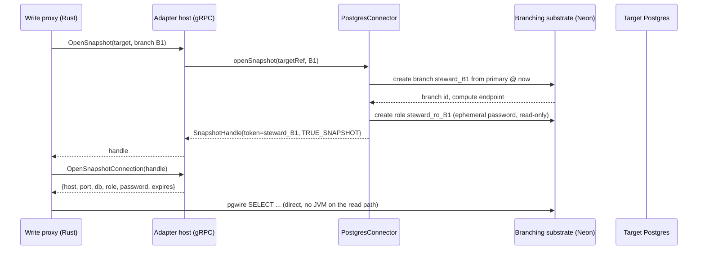

# 08 — Data-plane adapters

**Status:** Draft
**Owner:** Founding team
**Last updated:** 2026-10-15
**Language / runtime:** Java 21, Gradle (`adapters/`, multi-project); one library per target kind, loaded by a thin gRPC host process in the data plane

Adapters are the only code in Steward that varies by target kind and the only code that holds target credentials (doc 03 §4). Each adapter is a Java library implementing the `Connector` interface from `adapters/api/`; the adapter host is a small JVM process, one per data plane, that loads the adapters and exposes `Connector` over gRPC to the write proxy and the changeset engine. An adapter opens a base snapshot on a target, serves keyed and pass-through reads from it, reads current rows for the staleness check, and applies a row delta idempotently per (merge ID, row key). It does not decide anything: no policy, no lifecycle, no routing, no compensation computation. This document specifies the interface, the error codes, the M0 Postgres adapter and its snapshot substrate, the M1 Iceberg, Snowflake, and Salesforce adapters, the host, and the conformance suite every adapter must pass.

## 1. Responsibilities

- Define and own the `Connector` interface, the `ConnectorException` error codes, and the gRPC service in `contracts/adapter.proto` that mirrors them one-to-one.
- Realise a **base snapshot** on a target and hand back a stable `SnapshotHandle` with an honest `fidelity`.
- Serve reads from a base snapshot: keyed reads to the changeset engine and merge worker, and a snapshot-scoped pass-through connection to the write proxy where the target supports one.
- Read **current** target rows for the staleness check (doc 13 §6.5 step 4).
- Apply a row delta to the target, idempotently per (merge ID, row key), resumably, with per-row confirmation to a progress sink.
- Detect schema drift between a base snapshot and the target at apply time and refuse with `SCHEMA_MISMATCH`.
- Hold, resolve, and rotate target credentials inside the data plane.
- Report per-adapter capabilities (transactional apply, batch limits, rate limits) so the merge worker can plan.
- Run the adapter host: plugin loading, gRPC surface, connection pools, health, metrics.

## 2. Non-goals

- **Compensation.** The changeset engine in the data plane computes the inverse from the base snapshot and the row delta (doc 13 §6.5 steps 6–7) and writes the compensation log (doc 09). Adapters only supply the rows it needs (`readRows`, `currentRows`); docs 02 and 03 say the same.
- **Branch lifecycle and state.** The adapter never knows what state a branch is in. The control plane (doc 07) owns transitions; the proxy's routing store (doc 04) owns the data-plane view.
- **Routing and the overlay.** The proxy resolves connections and owns the overlay store (doc 04, doc 05). Adapters never read or write an overlay.
- **Policy and impact queries.** The changeset engine (doc 05) runs them. An adapter may be asked for rows; it is never asked whether a change is acceptable.
- **Cross-target coordination.** One target per branch (doc 01 §6). An adapter instance talks to exactly one target.
- **Being a database.** No caching of target rows beyond a single call.

## 3. Interfaces

### 3.1 Inbound

The host exposes `steward.adapter.v1.Adapter` over gRPC on a Unix domain socket in the data plane (doc 03 §8). Callers are the write proxy (reads, snapshot open/close) and the changeset engine / merge worker (keyed reads, current rows, apply). No caller outside the data plane ever reaches the host; the control plane talks to adapters only indirectly, through merge instructions carried to the merge worker.

The proto is a one-to-one mirror of the Java interface below; the Java interface is normative and the proto is generated-doc from it. A change to either is a `contracts/` change (doc 18 §5).

```java
package steward.adapter.api;

/** The only public type an adapter exports. One instance per registered target. */
public interface Connector extends AutoCloseable {

    /** Static facts about the target: tables, columns and types, primary keys,
     *  which tables can supply before-images cheaply, whether true snapshots exist.
     *  Must be cheap (cached by the adapter; refreshed on explicit request). */
    TargetDescription describe() throws ConnectorException;

    /** What this adapter can do, so the merge worker can plan apply. */
    Capabilities capabilities();

    /** Realise a base snapshot for a branch. Returns a stable reference that
     *  readRows/openSnapshotConnection accept until closeSnapshot or until the
     *  target loses it (SNAPSHOT_LOST). Idempotent on targetRef + branchId. */
    SnapshotHandle openSnapshot(TargetRef targetRef, BranchId branchId) throws ConnectorException;

    /** Release the snapshot. Idempotent; a missing snapshot is not an error. */
    void closeSnapshot(SnapshotHandle snapshot) throws ConnectorException;

    /** Keyed reads as of the snapshot. Missing keys are absent from the result,
     *  never an error. Keys per call bounded by capabilities().maxReadKeys(). */
    RowBatch readRows(SnapshotHandle snapshot, TableRef table, List<RowKey> keys)
            throws ConnectorException;

    /** Full scan of a table as of the snapshot. Named so nobody calls it by
     *  accident: it costs O(table) on the target and must only be used by the
     *  changeset engine for tables under capabilities().bulkScanRowLimit(). */
    RowStream scanTableExpensive(SnapshotHandle snapshot, TableRef table, Optional<Projection> columns)
            throws ConnectorException;

    /** A snapshot-scoped connection descriptor the proxy can use for pass-through
     *  reads in the target's own protocol. Empty when the target has no such
     *  mode (Salesforce). The credential inside is ephemeral and read-only. */
    Optional<SnapshotConnection> openSnapshotConnection(SnapshotHandle snapshot)
            throws ConnectorException;

    /** Current (not snapshot) rows for the staleness check. Includes the
     *  target's last-modified marker per row when the target exposes one. */
    RowBatch currentRows(TableRef table, List<RowKey> keys) throws ConnectorException;

    /** Apply a row delta. Idempotent per (mergeId, table, rowKey); resumable:
     *  rows already confirmed under mergeId are skipped. Reports each row's
     *  confirmation to the sink before returning. Partial progress is normal
     *  on non-transactional targets (doc 13 §6.5). */
    ApplyResult apply(MergeId mergeId, RowDelta delta, ProgressSink progress)
            throws ConnectorException;

    /** Close pools and release credentials. */
    @Override void close();
}

public record SnapshotHandle(String targetRef, String token, Fidelity fidelity, Instant openedAt) {}
public enum Fidelity { TRUE_SNAPSHOT, TIMESTAMP_BOUNDED }

public record Capabilities(
    boolean transactionalApply,      // whole delta in one target transaction
    int maxApplyBatchRows,           // rows per statement/request
    int maxReadKeys,                 // keys per readRows call
    long bulkScanRowLimit,           // scanTableExpensive refused above this
    Optional<RateLimit> rateLimit,   // requests per window, when the target meters
    boolean supportsPassThrough,     // openSnapshotConnection returns non-empty
    boolean beforeImagesCheap) {}    // readRows on snapshot is O(keys), not O(table)

/** Row-keyed progress. The merge worker persists it (doc 13 §6.5 step 9). */
public interface ProgressSink {
    void confirmed(TableRef table, RowKey key);
    void failed(TableRef table, RowKey key, ErrorCode code, String safeMessage);
}
```

`TargetDescription` carries, per table: columns with nominal types, the primary key (or Salesforce `Id`), whether the row carries a last-modified marker (`xmin`-free Postgres tables do not; Salesforce `SystemModstamp` does), and `beforeImagesCheap`. `RowDelta` is the row-delta layer of a changeset (doc 02 §1), streamed in table order, inserts before updates before deletes within a table.

**Error codes.** Every failure crosses the boundary as `ConnectorException(code, safeMessage, retryAfter?)`. `safeMessage` must not contain row values. The codes are stable and are the gRPC `status.details`:

| Code | Meaning | Retryable |
|---|---|---|
| `SNAPSHOT_LOST` | The snapshot handle no longer resolves (CoW branch GC'd, Iceberg snapshot expired, exported snapshot's transaction ended) | No; reported via heartbeat and the control plane abandons the branch with lifecycle reason `snapshot_lost` (doc 13 §2.1, §6.2) |
| `STALE_BASE` | `currentRows` detected a row the base does not match; raised only by the merge worker's comparison, never by the adapter itself, but reserved here so the proto has it | No |
| `RATE_LIMITED` | Target refused for quota; `retryAfter` populated | Yes, after `retryAfter` |
| `PARTIAL_APPLY` | Apply returned with some rows unconfirmed; progress sink has the detail | Yes, resume with same merge ID |
| `AUTH_FAILED` | Credential rejected | After rotation |
| `SCHEMA_MISMATCH` | Target schema at apply time is incompatible with the base snapshot's (§5.4) | No |
| `TARGET_UNREACHABLE` | Network or connection failure | Yes, with backoff |
| `POOL_EXHAUSTED` | No connection available within the pool timeout | Yes |
| `KEY_LIMIT_EXCEEDED` | Caller exceeded `maxReadKeys` or `maxApplyBatchRows` | No; caller bug |
| `UNSUPPORTED` | Operation not offered by this adapter (`openSnapshotConnection` on Salesforce) | No |
| `INTERNAL` | Adapter bug; always paired with a log line carrying a correlation ID | No |

### 3.2 Outbound

The adapter calls only its target, and the data-plane secret store at credential resolution time. Nothing else: no control plane, no overlay store, no compensation log, no DNS outside the customer's network. The host's egress policy (doc 14) enforces this.

Assumptions about targets: Postgres answers a keyed read in under 10 ms on an indexed primary key; Iceberg metadata reads are 100 ms to seconds depending on the catalog; Snowflake has 200 ms to 2 s per statement plus warehouse resume; Salesforce REST is 100 to 500 ms per call and metered daily. None is assumed highly available; every call has a timeout and a bounded retry set by the merge worker, not by the adapter.

## 4. State

Adapters hold no durable state of their own. Everything they touch is either in the target or in the host's memory:

| State | Where | Durability | Source of truth? |
|---|---|---|---|
| Open snapshot handles | Host memory, re-derivable from the target (Neon branch list, Iceberg snapshot IDs); the routing store (doc 04) also carries the handle | Lost on host restart; re-validated lazily | No; the target is |
| `steward.applied_rows` (Postgres, Snowflake), `steward_applied_rows` (Iceberg) | Steward's own schema in the target | As durable as the target; written in the apply transaction | Yes, for "was this row applied under merge M" |
| Steward external-ID field and `Steward_Merge_Checkpoint__c` object (Salesforce) | The org | Durable | Yes, for the same question |
| Resolved credentials, HikariCP pools | Host memory | Never persisted | No; the secret store is |
| Schema cache from `describe()` | Host memory, TTL 60 s | Cache | No |

**Decision:** idempotency state for apply lives **in the target**, in a schema named `steward` that Steward creates at target registration, not in a Steward-owned sidecar store. Reason: on transactional targets the applied-rows insert commits in the same transaction as the data write, which is the only way "applied" and "recorded as applied" cannot diverge. For Salesforce, where no such transaction exists, the equivalent is an upsert on an external-ID field plus a checkpoint object (§5.3). The merge worker's own progress record (doc 13 §6.5 step 9) is a second, redundant copy; on resume the adapter trusts the target's table over the worker's record.

## 5. Core flows

### 5.1 Open snapshot and pass-through read (Postgres, M0)



Failure at each step: branch creation fails → `TARGET_UNREACHABLE` or `INTERNAL`; the proxy's create flow fails before its checkpoint (doc 13 §6.1 step 2) and the agent retries with fresh IDs. Role creation fails → the adapter drops the branch and returns the error; no half-open snapshot survives. Reply lost → the branch exists; `openSnapshot` is idempotent on (targetRef, B1) and the retry finds `steward_B1` and returns it. Branch GC'd later by the substrate → next `readRows` or the proxy's next connect returns `SNAPSHOT_LOST`.

**Decision: pass-through credentials are ephemeral and snapshot-scoped.** Agents run arbitrary SQL, so keyed reads alone cannot serve the proxy; it needs a real connection to the branch. To keep doc 03's rule that only adapters hold *target* credentials, the adapter mints a read-only role on the CoW branch with a random password and a `VALID UNTIL` equal to the branch TTL, and hands that to the proxy. The proxy never sees the primary's credentials. The role is dropped with the snapshot.

### 5.2 Apply on a transactional target (Postgres, Snowflake)

```mermaid
sequenceDiagram
    participant MW as Merge worker
    participant PG as PostgresConnector
    participant T as Target

    MW->>PG: apply(M1, delta, sink)
    PG->>T: BEGIN; SET LOCAL steward.merge_id = 'M1'
    PG->>T: schema check vs delta's base schema digest
    alt delta ≤ 50k rows (single transaction)
        loop per table, batches of 1000
            PG->>T: INSERT ... ON CONFLICT (merge_id, table, pk) DO NOTHING INTO steward.applied_rows
            PG->>T: UPDATE/INSERT/DELETE ... WHERE pk IN (rows not already applied)
        end
        PG->>T: COMMIT
    else chunked
        loop per chunk of 10k rows, each its own transaction
            PG->>T: same, plus chunk row in steward.apply_progress(M1, chunk_no)
        end
    end
    PG-->>MW: sink.confirmed(...) per row; ApplyResult
```

Row-level idempotency: the write to `steward.applied_rows (merge_id, table_name, pk jsonb, applied_at)` is in the same transaction as the data write; the data statement joins against it so a row already present is skipped. Running `apply(M1, delta)` twice therefore yields the same target state, and the second run confirms every row without writing data. `SET LOCAL steward.merge_id` makes the merge ID visible to the customer's own audit triggers via `current_setting('steward.merge_id', true)`.

Chunking: **Decision** — a delta under 50,000 rows applies in one transaction; above that, chunks of 10,000 rows each in its own transaction with a row in `steward.apply_progress`. Doc 13 §6.5 records the same threshold; the chunked path exists for deltas that would hold a long lock on an operational table, and it is only safe because compensation was persisted first and per-row idempotency makes the resume exact.

Failure analysis: schema check fails → `SCHEMA_MISMATCH` before any write; merge worker reports to the control plane, which treats it as a pre-checkpoint failure only if compensation is not yet persisted (it is persisted at step 7 before apply, so in practice this is a human escalation per doc 13 §6.5 "stalled"). Connection drops mid-transaction → the transaction rolls back; nothing applied; `TARGET_UNREACHABLE`; worker retries with M1. Crash mid-chunk → the committed chunks are in `applied_rows`; retry skips them. Pool exhausted → `POOL_EXHAUSTED`; retry.

### 5.3 Apply on Salesforce (non-transactional)

Salesforce has no transaction and a daily API quota. Per doc 13 §6.5, partial application is the normal case. The adapter:

1. Ensures every governed object has a Steward-owned external-ID field `Steward_Row_Key__c` (text, external ID, unique), populated as `<pk>` at registration time, and a custom object `Steward_Merge_Checkpoint__c (Merge_Id__c, Object__c, Row_Key__c, Applied_At__c)` with a composite unique external ID.
2. For updates and inserts, uses Bulk API 2.0 `upsert` keyed on `Steward_Row_Key__c` in batches of `maxApplyBatchRows` (default 2,000; Bulk API accepts up to 10,000 per job but smaller batches bound the blast radius of a batch-level failure). For deletes, Bulk API `delete` by `Id`.
3. After each batch's result file is read, upserts one checkpoint record per confirmed row, then calls `sink.confirmed`.
4. On resume, first reads checkpoints for M1 and removes those rows from the delta.

Idempotency: an upsert keyed on the external ID with the same values is a no-op; a delete of an already-deleted `Id` returns `ENTITY_IS_DELETED` and is treated as confirmed. The checkpoint object makes the second run skip the API call entirely, which matters because a no-op upsert still consumes quota. If the org's remaining daily quota is below the estimated cost of the next batch (rows / batch size, plus checkpoints), the adapter returns `RATE_LIMITED` with `retryAfter` set to the quota reset time rather than exhausting the customer's quota for their own integrations.

The snapshot is `TIMESTAMP_BOUNDED`: `openSnapshot` records `now()` in org time; `readRows` on the snapshot fetches current records and the adapter filters out any with `SystemModstamp > snapshot.ts` as `absent-at-snapshot` (it cannot reconstruct the pre-modification values). `currentRows` returns `SystemModstamp` so the merge worker's staleness check can apply the doc 13 §6.5 rule for CRMs. The adapter's `describe()` marks `beforeImagesCheap = false` and `trueSnapshot = false` so the changeset engine and the UI can say "as of" honestly.

### 5.4 Schema drift

At `apply`, the adapter compares the target's current schema for each table in the delta to the schema digest recorded in the snapshot (captured by `describe()` at `openSnapshot`). The merge fails with `SCHEMA_MISMATCH` before any row is written.

| Drift | Verdict | Why |
|---|---|---|
| Nullable column added | Tolerated | Delta leaves it NULL/default; no information lost |
| Column added with a default and NOT NULL | Tolerated | Same |
| Column in the delta dropped or renamed | Mismatch | The delta cannot be applied as reviewed |
| Column type changed (any column in the delta) | Mismatch | Values were reviewed under the old type |
| Primary key changed | Mismatch | Row identity is gone |
| NOT NULL added without default to a column the delta inserts NULL into | Mismatch | Detected by the schema check, not by a constraint error mid-apply |
| New CHECK or FK constraint | Not detected up front; a constraint violation during apply surfaces as `PARTIAL_APPLY` with per-row failures | Enumerating constraints is target-specific and brittle; the per-row path is safe because compensation exists |
| Table dropped | Mismatch | |

Because the compensation record is persisted before apply, a `SCHEMA_MISMATCH` after the checkpoint is a stalled merge per doc 13 §6.5: a human either reverts (always possible) or fixes the schema and resumes. The adapter re-runs the check on every resume.

### 5.5 Credentials

Each registered target carries a **credential reference**, not a credential: a URI such as `k8s://steward/targets/<id>` or `aws-sm://arn:...` or `vault://secret/steward/<id>`. The reference travels from the control plane in the routing assignment (doc 03 §2); the secret itself exists only in the customer's data-plane secret store. At host start the host resolves every reference and constructs each `Connector`. Rotation: the host watches the secret (Kubernetes secret informer, AWS Secrets Manager version polling every 60 s, Vault lease renewal); on change it builds a new pool with the new credential, drains the old pool over 30 s, and never restarts. An `AUTH_FAILED` from the target triggers an immediate re-resolve before the error is surfaced, so a rotation the watcher has not yet seen costs one retry, not a merge failure.

## 6. Failure modes

| Failure | Detection | Impact | Recovery |
|---|---|---|---|
| CoW branch GC'd by the substrate (retention, operator action) | `readRows` / pass-through connect fails; mapped to `SNAPSHOT_LOST` | Branch reads fail; reported in the heartbeat | Control plane abandons the branch with reason `snapshot_lost` (doc 13 §2.1, §6.2 f3); principal creates a new one. Mitigate: host pins branches it owns with a substrate retention tag |
| Exported-snapshot fallback: holding connection dropped | Session gone | Same as above for every branch sharing that snapshot | Same; the fallback is weaker, §11 |
| Iceberg snapshot expired by `expire_snapshots` | Catalog returns no such snapshot | `SNAPSHOT_LOST` | Host registers a tag `steward/<branch>` on open so expiry skips it; still lost if the tag is removed |
| Salesforce daily API limit exhausted | `REQUEST_LIMIT_EXCEEDED` or pre-flight quota check | Apply stalls | `RATE_LIMITED` with `retryAfter` = quota reset; merge stays `pending`; heartbeat carries progress; doc 13 stall alert after 1 h unless `retryAfter` is later, in which case the alert says so |
| HikariCP pool exhausted | `getConnection` times out (default 5 s) | `POOL_EXHAUSTED` on that call | Caller retries with backoff; host metric `adapter_pool_wait_seconds` alerts at p99 > 1 s |
| Target unreachable | Connect timeout (3 s) | All operations fail | Caller retries; nothing durable changes |
| Credential rotated, watcher lagging | `AUTH_FAILED` | One retry | Re-resolve, rebuild pool |
| Schema drift | Digest comparison at apply | Merge stalled | Human: revert or fix schema and resume |
| Host OOM or crash | gRPC socket gone; k8s restart | In-flight calls fail; open handles lost from memory | Host restarts in < 10 s; proxy re-sends handles from the routing store; apply resumes from `applied_rows` |
| Disk full on host | Not applicable to adapters (no durable state); logs go to stdout | None | n/a |
| Target slow (Snowflake warehouse resumed, Postgres vacuum) | Latency metrics | Apply throughput drops | No action; timeouts are per-statement (60 s) and resumable |
| Two hosts for one data plane (misdeploy) | Both register with the proxy | Duplicate apply attempts | Harmless by idempotency; alert on duplicate host IDs |
| Adapter jar fails to load | Host start | That target kind is unavailable | Host starts anyway, marks the kind `unavailable`, alerts |

## 7. Performance and capacity

Requirements (R) are what the conformance suite asserts against Testcontainers; estimates (E) are expectations for real targets.

| Metric | Postgres | Iceberg | Snowflake | Salesforce |
|---|---|---|---|---|
| `openSnapshot` latency | R: < 2 s on Neon; E: 300–800 ms | E: < 1 s (catalog round-trip) | E: < 500 ms (records timestamp; Time Travel needs no setup) | E: < 100 ms (timestamp only) |
| `readRows` keyed, 1,000 keys | R: < 100 ms p50, < 500 ms p99 | E: 1–5 s (manifest pruning + Parquet reads) | E: 1–3 s per statement | E: 2–4 REST calls of 500 ms |
| Keyed read throughput | R: ≥ 20,000 rows/s per host | E: 5,000 rows/s | E: 5,000 rows/s | E: 500 rows/s |
| Apply throughput | R: ≥ 5,000 rows/s single-txn path; E: 10,000 rows/s with batching | E: 50,000 rows/s (one new snapshot per chunk) | E: 10,000 rows/s via `MERGE` on a staged temp table | E: 500–2,000 rows/s **but bounded by quota**: Bulk API 2.0 counts 1 call per 10,000 rows, checkpoints count per batch; a 100k-row merge is ~60 calls; the default daily quota is 15,000 + per-licence allocation, which is shared with everything else the customer runs |
| Pool size (HikariCP) | 10 per target by default; apply uses ≤ 4 concurrent chunk transactions | n/a (catalog client) | 4 per target | n/a (HTTP client, 10 connections) |

Host sizing: JVM with `-Xmx1g` default, `-Xmx2g` for data planes with more than 20 targets; `-XX:+UseZGC`; CDS archive built at release so startup is **R: < 5 s to serving on the socket** with adapters loaded (E: 2–3 s). Streaming is mandatory on every row path (`RowStream`, batched gRPC responses of 1,000 rows); the host must never materialise a full delta in heap.

## 8. Security

The host sits on the boundary between Steward's data-plane components and the customer's target. It is the only process with target credentials, so:

- Credentials are resolved from the data-plane secret store (§5.5), kept in memory only, and never written to logs, metrics labels, exceptions, or gRPC error details. `ConnectorException.safeMessage` is constructed from a fixed template; the wrapped cause's message is logged at `DEBUG` only after a redaction pass that strips anything matching the credential.
- Row values are never logged (doc 18 §2). Log lines carry table names, key counts, merge IDs, and error codes.
- Network egress from the host is restricted to the target's endpoints and the secret store (doc 14 network policy); the host has no route to the control plane.
- The gRPC socket is a Unix domain socket with filesystem permissions limited to the proxy and engine users; no TCP listener.
- Pass-through credentials (§5.1) are per-snapshot, read-only, expire with the branch TTL, and are revoked at `closeSnapshot`.

**Least-privilege grants, Postgres.** Steward asks for two roles at registration:

```sql
-- Role used for snapshots, reads, and apply
CREATE ROLE steward_adapter LOGIN PASSWORD '...';
GRANT CONNECT ON DATABASE <db> TO steward_adapter;
GRANT USAGE ON SCHEMA <governed schemas> TO steward_adapter;
GRANT SELECT, INSERT, UPDATE, DELETE ON <governed tables> TO steward_adapter;
GRANT USAGE, SELECT ON ALL SEQUENCES IN SCHEMA <governed schemas> TO steward_adapter;
-- Steward's own schema for idempotency state
CREATE SCHEMA steward AUTHORIZATION steward_adapter;
-- Substrate: Neon branch create/delete and CREATE ROLE on the branch compute
-- (granted via the substrate's API key, scoped to the project)
```

No superuser, no `CREATEDB`, no `REPLICATION` except in the fallback mode (§11), where `REPLICATION` is required to create the slot and is called out at registration. Snowflake: `USAGE` on warehouse, database, schema; `SELECT, INSERT, UPDATE, DELETE` on governed tables; `CREATE TABLE` on the `STEWARD` schema only. Iceberg: catalog credentials with commit rights on governed tables and a Steward namespace. Salesforce: a dedicated integration user with an API-only profile, object-level CRUD on governed objects, and field-level access to `Steward_Row_Key__c` and the checkpoint object.

## 9. Observability

Metrics (OpenTelemetry, exported from the host; all labelled by `target_kind`, `target_id`, never by key or value):

- `adapter_call_duration_seconds{op}` histogram per `Connector` method.
- `adapter_errors_total{op, code}`.
- `adapter_apply_rows_total{merge_id, outcome=confirmed|failed|skipped}` and `adapter_apply_in_progress{merge_id}` gauge, which is what the heartbeat's `merge_progress` is read from.
- `adapter_pool_active`, `adapter_pool_wait_seconds` (HikariCP metrics bridged).
- `adapter_snapshots_open` gauge; `adapter_snapshot_lost_total`.
- `adapter_quota_remaining{target_id}` (Salesforce `Sforce-Limit-Info` header, refreshed on every call) and `adapter_quota_reset_seconds`.
- `adapter_host_startup_seconds`, `adapter_plugin_loaded{kind, version}`.

Traces: every gRPC call is a span carrying `branch_id`, `merge_id`, `snapshot_token`, propagated from the proxy or engine via W3C trace context. Logs: JSON, one line per call at `INFO` with op, duration, code, row count.

The three signals on-call looks at first: `adapter_errors_total` by code (is it `SNAPSHOT_LOST`, `RATE_LIMITED`, or `AUTH_FAILED`?), `adapter_apply_in_progress` stuck flat (a stalled merge), and `adapter_quota_remaining` approaching zero on Salesforce targets.

## 10. Testing

**Conformance suite** (`adapters/conformance/`): a JUnit 5 suite parameterised over a `ConnectorFixture` that every adapter must provide and pass in CI. It asserts the interface contract, not the backend:

- `describe()` is stable across calls and names a primary key for every governed table.
- `openSnapshot` is idempotent on (target, branch); a second open returns an equal handle.
- Writes to the target after `openSnapshot` are invisible to `readRows` on a `TRUE_SNAPSHOT` handle, and are visible to `currentRows`. For `TIMESTAMP_BOUNDED`, rows modified after the timestamp are reported absent.
- `readRows` with missing keys returns the present subset and no error; exceeding `maxReadKeys` raises `KEY_LIMIT_EXCEEDED`.
- **Apply-twice equals apply-once** (jqwik property test): for random deltas over a seeded table, `apply(M, d)` then `apply(M, d)` yields the same target state and the same confirmed-row set as one call; and `apply(M, d)` interrupted after a random prefix (fixture injects a failure into the sink) then resumed yields the same state. Also `apply(M1, d)` then `apply(M2, d)` with a fresh merge ID is **not** a no-op where `d` has inserts, which proves idempotency is per merge ID, not per row content.
- Schema drift cases from §5.4 each produce the stated verdict.
- `SNAPSHOT_LOST` is raised when the fixture removes the snapshot behind the adapter's back.
- No log line emitted during the suite contains any value from the seeded rows (the fixture seeds rows with a sentinel string and the suite greps captured logs).

Fixtures: Testcontainers Postgres 16 plus a Neon-compatible pageserver container for the substrate path and a plain Postgres for the fallback path; a local Iceberg REST catalog over MinIO; Snowflake against a shared CI account with a per-run schema (nightly only, not on every PR); Salesforce against a recorded-fixture mock (WireMock with captured Bulk API 2.0 and REST conversations) on every PR and against a scratch org nightly. All seed data comes from `tools/fixtures` (doc 18 §7).

Integration: `adapters/tests/integration` runs the host with all adapters under `tools/stack up` and exercises the gRPC surface from a Rust test client in `proxy/`, including handle re-validation after a host restart. Load: doc 17 runs the doc 03 principle 9 write patterns through proxy → host → Postgres and asserts the §7 requirements.

## 11. Alternatives considered

**Substrate for M0 — Decision: Neon open-source storage, with the exported-snapshot/replica fallback.** Criteria from doc 03 §11: self-hostable under our Helm chart, snapshot latency, licence. Neon's pageserver and safekeepers are Apache 2.0, run in Kubernetes, and create a branch in well under a second; it is also the substrate with the most production exposure and a compute endpoint per branch, which is exactly what pass-through reads want. Ardent is younger and its self-hosting story is thinner; Xata's branching is a hosted product. The cost of Neon is operating a pageserver and safekeepers in the customer's account and the requirement that the governed Postgres run on Neon compute, which means the customer either migrates the target onto Neon storage or Steward keeps a Neon replica of it fed by logical replication (the recommended M0 shape: the primary is untouched; Steward branches the replica; apply goes to the primary). **Fallback** for customers who cannot run the substrate: a dedicated physical read replica with a replication slot on the primary so WAL is retained, where `openSnapshot` records the primary's current LSN, waits for the replica to reach it, then pauses replay (`pg_wal_replay_pause()`); on managed Postgres that cannot pause replay, a Steward-owned Postgres fed by logical replication with the subscription paused instead. Limitations, stated plainly: one pinned LSN per replica, so every branch opened while it is pinned shares that base snapshot and the replica cannot advance until all of them close; the base ages, so `stale_base` becomes more frequent; retained WAL grows on the primary; a replica restart loses the pin (`SNAPSHOT_LOST` for every branch on it); `REPLICATION` privilege is required. It is `TRUE_SNAPSHOT` fidelity but with a shared, ageing base; the UI should show the snapshot's age. The fallback is supported in M0 but is not the default.

**Writing adapters in Rust.** One language for the whole data plane, no JVM, no gRPC hop. Rejected for M0: the Iceberg, Snowflake, and Salesforce client libraries are mature in Java and immature or absent in Rust, and doc 03 §1 made this call. Revisit per adapter if a Rust client reaches parity; the gRPC boundary means an adapter could move language without the proxy noticing.

**Debezium / Kafka Connect as the adapter layer.** Mature connectors for every target. Rejected: they are built for change capture and sink streaming, not for point-in-time snapshot handles, keyed reads, or idempotent apply keyed by a merge ID; and Kafka is a dependency doc 03 §9 defers until a customer demands it.

**One process per adapter instead of a shared host.** Better isolation (a Salesforce client's memory cannot starve Postgres reads). Rejected for M0: one JVM per target kind per data plane multiplies heap and startup cost and the number of sockets the proxy must manage. Mitigation in the shared host: per-adapter classloaders and per-adapter thread pools with bounded queues. Listed in §12 for M1.

**ServiceLoader versus explicit registry — Decision: explicit registry.** The host's config names each adapter as `{kind, jar, class, version}`; each loads in its own `URLClassLoader` with the API jar as parent. ServiceLoader's classpath scan is convenient but makes "which version of which adapter is running" a question for the classpath rather than the config, and it cannot isolate dependencies between adapters (two JDBC drivers, two Jackson versions).

**Idempotency table in a Steward-owned sidecar store.** Keeps Steward's schema out of the customer's target. Rejected: loses same-transaction atomicity between the data write and the record of it; the whole point of `applied_rows` is that it cannot disagree with the data.

## 12. Open questions

| Question | Owner | Needed by |
|---|---|---|
| Confirm Neon open-source storage as the M0 substrate (§11), including the "Neon replica fed by logical replication" shape versus migrating the target onto Neon compute | Architecture | Before M0, with doc 04 |
| Resolved: docs 02 §1 and 03 §4 now say adapters supply rows and the changeset engine computes compensation; doc 03's component map draws the engine writing the compensation log | Founding team | Done |
| Resolved: doc 13 §6.5 now records the 50,000-row single-transaction threshold and 10,000-row chunking (§5.2) | Adapters lead | Done |
| Resolved: doc 03 §4 and doc 04 §8 now say the proxy never holds *primary* target credentials and uses the adapter-minted ephemeral, read-only, snapshot-scoped credential for pass-through reads (§5.1) | Architecture | Done |
| MySQL and BigQuery adapters: MySQL has no CoW substrate of comparable maturity (snapshot would be `TIMESTAMP_BOUNDED` via a paused replica); BigQuery has native time travel (7 days) and `MERGE`. Proposed order: BigQuery in M1 alongside Snowflake, MySQL in M2 | Founding team | Doc 19 |
| HubSpot: no external-ID upsert on all objects and a per-10-second rate limit rather than a daily quota; needs its own checkpoint design. M2 | Adapters lead | Doc 19 |
| Should the host run as a sidecar of the proxy pod in the customer's Kubernetes (shared network namespace, Unix socket trivially shared) or as its own Deployment (independent scaling and restart)? Recommendation: sidecar in M0, revisit when a data plane has more than ~20 targets | Proxy lead | Doc 14 |
| CRM staleness rule from doc 13 §12: for Salesforce, `SystemModstamp` plus column comparison; for objects without a per-field modified marker, column comparison only and the changeset summary flags `staleness_check: values_only` | Adapters lead | Doc 13 amendment |
| One host per data plane versus one per target kind (§11) once JVM isolation becomes a problem | Adapters lead | M1 |
