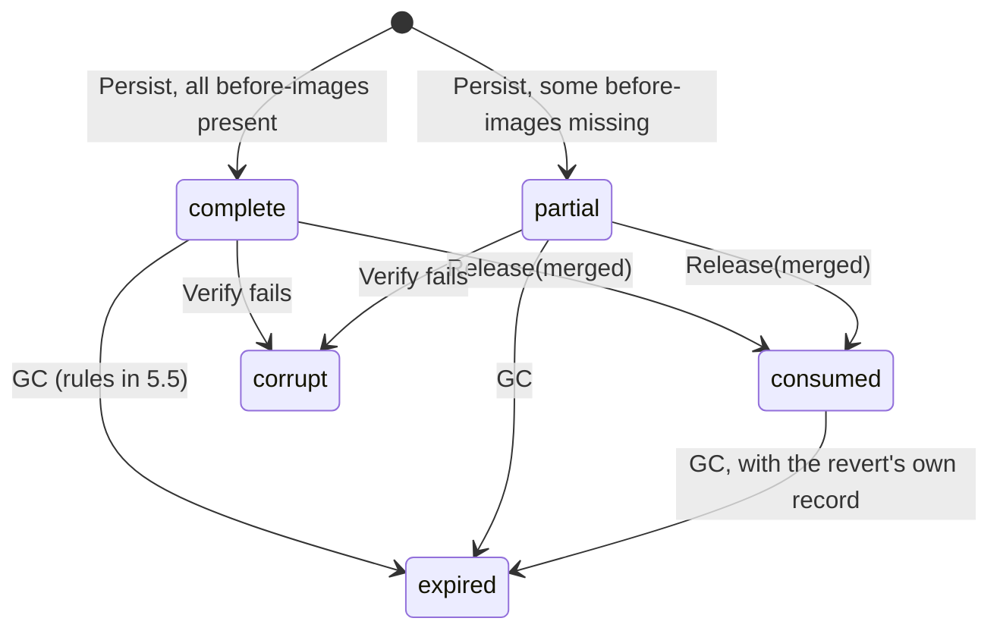

# 09 — Compensation log

**Status:** Draft
**Owner:** Founding team
**Last updated:** 2026-10-15
**Language / runtime:** Data-plane component. A module of the changeset engine (Rust, `engine/compensation`), not its own process. Storage is Parquet on the customer's object storage plus a small SQLite index on the data plane's durable volume. Written by the changeset engine at merge time; read by the changeset engine for reverts and conflict detection; read by reviewers through a control-plane-issued signed grant for display and export.

The compensation log is the append-only, write-once record of every merge's inverse. Each merge produces exactly one compensation record whose body is the inverse row operations, in the same Parquet op schema the overlay uses (doc 05), so a revert's overlay *is* the compensation body and needs no transformation. Persisting the record is the merge's checkpoint (doc 13 §6.5 step 7); until it is durable the merge has not happened, and after it is durable the merge is committed. This component owns the record format, the durable write path and its atomicity, the index that says which merges can still be reverted, retention and garbage collection, integrity (checksums and a per-target hash chain), and export. It is explicitly not responsible for deciding whether a revert may happen (policy, doc 06), for applying anything to a target (adapters, doc 08), or for branch state (control plane, doc 07; contract in doc 13).

## 1. Responsibilities

- Define the compensation record format: header plus body segments, and the inverse rules that map a row delta to a body (identical to doc 05's rules).
- Compute the body from the row delta and the before-images read during the staleness check (doc 13 §6.5 steps 4–6), and mark records `partial` when a before-image cannot be obtained.
- Persist records durably and atomically so that "the record exists" is a single, unambiguous fact that the merge checkpoint can rest on; report `compensation_persisted` only after read-back verification.
- Own the compensation index: `merge_id → object path, status, reservation, retention_until, legal_hold` and the per-target chain head.
- Serve `open(merge_id)` for reverts (doc 13 §6.6), `keys(merge_id)` for conflict detection, and `verify(merge_id)` for integrity checks.
- Enforce retention: compute nothing itself, but garbage-collect exactly the records the rules in §5.5 allow, idempotently.
- Maintain integrity: per-record SHA-256 checksums and a per-target tamper-evident hash chain of headers.
- Produce signed export bundles for compliance, served under a signed grant.
- Mirror index *metadata* (never content) to the control plane so the UI can list reverts that are available.

## 2. Non-goals

- **Deciding whether a revert is allowed or what verdict it gets.** A revert is a changeset and goes through policy like any other (doc 02, doc 03 §4). The log never evaluates policy and is never consulted by policy.
- **Applying inverses to the target.** The adapter applies the revert branch's row delta exactly as it applies any merge (doc 08).
- **Branch and merge state.** Metadata Postgres is the source of truth (doc 13 §10 invariant 1). The index records what the data plane observed; it adopts what the control plane says.
- **Reading before-images from the target.** The adapter reads them during the staleness check; this module consumes what it is handed and never holds target credentials.
- **Evidence storage.** Evidence lives in the per-branch evidence log (doc 13 §6.2); the compensation record references evidence by digest and the two share a retention clock (doc 13 §9), but this module does not write evidence.
- **Being a general change-data-capture log.** One record per merge, nothing else.

**Decision: module, not process.** The log is a crate inside the changeset engine rather than a separate binary. Reasons: (a) the body is produced by the same DuckDB computation that produces the row delta, and copying it across a process boundary would double the memory for the largest merges; (b) the persist step is the merge checkpoint, and a second process is a second failure domain in the one place where a lost acknowledgement is most expensive (doc 13 §6.5 failure 6); (c) the engine already exposes a local gRPC surface to the merge worker and the proxy (doc 03 §8), so the log's methods ride on it without a new listener. The cost is that an engine crash takes the log's in-flight writes with it, which the atomicity rule in §5.1 makes harmless. The module has its own storage layout, its own SQLite file, and its own gRPC service definition in `contracts/`, so it can be split out later without changing callers.

## 3. Interfaces

### 3.1 Inbound

All methods are gRPC on the changeset engine's local socket (`steward.engine.v1.CompensationLog`, defined in `contracts/`). Callers are inside the data plane. The control plane never calls these directly; it reaches the log only through a grant-authenticated endpoint on the data plane (§8).

| Method | Caller | Purpose |
|---|---|---|
| `Persist(merge_id, branch_id, changeset_id, target_id, base_snapshot_ref, policy_versions, delta_ref, before_images_ref)` | Merge worker (doc 13 §6.5 step 6–7) | Compute and durably write the record; returns `{status: complete|partial, checksum, row_count, partial_keys_count}`. Idempotent per `merge_id`. |
| `Open(merge_id, revert_branch_id)` | Merge worker on behalf of the control plane (doc 13 §6.6 step 3) | Reserve the record for a revert and return the body's object paths for overlay materialisation. |
| `Release(merge_id, revert_branch_id, outcome: merged|rejected|abandoned)` | Heartbeat handler, on the revert branch's terminal transition | `merged` moves the record to `consumed`; the others clear the reservation. |
| `Keys(merge_id)` | Changeset engine, conflict detection | Stream of `(table, key)` the record touches. |
| `Status(merge_id)` / `List(target_id, filter)` | Heartbeat handler; grant endpoint | Index rows, no content. |
| `Verify(merge_id)` / `VerifyChain(target_id, from, to)` | GC job; grant endpoint; operator CLI | Recompute checksums and chain links. |
| `SetRetention(merge_id, retention_until)` / `SetLegalHold(merge_id, bool)` | Heartbeat handler, carrying the control plane's instruction | Mutable index fields only; the header is never modified. |
| `Export(merge_ids | target_id + range, destination_prefix)` | Grant endpoint | Build a signed export bundle (§5.6). |

Row content leaves this module only through `Open` (to an overlay in the same object store) and `Export` (to a customer-chosen prefix in the same account). The grant endpoint for *display* of a record streams the body to the reviewer's browser from the data plane; it never passes through the control plane (doc 03 §2).

### 3.2 Outbound

| Dependency | Used for | Assumptions |
|---|---|---|
| Object store (customer's S3 / GCS / Azure Blob), same bucket and prefix scheme as the overlay store | Body segments, headers, export bundles | Single-object PUT is atomic and read-after-write consistent (true of all three since 2020); PUT of 20 MB completes in < 2 s p99; availability outside our control, so every write is retried with backoff for up to the merge worker's budget. |
| SQLite (WAL mode), file `compensation.db` on the data plane's durable volume | Index, chain heads, GC bookkeeping | Local disk; fsync on commit; one writer process (this module). Not the proxy's routing store, see §4. |
| DuckDB (in-process, via the engine's thread pool) | Computing the body from delta plus before-images; writing Parquet | `spawn_blocking` per doc 18 §2; memory bounded by the engine's configured limit. |
| Merge worker / heartbeat handler (in the engine) | Receiving control-plane instructions: retention, legal hold, revert-branch outcomes, merge outcomes | Arrive at least once, possibly late (one heartbeat interval), possibly duplicated; every handler is idempotent. |
| Data-plane signing key (Ed25519, in the data plane's secret store, doc 14) | Export manifests | Public key registered with the control plane at data-plane enrolment. |

Nothing here depends on the control plane synchronously (doc 03 §5, data-plane class).

## 4. State

| State | Where | Durability | Role |
|---|---|---|---|
| Compensation records (header + body segments) | Object store, `steward/targets/<target_id>/compensation/<merge_id>/` | Durable, write-once, encrypted at rest with the customer-managed key | **Source of truth** for the content of every inverse. The only copy. |
| Compensation index | SQLite `compensation.db` on the durable volume | Durable (WAL, fsync) | Derived from headers plus control-plane instructions; fully rebuildable from the object store (§5.4) except the mutable fields, which are re-sent by the control plane. |
| Per-target chain head (`last_header_hash`) | Same SQLite file | Durable | Derived; rebuildable by walking headers. |
| Index metadata mirror | Control plane metadata Postgres | Control plane's concern | A display cache; never authoritative for content and never contains row data. |

**Storage layout.**

```
steward/targets/<target_id>/compensation/<merge_id>/
    body/<table>-<seq>.parquet      op schema identical to the overlay (doc 05); seq from 0000
    body/partial-keys.parquet       only when status = partial: (table, key) rows
    header.json                     written last; existence = record is valid
steward/targets/<target_id>/compensation/_exports/<export_id>/   signed bundles (§5.6)
```

**Header.** JSON, under 4 KB in the common case:

```
{ format_version, merge_id, branch_id, changeset_id, target_id,
  base_snapshot_ref, computed_at, engine_version,
  policy_versions: [..],                 versions that produced the verdict that led to the merge
  row_count, op_counts: {insert, update, delete},
  segments: [{path, table, op_count, bytes, sha256}],
  checksum,                              SHA-256 over the ordered list of segment sha256 values
  reversible: "complete" | "partial", partial_keys_count,
  evidence_refs: [{path, digest}],
  prev_hash }                            SHA-256 of the previous header for this target, or null
```

**Index row.** `merge_id PK, target_id, branch_id, object_prefix, status, consumed_by_revert_id NULL, merge_applied NULL|0|1, branch_closed 0|1, retention_until, legal_hold 0|1, header_hash, row_count, persisted_at, last_verified_at`. Status is one of `complete`, `partial`, `consumed`, `expired`, `corrupt`.



`consumed` is the index's name for what doc 13 §6.6 calls the merge being marked `compensated`; the merge state lives in the control plane, the record status here, and they agree after one heartbeat. A reservation (`consumed_by_revert_id` set while status is still `complete` or `partial`) is not a status: it is a lease taken by `Open` and dropped by `Release`.

**Decision: a separate SQLite file, not the routing store.** Doc 03 §4 makes the routing store the proxy's; SQLite tolerates one writer per file, and the engine may run as a sidecar (doc 03 §11). Same technology, same durable volume, different file. If doc 04 picks RocksDB or sled instead, this module still uses SQLite: the index needs multi-row transactions for the GC race in §6.

## 5. Core flows

### 5.1 Inverse rules and the body

The body uses the overlay segment schema from doc 05 §4.1 exactly, one Parquet file set per table, with columns `seq, op, key, key_hash, before, after, touched, ts, stmt_id`. Inverse rules, which **must** match doc 05's and are restated here only so this document reads alone:

| Merge op | Inverse op in the body | `before` of the inverse op |
|---|---|---|
| `insert(key, after)` | `delete(key)` | `after` (the row the merge created) |
| `update(key, after, before)` | `update(key, after = before)` | `after` (what the merge wrote) |
| `delete(key, before)` | `insert(key, after = before)` | null (the key is expected to be absent) |

The inverse op's `before` is the value the merge left in the target. That is what doc 13 §6.6 calls the "expected current value" and is what the changeset engine compares to the target when it computes a revert's `conflicts` section. So the body serves both revert and conflict detection without a second format.

Before-images come from the staleness check (doc 13 §6.5 step 4): the adapter has just read the current row for every key in the delta, and after the check passes those rows equal the base snapshot's rows. The module **must** use those rows, not a second read, so that the compensation describes exactly the state the merge replaced. Where the adapter's `describe()` (doc 08) reports that before-images are unavailable for a table or column (a CRM field that is write-only, a formula or encrypted field, a bulk-only API that cannot read by key), the affected ops are written with `before = null`, the keys are listed in `body/partial-keys.parquet`, and the record is `partial`. Reverting a `partial` record restores what it can; the changeset for such a revert carries `partial_keys` and policy **must** treat it as at least `hold` (the engine enforces this the same way it enforces `hold` on conflicts, doc 13 §6.6).

The merge itself proceeds. Reversibility is known before the merge: the changeset engine computes `delta.reversible` at propose time from `describe()` and the delta's tables and columns, exposes it in the summary layer, and the queue UI shows "not fully reversible" before approval. **Decision:** a policy **may** block a merge that would not be fully reversible, via the built-in assertion `delta.reversible = 'partial'` available to every target's policies with outcome `block` or `hold`. Recommended default for new targets: `hold`. Flagged for founders in §12.

### 5.2 Write path (the merge checkpoint)

```mermaid
sequenceDiagram
    participant MW as Merge worker (engine)
    participant CL as Compensation log (module)
    participant DD as DuckDB
    participant OS as Object store
    participant IX as Index (SQLite)
    participant CP as Control plane

    MW->>CL: Persist(M1, delta_ref, before_images_ref, ...)
    CL->>IX: 0. lookup M1
    alt header already valid
        CL-->>MW: existing {status, checksum}  (idempotent, doc 13 §6.5 failure 6)
    end
    CL->>DD: 1. join delta with before-images; apply inverse rules; sort by (table, key)
    DD-->>CL: Arrow batches per table
    loop per segment
        CL->>OS: 2. PUT body/<table>-<seq>.parquet  (sha256 computed while writing)
    end
    CL->>OS: 3. PUT body/partial-keys.parquet (if any)
    CL->>IX: 4. read chain head for target
    CL->>OS: 5. PUT header.json (segments, checksum, prev_hash)  — record now valid
    CL->>OS: 6. GET header.json; GET each segment; recompute sha256; compare
    CL->>IX: 7. tx: insert index row (status, header_hash), advance chain head
    CL-->>MW: 8. {status, checksum, row_count}
    MW->>CP: compensation_persisted (step 10 of doc 13 §6.5 carries it)
```

"Persisted", and therefore the merge checkpoint, means **all** of: every body segment durably written; the header durably written; the read-back checksum in step 6 verified; the index row committed. The merge worker **must not** report `compensation_persisted`, and the adapter **must not** begin apply (doc 13 invariant 7), until step 7 returns.

**Atomicity.** Object stores give atomic single-object PUT and nothing more. The trick is ordering: body segments first, header last. A header names every segment with its size and SHA-256; a reader that finds a header validates the list and refuses a record whose segments are missing or mismatched; a prefix with segments and no header is not a record. There is therefore never a moment at which a half-written record can be mistaken for a whole one. Segments are written deterministically (ops sorted by `(table, key)`, pinned Parquet writer settings, one segment per 64 MB uncompressed) so that a retry with the same `M1` after a crash between steps 2 and 5 overwrites segments with identical bytes.

**Chain.** `prev_hash` is the SHA-256 of the previous header for the same target. Merges per target are serialised by the control plane's lease (doc 13 §7), so the chain is linear; the module additionally holds a per-target mutex across steps 4–7 so a lease bug cannot fork it. Records of merges that later `failed` (doc 13 §6.5 failure 6: acknowledgement lost, fresh merge ID) stay in the chain; see §5.5 for why their headers are never deleted. **Decision:** the chain is in M0. It is one hash per record, and the audit story doc 01 §8 sells ("the history of every agent write") is only defensible if a customer can prove no record was removed or altered.

Failure at each step is in §6.

### 5.3 Read path: revert

```mermaid
sequenceDiagram
    participant CP as Control plane
    participant MW as Merge worker (engine)
    participant CL as Compensation log
    participant IX as Index
    participant OS as Object store

    CP->>MW: create revert branch B2, revert_of = M1 (doc 13 §6.6 step 2)
    MW->>CL: Open(M1, B2)
    CL->>IX: 1. tx: reserve — UPDATE ... SET consumed_by_revert_id=B2 WHERE merge_id=M1 AND status IN (complete, partial) AND consumed_by_revert_id IS NULL
    alt no row updated
        CL-->>MW: refused {reason: consumed | expired | corrupt | reserved_by other}
    end
    CL->>OS: 2. GET header; validate segment list and checksum
    CL-->>MW: 3. {segment paths, status, partial_keys path}
    MW->>OS: 4. server-side copy segments → overlays/<O2>/ (doc 13 §6.6 step 4)
    MW->>OS: 5. write overlay manifest O2 {base_snapshot: now, revert_of: M1, compensation_checksum}
    Note over CP: step 5 of doc 13 §6.6 (branch row B2) is the checkpoint
    CP-->>MW: later, via heartbeat: B2 terminal state
    MW->>CL: Release(M1, B2, merged | rejected | abandoned)
    CL->>IX: merged → status=consumed; otherwise clear reservation
```

The overlay is an object copy, not a recomputation; the revert branch's manifest records the record's checksum so the engine can prove the overlay it diffs is the body that was persisted. The record becomes `consumed` only when B2 reaches `merged`; a revert branch that is `rejected` or `abandoned` returns the record to `complete` (or `partial`) by clearing the reservation. Doc 02's "a compensation record may be used by at most one revert" is read as "consumed by at most one *merged* revert"; a rejected revert may be retried. If B2's own merge later produces compensation record `M2`, reverting `M2` restores the original merge: chains of reverts need no special case.

If the revert branch is orphaned before step 5 of doc 13 §6.6 (fresh IDs on retry), the heartbeat kills O2 as `unknown` (doc 13 §6.1); the reservation for the dead B2 is cleared by the same heartbeat handler, because the control plane answers `unknown` for B2.

### 5.4 Conflict detection and index repair

`Keys(merge_id)` streams `(table, key)` from the body's key columns only (a DuckDB projection over the segments, no values materialised). The changeset engine uses it in two places: computing a revert's `conflicts` section (doc 13 §6.6, comparing the inverse op's `before_image` with the target), and, as an optional pre-check when a later merge on the same target is proposed, to annotate the summary with `touches_revertable_merges: [M1, ...]` so a reviewer knows approval will complicate a pending revert. The second is an estimate for humans; the staleness check at merge time remains the enforcement (doc 13 §7).

**Index repair.** On every start and once an hour, the module lists `targets/*/compensation/*/header.json` and reconciles: a header with no index row (step 7 crashed) is re-indexed with `retention_until = persisted_at + target default` until the control plane re-sends the real value; an index row whose header is missing is marked `corrupt` and alerted. Chain heads are recomputed from the headers. The listing is paginated and bounded by `persisted_at` of the newest index row minus one day, so repair cost does not grow with history.

### 5.5 Retention and garbage collection

Defaults from doc 13 §9: 90 days per target, longer where the target's revert policy is longer; evidence follows the record. The control plane computes `retention_until` for each record from the target's policy at merge time and whenever the policy changes, and sends it with the merge instruction and on heartbeat; the data plane stores it in the index and does not derive it locally. "Could still be reverted under policy" is defined operationally as `now < retention_until`; the control plane owns that clock because the policy is its data.

A record is eligible for GC when **all** hold:

1. `retention_until < now` (as last told by the control plane; a record the control plane has never set a value for keeps the default);
2. status is `complete`, `partial`, or `consumed`, and `consumed_by_revert_id IS NULL`, or status is `consumed` and the revert's own record is also eligible;
3. `branch_closed = 1`, learned from the heartbeat for the merged branch (doc 13 §2.1: `merged → closed`);
4. `legal_hold = 0`;
5. for orphans (`merge_applied = 0`): `persisted_at` older than 7 days (doc 13 §9), conditions 1 and 3 waived.

GC runs in the data plane every 10 minutes. For each eligible row it executes one transaction: `UPDATE ... SET status='expired' WHERE merge_id=? AND <all conditions re-checked>`; only if that updates one row does it delete body segments and the partial-keys file, then set `body_deleted_at`. The header is **retained indefinitely**: it is under 4 KB, it carries the chain link, and deleting it would make `VerifyChain` unable to prove the record once existed. A crash after the UPDATE and before the deletes leaves an `expired` row with bodies present; the next run finds `status='expired' AND body_deleted_at IS NULL` and deletes again. Deletes are idempotent (a missing object is success). **Decision:** headers are permanent; bodies expire. The Terraform-provisioned S3 lifecycle rule on the compensation prefix (doc 14) is a safety-net ceiling only, set to `retention_days + 30` with `header.json` excluded; this module's GC is the primary mechanism and the lifecycle rule must never fire on a record the index still considers retained.

Legal hold is a per-record or per-target flag set by the control plane through the heartbeat (API in doc 10, open in §12). It only ever adds a condition; it never shortens retention. Object-store object lock is a possible belt-and-braces addition (§12).

### 5.6 Export

A customer exports records for compliance through a control-plane-minted grant scoped `compensation:export:<target_id>`. The module copies each record's body segments and header unchanged into `_exports/<export_id>/<merge_id>/`, adds the referenced evidence files, and writes `manifest.json`: the list of records with their headers' hashes and chain links, the evidence digests, the export time, the data-plane identity, and an Ed25519 signature over the manifest body. Export is a copy within the customer's account; nothing crosses to the control plane except the manifest's hash, which the control plane records as an audit event. Verifying an export offline needs only the public key and the manifest.

## 6. Failure modes

| Failure | Detection | Impact | Recovery |
|---|---|---|---|
| Object store PUT fails mid-body (§5.2 step 2–3) | PUT error or timeout after retry budget | No header, so no record; merge not checkpointed | `Persist` returns `compensation_failed`; merge `failed`, branch to `proposed` (doc 13 §6.5 failure 5–6); retry with a fresh merge ID rewrites; stray segments under the old merge ID are deleted by GC as a header-less prefix older than 1 day |
| Crash between header PUT (step 5) and index insert (step 7) | Startup repair finds header without index row | Merge worker never got step 8, so it retries `Persist(M1)`: step 0 finds the valid header, verifies, inserts the index row, returns | Repaired by the retry or by startup repair, whichever first |
| Read-back checksum mismatch (step 6) | Compare fails | Record not trusted; merge not checkpointed | Delete header, rewrite all segments and header once; second failure → `compensation_failed`, alert (indicates object store or memory corruption) |
| Index write fails after object store succeeded | SQLite error; startup/hourly repair | Record is valid but invisible to the UI until repaired | Repair re-indexes from headers; retention defaults until the control plane re-sends |
| Checksum mismatch on `Open` or `Verify` | Compare fails | Revert refused with `corrupt`; `compensation_corrupt_total` increments; page | Human investigation; record stays `corrupt`; never GC'd |
| GC racing `Open` | Both try the same index row | None: the `UPDATE ... WHERE` in each side is the arbiter (§5.5, §5.3); the loser sees `expired` or a reservation | No action |
| Control plane never sends `retention_until` (bug, long outage) | Rows at default value past 90 days | Record retained at the default; slightly more storage | Heartbeat re-sends on reconnect |
| Heartbeat reports the merged branch `closed` before the control plane learned the merge applied | Impossible per doc 13 (`closed` follows `merged`) | — | Alert row in doc 13 §6.8 |
| Disk full on the durable volume | SQLite `SQLITE_FULL` | `Persist` fails at step 7 → merge not checkpointed; reverts refused | Alert at 80% volume use; operator expands the volume; no data loss |
| Object store slow (p99 > 10 s) | `compensation_persist_seconds` | Merge wall time grows; lease renewed by heartbeat (doc 13 §6.5 failure 10) | No action unless budget exceeded, then `compensation_failed` |
| DuckDB out of memory on a very large delta | Allocation error | `Persist` fails before any PUT | Segment-at-a-time computation keeps peak memory to one segment (64 MB) plus the before-image table; above the engine's limit, the merge fails `compensation_failed` with a clear reason; raise limit or split the task |
| Chain head mismatch (header's `prev_hash` ≠ index head) | `Persist` step 4–5 check; `VerifyChain` | Possible lease violation or tampering | `Persist` refuses; alert; operator runs `VerifyChain` |
| Export destination unwritable | PUT error | Export fails, nothing partial is signed | Caller retries; partial bundles have no manifest and are deleted after 1 day |

## 7. Performance and capacity

Reference merge: 100k-row row delta, 20 columns, ~200 bytes per row, Postgres target.

| Quantity | Value | Kind |
|---|---|---|
| Compensation computation + persist, as a share of merge wall time at 100k rows | < 20% | Requirement |
| Compute body (DuckDB join + sort + inverse) | ~0.1–0.3 s | Estimate |
| Parquet write + PUT, ~20 MB uncompressed, ~6 MB compressed | ~0.5–1.0 s | Estimate |
| Read-back verify | ~0.3–0.6 s | Estimate |
| Index transaction | < 10 ms | Estimate |
| Total persist, 100k rows | ~1.5–2.5 s p50, < 5 s p99 | Estimate; the requirement is the ratio |
| Postgres merge wall time for the same delta (staleness read + apply) | ~8–15 s | Estimate, so persist is ~15% |
| Persist, 1k rows | < 300 ms p99 | Requirement (CRM merges are small and frequent) |
| Storage per record | ≈ before-image bytes for updates and deletes + keys for inserts; typically 0.5–1.5× the overlay | Estimate |
| Storage at 1,000 merges/day, 10k rows average | ~2 GB/day, ~180 GB at 90-day retention, compressed | Estimate |
| `Open` for revert (reserve + copy, server-side) | < 2 s for 100k rows | Requirement |
| `Keys` stream, 100k rows | < 1 s | Requirement |
| Index size | ~300 bytes/row; 100k records ≈ 30 MB | Estimate |
| GC job, 10k eligible records | < 5 min, bounded by object deletes | Estimate |
| Memory ceiling for `Persist` | one 64 MB segment + before-image table (≈ delta size) | Requirement |

Salesforce and HubSpot merges are rate-limited to minutes (doc 13 §6.5), so the 20% ratio is trivially met there; the Postgres case is the one that sets the budget. The benchmark in `engine/benches/compensation.rs` runs the 1k and 100k cases per doc 18 §3.

## 8. Security

Before-images are the most sensitive data Steward holds: they are the old values of production rows, including rows a merge deleted. The rules:

- **Never crosses the boundary.** Headers' metadata (counts, hashes, status) may be mirrored to the control plane; bodies, partial-key lists, and before-images never (doc 03 §2, doc 13 invariant 9). The gRPC and heartbeat messages in `contracts/` carry no field that could hold a row value.
- **Encryption at rest** with a customer-managed key (SSE-KMS or equivalent) on the compensation prefix, configured by the Terraform module (doc 14). The data plane's role has `GetObject/PutObject/DeleteObject` on this prefix and nothing on the control plane's resources.
- **Access only via grant.** Every read of a body outside the merge worker's own flows (reviewer display, export, operator `Verify` with content) requires a short-lived signed grant minted by the control plane, scoped to a merge ID or a target and an action, verified by the data plane's grant endpoint against the control plane's public key. Grants are never reusable across actions.
- **Audit every read.** Each `Open`, display read, `Export`, and content `Verify` writes an audit event `{merge_id, action, principal, grant_id, at}` to the data plane audit log and reports it (metadata only) to the control plane.
- **Immutability.** The data-plane role may not overwrite an existing `header.json` (bucket versioning plus a deny on overwrite of `*/header.json`, where the store supports it); the module never issues such a write except the single rewrite in the checksum-mismatch path, which deletes first.
- **Never logged:** any `before` or `after` row image, keys of partial records, export destinations containing row data. Logs carry merge IDs, counts, hashes, and durations (doc 18 §2).
- **Export signing key** lives in the data plane's secret store and never leaves the customer's account; the control plane holds only the public key.

## 9. Observability

Metrics (Prometheus names, all labelled by `target_id` where meaningful):

| Metric | Meaning |
|---|---|
| `compensation_records_written_total{status}` | Per outcome |
| `compensation_partial_ratio` | Partial records / all records over 24 h; a product health signal, high means the target's adapter lacks before-images |
| `compensation_persist_seconds` histogram | §5.2 steps 1–7 |
| `compensation_persist_share_of_merge` | Persist time / merge wall time |
| `compensation_reverts_total{outcome}` | `Open` calls by result |
| `compensation_corrupt_total` | Must be zero |
| `compensation_gc_lag_seconds` | Age of the oldest eligible-but-not-expired record |
| `compensation_index_repairs_total{kind}` | Headers re-indexed, rows marked corrupt |
| `compensation_chain_verify_failures_total` | Must be zero |
| `compensation_bytes_stored` | Per target |

Logs are structured JSON with `merge_id`, `target_id`, step, duration, and outcome. Traces: one span per `Persist` with child spans for compute, each PUT, verify, index, and the span is attached to the merge trace from the merge worker.

The three signals an on-call engineer looks at first: `compensation_corrupt_total` (any non-zero value is an incident), `compensation_persist_seconds` p99 (merges are stalling at the checkpoint), and `compensation_partial_ratio` (a target's reverts are degrading, usually after a schema or permission change on the target).

## 10. Testing

- **Property test, end to end.** Doc 05's property "apply then compensate = identity" runs through this log: generate a random overlay from `tools/fixtures`, merge it into a fixture target, `Persist`, `Open`, materialise a revert branch, merge that, and assert the target equals its base snapshot. Run for Postgres and the Iceberg reference adapter in `tools/e2e`; for the Salesforce adapter against its sandbox mock.
- **Inverse rules conformance.** A shared table-driven test in `engine/` asserts this module's inverse function and doc 05's produce byte-identical bodies for the same delta.
- **Crash injection.** Using the `fail` crate's failpoints at every step of §5.2 and §5.3 (after each PUT, after header, after verify, before and after index commit, mid-GC), the integration suite under `engine/tests/integration` kills and restarts the module and asserts: no merge checkpoints without a valid record; `Persist(M1)` retried after any failpoint converges to exactly one valid record; chain heads are consistent; no index row without header and no header without row after repair.
- **GC idempotency.** Run GC twice over the same eligible set with a crash in between; assert the same end state, and that a reservation taken between runs survives.
- **Race tests.** `Open` and GC on the same record under a loop of 1,000 iterations; exactly one wins each time.
- **Integrity.** Flip a byte in a segment and in a header; `Open` refuses, `Verify` marks `corrupt`, `VerifyChain` locates the break.
- **Grant tests.** Expired, wrong-scope, and replayed grants are refused; every accepted read produces one audit event.
- **Partial records.** A fixture adapter whose `describe()` withholds before-images for one column; assert `partial`, the keys file, the `hold` floor on the revert's verdict, and `delta.reversible = 'partial'` in the summary.
- **Benchmarks.** `engine/benches/compensation.rs` for 1k and 100k rows; CI fails on > 5% regression (doc 18 §3).

Fixtures are synthetic only (doc 18 §7).

## 11. Alternatives considered

- **Storing compensation in the target itself (a shadow table).** Keeps everything in one system and lets a DBA inspect it with familiar tools. Rejected: it makes Steward a writer of its own tables in the customer's system of record (doc 01 §6), it does not exist for CRMs, it is deletable by anyone with table rights (no chain, no immutability), and it couples retention to the customer's backup policy.
- **Computing compensation lazily at revert time from a snapshot.** No write cost at merge. Rejected per doc 13 §11: if the snapshot is gone or the adapter cannot read it when the revert is requested, the merge is irreversible and the product promise is broken; the before-images are already in hand at merge time from the staleness check, so persisting them is nearly free.
- **One log-structured file per target instead of one object per merge.** Fewer objects, a natural chain. Rejected for M0: object stores do not support append, so every merge would rewrite or multipart-compose a growing file; per-merge prefixes make `Open` a server-side copy and GC a prefix delete, and the chain is recovered by `prev_hash` in the header.
- **Separate process for the log.** Isolation from engine crashes and a clearer trust boundary. Rejected as the default (§2); the module boundary is kept clean so it can be split later.
- **Chain deferred to M1.** Saves a lookup per persist. Rejected: cost is negligible and retrofitting a chain over records that already exist leaves an unprovable prefix.
- **Deleting headers at GC.** Saves ~4 KB per record. Rejected: the chain and the audit proof depend on them.

## 12. Open questions

| Question | Owner | Needed by |
|---|---|---|
| Confirm: a policy may `block` or `hold` a merge on `delta.reversible = 'partial'` via a built-in assertion, default `hold` for new targets (§5.1). | Founding team | Doc 06, before M0 |
| Confirm: compensation log is a module of the changeset engine, not a process (§2). | Architecture | Doc 05 |
| Confirm: hash chain in M0; headers retained indefinitely, bodies expire (§5.2, §5.5). | Founding team | Doc 15 |
| Customer-managed key integration per cloud (AWS KMS, GCP CMEK, Azure Key Vault) and how the Terraform module expresses it. | Infrastructure lead | Doc 14 |
| Legal-hold API: per record, per target, or per time range; who may set it; whether object-store object lock is also applied. | Product + Control plane lead | Doc 10 |
| Export format standardisation: is the Parquet-plus-signed-manifest bundle enough, or do auditors need CSV and a PDF summary? | Product | After first compliance customer |
| Doc 13 §6.8 now lists the heartbeat fields `compensation_status`, `revert_outcome`, and `retention_ack`, with `retention_until` / legal hold in the reply; the heartbeat is sent by `steward-engine`, which hosts this module. Doc 10 must still define the protobuf in `contracts/`. | Control plane lead | Doc 10 |
| Should `touches_revertable_merges` (§5.4) be computed for every proposed changeset or only on targets that opt in, given its cost scales with open revert windows? | Engine lead | Doc 05 |
| Whether server-side checksum verification on PUT (where the object store offers it) may replace the full read-back in step 6 for large records. | Engine lead | After M0 benchmarks |
