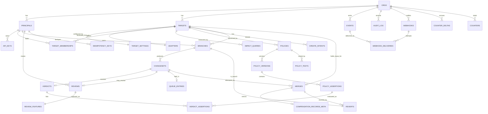

# 12 — Data model and schemas

**Status:** Draft
**Owner:** Founding team
**Last updated:** 2026-10-15

The source for every durable schema Steward owns: the control-plane metadata Postgres (Ecto migrations are generated from the DDL here), the data-plane storage layouts (overlay WAL and Parquet segments, manifest, freeze marker, compensation record, routing store, compensation index, evidence log), the JSON that crosses the plane boundary (summary, impact, events), the analytics export, retention, the tenancy rule, and the migration policy. It owns storage shapes, not API (doc 10) or SDK (doc 11) shapes. Where a component spec sketched a table, this document is authoritative for its columns; where doc 13 states an invariant a database can encode, the DDL encodes it.

## 1. Conventions

- Every control-plane table carries `org_id uuid NOT NULL` (doc 07 §8) plus `inserted_at`/`updated_at timestamptz NOT NULL`; `orgs`, `oban_jobs`, `schema_migrations` are the allow-list, and append-only tables have `inserted_at` only.
- IDs are `uuid` (v7) generated by the plane named in doc 13 §8; ordered logs (`events`, `audit_log`, `counter_deltas`) use `bigserial`.
- States and reasons are Postgres enums (§3); adding a value is an online `ALTER TYPE ... ADD VALUE`.
- FKs that could cross an org are composite on `(org_id, id)`; parents carry `UNIQUE (org_id, id)`.
- No control-plane column **may** hold a row value, a key value, statement text with literals, or a credential (doc 13 invariant 9); boundary JSONB is validated against §5 before insert.

## 2. Control-plane Postgres schema

### 2.1 Enums

```sql
CREATE TYPE principal_kind     AS ENUM ('agent','human','service');
CREATE TYPE target_kind        AS ENUM ('postgres','mysql','iceberg','snowflake','bigquery','salesforce','hubspot');
CREATE TYPE snapshot_fidelity  AS ENUM ('TRUE_SNAPSHOT','TIMESTAMP_BOUNDED');            -- doc 08
CREATE TYPE capability         AS ENUM ('reviewer','policy_admin','target_admin'); -- membership capabilities, doc 07 §8
-- api_key_scopes: API-key scopes (`resource:verb`, e.g. policy:read, policy:write, merge:revert) are NOT membership capabilities;
-- they live on api_keys.scopes text[] and the canonical list is doc 10 §3 (doc 06 §8's policy_read/policy_write map to policy:read/policy:write).
CREATE TYPE branch_state       AS ENUM ('open','proposed','merging','merged','rejected','abandoned','closed');
CREATE TYPE changeset_state    AS ENUM ('computing','evaluated','superseded');
CREATE TYPE verdict_outcome    AS ENUM ('auto-merge','hold','block');
CREATE TYPE verdict_reason     AS ENUM ('policies','policy_error','no_policy_coverage','revert_conflict'); -- doc 06 §4.3
CREATE TYPE review_decision    AS ENUM ('approved','rejected','edited');
CREATE TYPE merge_state        AS ENUM ('pending','applied','compensated','failed');
CREATE TYPE compensation_status AS ENUM ('complete','partial','consumed','expired','corrupt');  -- doc 09 §4
CREATE TYPE assertion_status   AS ENUM ('passed','failed','error');
CREATE TYPE policy_version_state AS ENUM ('draft','active','retired');
CREATE TYPE create_intent_state AS ENUM ('pending','committed','failed','superseded');          -- doc 13 §6.1
CREATE TYPE lifecycle_reason   AS ENUM (/* §3 */);
```

### 2.2 Core tables (full DDL)

Shown in reading order. Migration order is `orgs → principals → targets → policies → policy_versions → policy_assertions → branches → changesets → verdicts → reviews → merges`; the circular FKs (`branches.revert_of_merge_id`, `policies.active_version_id`) are added last.

```sql
CREATE TABLE branches (
  id                      uuid PRIMARY KEY,
  org_id                  uuid NOT NULL REFERENCES orgs(id),
  target_id               uuid NOT NULL,
  principal_id            uuid NOT NULL,
  overlay_id              uuid NOT NULL,                       -- generated by the data plane (doc 13 §8)
  base_snapshot_ref       text NOT NULL,                       -- SnapshotHandle.token (doc 08); opaque
  base_snapshot_fidelity  snapshot_fidelity NOT NULL,
  base_snapshot_at        timestamptz NOT NULL,
  state                   branch_state NOT NULL DEFAULT 'open',
  reason                  lifecycle_reason,                    -- last transition reason
  revert_of_merge_id      uuid,                                -- FK → merges(id), added last; set for revert branches (doc 13 §6.6)
  idempotency_key         text NOT NULL,
  ttl_expires_at          timestamptz,                         -- open-branch TTL (doc 13 §6.7)
  held_ttl_expires_at     timestamptz,                         -- NULL in M0 (doc 13 §12)
  proposed_at             timestamptz,
  last_heartbeat_at       timestamptz,
  heartbeat_lost          boolean NOT NULL DEFAULT false,      -- flag, not a state (doc 13 §6.8)
  merge_wait              boolean NOT NULL DEFAULT false,      -- queued behind the target lease (doc 13 §7)
  overlay_rows            bigint NOT NULL DEFAULT 0,           -- informational, from heartbeat
  overlay_bytes           bigint NOT NULL DEFAULT 0,
  evidence_gap            integer NOT NULL DEFAULT 0,
  terminal_at             timestamptz,
  terminal_by_principal_id uuid,                               -- invariant 16: a principal …
  terminal_by_job         text,                                -- … or `system` with a job name
  overlay_released_at     timestamptz,                         -- set when the data plane confirms deletion
  lock_version            integer NOT NULL DEFAULT 0,
  inserted_at             timestamptz NOT NULL DEFAULT now(),
  updated_at              timestamptz NOT NULL DEFAULT now(),
  UNIQUE (org_id, id),
  UNIQUE (overlay_id),
  UNIQUE (id, overlay_id),                                     -- heartbeat lookup is by both (doc 13 §6.8)
  UNIQUE (org_id, principal_id, idempotency_key),
  FOREIGN KEY (org_id, target_id)    REFERENCES targets(org_id, id),
  FOREIGN KEY (org_id, principal_id) REFERENCES principals(org_id, id),
  -- doc 13 invariant 16: every terminal transition carries a reason and an actor
  CONSTRAINT terminal_has_reason CHECK (
    state NOT IN ('merged','rejected','abandoned','closed')
    OR (reason IS NOT NULL AND terminal_at IS NOT NULL
        AND (terminal_by_principal_id IS NOT NULL OR terminal_by_job IS NOT NULL))),
  -- an open branch always has a TTL clock (doc 13 §2.1 create side effects)
  CONSTRAINT open_has_ttl CHECK (state <> 'open' OR ttl_expires_at IS NOT NULL),
  -- the overlay is released only in closed (doc 13 §2)
  CONSTRAINT released_only_when_closed CHECK (overlay_released_at IS NULL OR state = 'closed'),
  CONSTRAINT closed_is_released CHECK (state <> 'closed' OR overlay_released_at IS NOT NULL),
  CONSTRAINT merge_wait_only_proposed CHECK (NOT merge_wait OR state = 'proposed')
);
-- boot sweep (doc 07 §4) and every reconciliation job
CREATE INDEX branches_non_terminal ON branches (org_id, id)
  WHERE state IN ('open','proposed','merging');
-- HeartbeatLostScan (doc 07 §5.3)
CREATE INDEX branches_heartbeat_scan ON branches (last_heartbeat_at)
  WHERE state IN ('open','proposed','merging') AND NOT heartbeat_lost;
-- TTL job (doc 13 §6.7)
CREATE INDEX branches_ttl_scan ON branches (ttl_expires_at) WHERE state = 'open';
-- retention job (doc 13 §9): terminal, not yet closed
CREATE INDEX branches_retention_scan ON branches (terminal_at)
  WHERE state IN ('merged','rejected','abandoned');
CREATE INDEX branches_by_target_state ON branches (org_id, target_id, state);
CREATE INDEX branches_by_principal ON branches (org_id, principal_id, inserted_at DESC);
```

```sql
CREATE TABLE changesets (
  id                  uuid PRIMARY KEY,
  org_id              uuid NOT NULL REFERENCES orgs(id),
  branch_id           uuid NOT NULL,
  target_id           uuid NOT NULL,
  sequence            integer NOT NULL,                        -- 1, 2, … per branch
  state               changeset_state NOT NULL DEFAULT 'computing',
  superseded_by_id    uuid REFERENCES changesets(id),
  superseded_reason   lifecycle_reason,
  trigger             text NOT NULL CHECK (trigger IN ('propose','reevaluate','stale_base','revert','edit')), -- doc 13 §3
  rationale           text CHECK (octet_length(rationale) <= 4096),  -- propose-time rationale (doc 13 §6.3)
  summary             jsonb,                                   -- §5.1; NULL while computing
  impact              jsonb,                                   -- §5.2
  conflicts_count     integer NOT NULL DEFAULT 0,              -- doc 05 §5.6
  partial_keys_count  integer NOT NULL DEFAULT 0,              -- doc 09 §5.1
  reversible          boolean,                                 -- delta.reversible (doc 09 §5.1)
  row_delta_digest    bytea CHECK (octet_length(row_delta_digest) = 32),  -- SHA-256 (doc 05 §5.2)
  evidence_refs       jsonb NOT NULL DEFAULT '[]',             -- [{path, digest}], never content
  evidence_gap        integer NOT NULL DEFAULT 0,
  policy_version_set  uuid[] NOT NULL DEFAULT '{}',            -- versions sent to the engine with the compute
  compute_attempts    integer NOT NULL DEFAULT 0,
  computed_at         timestamptz,
  evaluated_at        timestamptz,
  lock_version        integer NOT NULL DEFAULT 0,
  inserted_at         timestamptz NOT NULL DEFAULT now(),
  updated_at          timestamptz NOT NULL DEFAULT now(),
  UNIQUE (org_id, id),
  UNIQUE (branch_id, sequence),
  FOREIGN KEY (org_id, branch_id) REFERENCES branches(org_id, id),
  FOREIGN KEY (org_id, target_id) REFERENCES targets(org_id, id),
  CONSTRAINT evaluated_has_layers CHECK (state <> 'evaluated' OR (summary IS NOT NULL AND impact IS NOT NULL
                                          AND row_delta_digest IS NOT NULL AND evaluated_at IS NOT NULL)),
  CONSTRAINT superseded_has_reason CHECK ((state = 'superseded') = (superseded_reason IS NOT NULL)),
  CONSTRAINT summary_bounded CHECK (summary IS NULL OR pg_column_size(summary) <= 262144),   -- 256 KiB (doc 05 §5.2)
  CONSTRAINT impact_bounded  CHECK (impact  IS NULL OR pg_column_size(impact)  <= 65536)
);
-- doc 13 invariant 2: at most one non-superseded changeset per branch
CREATE UNIQUE INDEX changesets_one_live_per_branch ON changesets (branch_id) WHERE state <> 'superseded';
-- doc 13 §6.3 failure 3: compute retry budget scan
CREATE INDEX changesets_computing ON changesets (inserted_at) WHERE state = 'computing';
```

```sql
CREATE TABLE verdicts (
  id                 uuid PRIMARY KEY,
  org_id             uuid NOT NULL REFERENCES orgs(id),
  changeset_id       uuid NOT NULL UNIQUE,                     -- doc 13 invariant 4
  outcome            verdict_outcome NOT NULL,
  reason             verdict_reason NOT NULL,
  policy_outcome     verdict_outcome NOT NULL,                 -- New: what §5.1 of doc 06 produced before the
                                                              -- coordinator's revert_conflict floor (doc 07 §5.2)
  policy_version_ids uuid[] NOT NULL DEFAULT '{}',             -- every in-scope version, fired or not
  evaluated_at       timestamptz NOT NULL DEFAULT now(),
  control_plane_ms   integer NOT NULL,
  data_plane_ms      integer NOT NULL,
  inserted_at        timestamptz NOT NULL DEFAULT now(),
  UNIQUE (org_id, id),
  FOREIGN KEY (org_id, changeset_id) REFERENCES changesets(org_id, id),
  CONSTRAINT floor_only_raises CHECK (policy_outcome = outcome OR (reason = 'revert_conflict' AND outcome = 'hold'))
);

CREATE TABLE verdict_assertions (
  verdict_id           uuid NOT NULL REFERENCES verdicts(id),
  policy_assertion_id  uuid NOT NULL REFERENCES policy_assertions(id),
  org_id               uuid NOT NULL REFERENCES orgs(id),
  status               assertion_status NOT NULL,
  count                bigint NOT NULL DEFAULT 0 CHECK (count >= 0 AND count <= 1000000),
  count_capped         boolean NOT NULL DEFAULT false,
  denominator          bigint,                                -- for max_fraction (doc 06 §4.1)
  sample_ref           text,                                  -- '<changeset_id>/<policy_id>/<assertion_id>' (doc 05 §5.4)
  error_code           text,                                  -- timeout | budget_exceeded | unknown_relation | unknown_column | bad_shape | …
  duration_ms          integer NOT NULL,
  inserted_at          timestamptz NOT NULL DEFAULT now(),
  PRIMARY KEY (verdict_id, policy_assertion_id),
  CONSTRAINT error_has_code CHECK ((status = 'error') = (error_code IS NOT NULL)),
  -- never sample_keys: the ref is a locator, keys stay in the data plane
  CONSTRAINT sample_ref_shape CHECK (sample_ref IS NULL OR sample_ref ~ '^[0-9a-f-]{36}/[a-z0-9-]+/[a-z0-9-]+$')
);
```

```sql
CREATE TABLE reviews (                                        -- append-only (§2.5)
  id                    uuid PRIMARY KEY,
  org_id                uuid NOT NULL REFERENCES orgs(id),
  changeset_id          uuid NOT NULL UNIQUE,                  -- one review per changeset (doc 02 §3)
  branch_id             uuid NOT NULL,
  target_id             uuid NOT NULL,
  reviewer_principal_id uuid NOT NULL,
  decision              review_decision NOT NULL,
  allow_retry           boolean NOT NULL DEFAULT false,        -- reject-with-retry (doc 13 §5)
  note                  text CHECK (octet_length(note) <= 4096),
  idempotency_key       text NOT NULL,
  decided_at            timestamptz NOT NULL DEFAULT now(),
  inserted_at           timestamptz NOT NULL DEFAULT now(),
  UNIQUE (org_id, reviewer_principal_id, idempotency_key),
  FOREIGN KEY (org_id, changeset_id)          REFERENCES changesets(org_id, id),
  FOREIGN KEY (org_id, branch_id)             REFERENCES branches(org_id, id),
  FOREIGN KEY (org_id, reviewer_principal_id) REFERENCES principals(org_id, id),
  CONSTRAINT retry_only_on_reject CHECK (NOT allow_retry OR decision = 'rejected'),
  CONSTRAINT edit_not_in_m0 CHECK (decision <> 'edited')      -- lift when doc 13 §12 schedules edit
);
CREATE INDEX reviews_by_target ON reviews (org_id, target_id, decided_at DESC);
```

```sql
CREATE TABLE merges (
  id                        uuid PRIMARY KEY,                 -- equals the compensation ID (doc 13 §8)
  org_id                    uuid NOT NULL REFERENCES orgs(id),
  target_id                 uuid NOT NULL,
  branch_id                 uuid NOT NULL,
  changeset_id              uuid NOT NULL,
  state                     merge_state NOT NULL DEFAULT 'pending',
  reason                    lifecycle_reason,                 -- failure reason; NULL unless failed
  progress_applied          bigint NOT NULL DEFAULT 0,        -- rows confirmed (doc 13 §6.5 step 9)
  progress_total            bigint NOT NULL DEFAULT 0,
  progress_updated_at       timestamptz,
  compensation_persisted_at timestamptz,                      -- the checkpoint, as reported by the data plane
  applied_at                timestamptz,
  compensated_at            timestamptz,
  compensated_by_branch_id  uuid REFERENCES branches(id),     -- the merged revert branch
  failed_at                 timestamptz,
  stalled_alerted_at        timestamptz,                      -- doc 13 §6.5 "stalled past budget"
  inserted_at               timestamptz NOT NULL DEFAULT now(),
  updated_at                timestamptz NOT NULL DEFAULT now(),
  UNIQUE (org_id, id),
  FOREIGN KEY (org_id, target_id)    REFERENCES targets(org_id, id),
  FOREIGN KEY (org_id, branch_id)    REFERENCES branches(org_id, id),
  FOREIGN KEY (org_id, changeset_id) REFERENCES changesets(org_id, id),
  -- doc 13 invariant 5: applied ⇒ compensation persisted; invariant 6 is enforced by the transition code,
  -- but the column makes a violation visible: a failed merge never has a persisted compensation
  CONSTRAINT applied_has_compensation CHECK (state NOT IN ('applied','compensated') OR compensation_persisted_at IS NOT NULL),
  CONSTRAINT failed_has_reason        CHECK ((state = 'failed') = (reason IS NOT NULL AND failed_at IS NOT NULL)),
  CONSTRAINT failed_before_checkpoint CHECK (state <> 'failed' OR compensation_persisted_at IS NULL),
  CONSTRAINT compensated_has_revert   CHECK (state <> 'compensated' OR (compensated_at IS NOT NULL AND compensated_by_branch_id IS NOT NULL)),
  CONSTRAINT progress_bounds          CHECK (progress_applied >= 0 AND progress_applied <= progress_total)
);
-- doc 13 invariant 11: at most one pending merge per target
CREATE UNIQUE INDEX merges_one_pending_per_target ON merges (target_id) WHERE state = 'pending';
-- a changeset has at most one merge that is not failed
CREATE UNIQUE INDEX merges_one_live_per_changeset ON merges (changeset_id) WHERE state <> 'failed';
CREATE INDEX merges_by_target_time ON merges (org_id, target_id, inserted_at DESC);
```

```sql
CREATE TABLE policies (
  id                 uuid PRIMARY KEY,
  org_id             uuid NOT NULL REFERENCES orgs(id),
  target_id          uuid NOT NULL,
  slug               text NOT NULL CHECK (slug ~ '^[a-z0-9][a-z0-9-]{0,63}$'),
  active_version_id  uuid,                                    -- FK added after policy_versions exists
  derived_from_id    uuid REFERENCES policies(id),            -- doc 06 §12 (copy-and-own libraries)
  created_by         uuid NOT NULL,
  archived_at        timestamptz,
  inserted_at        timestamptz NOT NULL DEFAULT now(),
  updated_at         timestamptz NOT NULL DEFAULT now(),
  UNIQUE (org_id, id),
  UNIQUE (org_id, target_id, slug),
  FOREIGN KEY (org_id, target_id)  REFERENCES targets(org_id, id),
  FOREIGN KEY (org_id, created_by) REFERENCES principals(org_id, id)
);

CREATE TABLE policy_versions (                                -- immutable except state and the lifecycle timestamps
  id                    uuid PRIMARY KEY,
  org_id                uuid NOT NULL REFERENCES orgs(id),
  policy_id             uuid NOT NULL REFERENCES policies(id),
  version               integer NOT NULL CHECK (version >= 1),
  state                 policy_version_state NOT NULL DEFAULT 'draft',
  yaml                  text NOT NULL CHECK (octet_length(yaml) <= 262144),
  name                  text NOT NULL,
  scope                 jsonb NOT NULL,                       -- parsed envelope: tables, columns, principals, time_windows
  outcome               verdict_outcome NOT NULL CHECK (outcome IN ('hold','block')),  -- doc 06 §4.1
  referenced_relations  text[] NOT NULL DEFAULT '{}',         -- from validate (doc 06 §5.4)
  static_check_passed_at timestamptz,
  tests_passed_at       timestamptz,
  saved_by              uuid NOT NULL,
  activated_by          uuid,
  activated_at          timestamptz,
  retired_at            timestamptz,
  inserted_at           timestamptz NOT NULL DEFAULT now(),
  updated_at            timestamptz NOT NULL DEFAULT now(),
  UNIQUE (org_id, id),
  UNIQUE (policy_id, version),
  CONSTRAINT active_was_checked CHECK (state = 'draft' OR (static_check_passed_at IS NOT NULL AND tests_passed_at IS NOT NULL
                                                           AND activated_by IS NOT NULL AND activated_at IS NOT NULL)),
  CONSTRAINT retired_has_time   CHECK ((state = 'retired') = (retired_at IS NOT NULL))
);
-- doc 06 §5.2: at most one active version per policy
CREATE UNIQUE INDEX policy_versions_one_active ON policy_versions (policy_id) WHERE state = 'active';
ALTER TABLE policies ADD FOREIGN KEY (active_version_id) REFERENCES policy_versions(id);

CREATE TABLE policy_assertions (                              -- doc 06 §4.3 name; the brief's "assertions"
  id                 uuid PRIMARY KEY,
  org_id             uuid NOT NULL REFERENCES orgs(id),
  policy_version_id  uuid NOT NULL REFERENCES policy_versions(id),
  assertion_id       text NOT NULL CHECK (assertion_id ~ '^[a-z0-9][a-z0-9-]{0,63}$'),
  description        text,
  sql                text NOT NULL CHECK (octet_length(sql) <= 65536),
  expect             jsonb NOT NULL,                          -- {"zero_rows":true} | {"max_rows":N} | {"max_fraction":F} | {"true":true}
  position           integer NOT NULL,
  inserted_at        timestamptz NOT NULL DEFAULT now(),
  UNIQUE (policy_version_id, assertion_id),
  UNIQUE (policy_version_id, position)
);
```

### 2.3 Remaining tables (compact)

Every table also has `org_id`, `inserted_at`, `updated_at`, `UNIQUE (org_id, id)` unless noted.

| Table | Columns | Keys, indexes, checks |
|---|---|---|
| `orgs` | `id uuid`, `slug text`, `name text`, `archived_at timestamptz` | PK `id`; `UNIQUE slug`. No `org_id`. |
| `principals` | `id`, `kind principal_kind`, `slug text`, `display_name text`, `org_admin bool`, `email text` (humans), `sso_subject text` (humans), `disabled_at` | `UNIQUE (org_id, kind, slug)`; the policy-scope form `agent:pricing-bot` is `kind || ':' || slug` (doc 06 §4.2) |
| `api_keys` | `id`, `principal_id`, `prefix text` (the `stw_<prefix>` part), `secret_sha256 bytea(32)`, `scopes text[]` (API-key scopes, doc 10 §3 `resource:verb` list), `target_ids uuid[]`, `last_used_at`, `expires_at`, `revoked_at` | `UNIQUE prefix`; secret never stored (doc 07 §8); pushed to data planes via `RoutingUpsert` (doc 04 §8) |
| `targets` | `id`, `slug`, `name`, `kind target_kind`, `credential_ref text` (URI, doc 08 §5.5), `data_plane_id text`, `merging_merge_id uuid`, `lease_expires_at`, `last_merge_id uuid`, `created_by`, `archived_at` | `UNIQUE (org_id, slug)`; `CHECK ((merging_merge_id IS NULL) = (lease_expires_at IS NULL))`; `INDEX (lease_expires_at) WHERE merging_merge_id IS NOT NULL` for `ExpiredLeaseScan`. **Decision:** the lease is columns on `targets` as doc 07 §5.4's `UPDATE` requires; no `merge_leases` table |
| `target_settings` | `target_id` (PK, 1:1), `branch_ttl interval DEFAULT '24 hours'`, `held_ttl interval` (NULL = none), `overlay_retention interval DEFAULT '7 days'`, `compensation_retention interval DEFAULT '90 days'`, `revert_window interval DEFAULT '90 days'`, `uncovered_changeset_verdict verdict_outcome DEFAULT 'hold'` (doc 06 §5.1), `summary_values_allowed jsonb DEFAULT '{}'` (`{table: [column]}`, doc 05 §5.2), `assertion_budget_s int DEFAULT 60`, `assertion_timeout_s int DEFAULT 20`, `impact_timeout_s int DEFAULT 30`, `heartbeat_lost_after interval DEFAULT '5 minutes'`, `merge_lease interval DEFAULT '5 minutes'`, `merge_stall_budget interval DEFAULT '1 hour'`, `separate_approval bool DEFAULT true` | `CHECK (compensation_retention >= revert_window)` (doc 13 §9: compensation is never GC'd while revertable); `CHECK (uncovered_changeset_verdict IN ('hold','auto-merge'))` |
| `target_memberships` | `target_id`, `principal_id`, `capability capability`, `granted_by` | PK `(org_id, target_id, principal_id, capability)`. `CHECK` via trigger: a principal of kind `agent` may not hold `policy_admin` (doc 06 §8); the matching rule for the `policy:write` scope is on `api_keys.scopes` |
| `adapters` | `id`, `target_id` (UNIQUE: doc 02 one adapter per target), `kind target_kind`, `version text`, `capabilities jsonb` (the `Capabilities` record of doc 08 §3.1), `catalog jsonb` (`TargetDescription`: tables, columns, types, PKs, `beforeImagesCheap`, last-modified marker; schema metadata, never rows), `catalog_digest bytea(32)`, `described_at` | `CHECK (pg_column_size(catalog) <= 4194304)` |
| `impact_queries` | `id`, `target_id`, `name text` (slug), `sql text`, `timeout_s int DEFAULT 30`, `enabled bool`, `created_by` | `UNIQUE (target_id, name)`; metrics are named `<name>.<column>` (doc 05 §5.3) |
| `create_intents` | `id uuid` (the candidate branch ID), `target_id`, `principal_id`, `idempotency_key`, `state create_intent_state`, `branch_id uuid` (set on commit) | `UNIQUE (org_id, principal_id, idempotency_key)`; `INDEX (inserted_at) WHERE state = 'pending'` for orphan reporting. `updated_at` only; doc 13 §6.1 |
| `reverts` | `id`, `target_id`, `merge_id` (the merge being reverted), `revert_branch_id` (UNIQUE), `requested_by`, `outcome text` NULL \| `merged` \| `rejected` \| `abandoned` | partial `UNIQUE (merge_id) WHERE outcome IS NULL` (one in-flight revert); partial `UNIQUE (merge_id) WHERE outcome = 'merged'` (doc 02 §3, doc 13 invariant 14) |
| `compensation_records_meta` | `merge_id` (PK, FK `merges`), `target_id`, `branch_id`, `status compensation_status`, `reserved_by_branch_id uuid`, `consumed_by_branch_id uuid`, `retention_until timestamptz`, `legal_hold bool DEFAULT false`, `row_count bigint`, `bytes bigint`, `partial_keys_count int`, `header_sha256 bytea(32)`, `persisted_at`, `body_deleted_at`, `last_reported_at` | Metadata mirror of the doc 09 index, written from heartbeat `compensation_status`; **never** segments, keys, or images. `INDEX (target_id, status)`. `retention_until` is computed here from `target_settings` (doc 09 §5.5) and delivered downward |
| `policy_tests` | `id`, `policy_id`, `name`, `fixture jsonb` (synthetic rows: tables, rows, principal, proposed_at; doc 18 §7), `expected_outcome verdict_outcome`, `expected_fired text[]`, `expected_counts jsonb`, `last_run_version_id`, `last_result text`, `last_run_at` | `UNIQUE (policy_id, name)`; `CHECK (pg_column_size(fixture) <= 1048576)` |
| `review_features` | `review_id` (PK), `changeset_id`, `target_id`, `decision review_decision`, `allow_retry bool`, `reviewer_principal_id`, `branch_principal_id`, `branch_principal_kind principal_kind`, `tables text[]`, `columns text[]`, `row_counts jsonb`, `summary_stats jsonb`, `impact jsonb`, `fired_assertion_ids uuid[]`, `verdict_reason verdict_reason`, `conflicts_count int`, `reversible bool`, `proposed_dow smallint`, `proposed_hour smallint`, `held_seconds int`, `decided_at` | doc 06 §4.3; `inserted_at` only. `INDEX (target_id, decided_at)` |
| `queue_entries` | `target_id`, `changeset_id` (UNIQUE), `branch_id`, `principal_id`, `hold_reasons jsonb` (`[{policy_id, assertion_id, count}]` or `[{reason}]`), `entered_at`, `priority int DEFAULT 0` | PK `id`; keyset index `(org_id, target_id, entered_at, id)` (doc 07 §5.6). Read model, rebuildable |
| `counter_deltas` | `id bigserial`, `key text`, `scope jsonb`, `delta bigint` | `inserted_at` only; no `updated_at`; drained by `CounterDrain` (doc 07 §5.8) |
| `counters` | `key text`, `scope jsonb`, `value bigint` | PK `(org_id, key, scope)`; `updated_at` only |
| `events` | see §6 | append-only, partitioned |
| `audit_log` | `id bigserial`, `principal_id` (NULL for data-plane-reported), `action text` (§2.5), `object_type text`, `object_id uuid`, `grant_id uuid`, `data_plane_id text`, `details jsonb` (bounded 4 KiB, no row data), `occurred_at` | append-only; `inserted_at` only; `INDEX (org_id, occurred_at DESC)`, `INDEX (object_type, object_id)` |
| `webhooks` | `id`, `target_id` (NULL = org-wide), `url text`, `secret_ciphertext bytea` (Cloak-encrypted; used for HMAC signing), `event_types text[]`, `enabled bool`, `created_by` | New: doc 07 §5.7's `NotifyPrincipal` needs a destination. `CHECK (url ~ '^https://')` |
| `webhook_deliveries` | `id bigserial`, `webhook_id`, `event_id bigint`, `attempt int`, `status text` (`pending|delivered|failed|dead`), `response_code int`, `next_attempt_at`, `delivered_at` | `UNIQUE (webhook_id, event_id, attempt)`; `INDEX (next_attempt_at) WHERE status = 'pending'`; 7-day retention |
| `idempotency_keys` | `principal_id`, `key text`, `request_sha256 bytea(32)`, `response_status int`, `response_body jsonb` (≤ 64 KiB), `expires_at` | PK `(org_id, principal_id, key)`; `INDEX (expires_at)`; 24 h (doc 13 §8). Different `request_sha256` on repeat is `idempotency_conflict` |

### 2.4 Standard triggers

- `set_updated_at()` BEFORE UPDATE wherever `updated_at` exists. `lock_version` is **not** trigger-bumped: it is incremented in the conditional `UPDATE ... WHERE lock_version = ?` so a zero-row update is `stale_transition` (doc 07 §5).
- `validate_boundary_json()` BEFORE INSERT OR UPDATE on `changesets.summary/impact`, `events.payload`, `review_features`, `queue_entries.hold_reasons`, `audit_log.details`: rejects any object containing a key in `('rows','row','sample_keys','before_image','after_image','values','key','keys')` at any depth. Defence in depth behind the Ecto embedded-schema check (doc 07 §8).

### 2.5 Append-only tables

`events`, `audit_log`, `reviews`, `verdicts`, `verdict_assertions`, `review_features`, `counter_deltas` (delete-only by the drain). Enforced two ways per doc 07 §8:

```sql
REVOKE UPDATE, DELETE ON events, audit_log, reviews, verdicts, verdict_assertions, review_features FROM steward_app;
GRANT INSERT, SELECT ON events, audit_log, reviews, verdicts, verdict_assertions, review_features TO steward_app;
CREATE FUNCTION raise_immutable() RETURNS trigger LANGUAGE plpgsql AS
  $$ BEGIN RAISE EXCEPTION 'table % is append-only', TG_TABLE_NAME; END $$;
CREATE TRIGGER events_immutable BEFORE UPDATE OR DELETE ON events FOR EACH ROW EXECUTE FUNCTION raise_immutable();
-- same trigger on each table above
```

Partition drops run as the owning `steward_migrator` role. `audit_log.action` values in M0: `grant.issued`, `row_delta.read`, `compensation.opened`, `compensation.read`, `compensation.exported`, `compensation.verified`, `api_key.created`, `api_key.revoked`, `membership.granted`, `membership.revoked`, `target_settings.changed`, `legal_hold.set`, `legal_hold.cleared`, `policy.activated`, `policy.retired`. **Decision:** `grant.issued` (doc 07 §5.6) is an `audit_log` row, not an event; it is an access record with no consumer.

## 3. Lifecycle reasons

One enum, `lifecycle_reason`, used by `branches.reason`, `changesets.superseded_reason`, `merges.reason`, and event payloads; `contracts/reasons.yaml` is generated from it. Values marked New exist because doc 13 invariant 16 requires a reason on every terminal transition and the specs name only the failure ones.

| Reason | Source | Where it appears |
|---|---|---|
| `snapshot_lost` | doc 13 §2.1, doc 08 | branch → `abandoned` from any non-terminal state; merge `failed` |
| `stale_base` | doc 13 §2.1, §6.5 | merge `failed`; branch `merging → proposed`; changeset superseded (new changeset with conflicts) |
| `ttl_expired` | doc 13 §6.7 | branch → `abandoned` |
| `heartbeat_lost` | doc 13 §6.8 (a flag, not a state) | `branch.heartbeat_lost` event only; never a branch `reason` |
| `policy_error` | doc 13 §6.3 f5, doc 06 | verdict reason (own enum); also `changeset.evaluated` payload |
| `no_policy_coverage` | doc 06 §5.1 | verdict reason |
| `revert_conflict` | doc 13 §6.6, doc 07 §5.2 | verdict reason |
| `reject_with_retry` | doc 13 §2, §5 | branch `proposed → open`; changeset superseded |
| `compute_failed` | doc 13 §6.3 f3 | changeset superseded; branch `proposed → open` |
| `data_plane_unreachable` | doc 13 §6.5 f3 | merge `failed`; branch `merging → proposed` |
| `compensation_failed` | doc 13 §6.5 f5–6, doc 09 §6 | merge `failed`; branch `merging → proposed` |
| `adapter_unavailable` | doc 13 §2.1 ("adapter unreachable past retry budget"), doc 05 §5.2 typed error | merge `failed` |
| `withdrawn` | doc 13 §2.1 ("owning principal withdraws") | branch `proposed → open`; changeset superseded. New spelling only |
| `reevaluated` | doc 06 §5.3 | changeset superseded by a policy-change re-evaluation. New: doc 06 describes the transition without naming it |
| `new_changeset` | doc 13 §3 ("a newer changeset exists") | changeset superseded on re-propose. New name |
| `verdict_block` | doc 13 §4; error code in doc 07 §5.5 | branch → `rejected` |
| `review_rejected` | doc 13 §5 | branch → `rejected`. New name |
| `review_approved` | doc 13 §5 | branch → `merging`. New name |
| `verdict_auto_merge` | doc 13 §4 | branch → `merging`. New name |
| `abandoned_by_principal` | doc 13 §6.7 | branch → `abandoned`. New name |
| `merge_applied` | doc 13 §2.1 | branch → `merged`. New name |
| `retention_elapsed` | doc 13 §2.1, §9 | branch → `closed`. New name |

CI regenerates `contracts/reasons.yaml` (`mix steward.reasons.export`) and fails on drift; proto enums in `contracts/` use the same identifiers.

## 4. Merge state ↔ compensation record status

`merges.state` is truth for the merge (control plane); record status is truth for the record (doc 09 index, mirrored in `compensation_records_meta.status`). They agree after one heartbeat.

| `merges.state` | Allowed record status | Transition that moves the merge | Transition that moves the record |
|---|---|---|---|
| `pending`, before checkpoint | none (no header exists) | `Persist` returns → `compensation_persisted_at` set, still `pending` | `[*] → complete \| partial` on `Persist` (doc 09 §5.2) |
| `pending`, after checkpoint | `complete`, `partial` | data plane reports `applied` → `applied` | — |
| `applied` | `complete`, `partial` (reservation may be set while a revert is in flight) | revert branch reaches `merged` → `compensated` | `Open` sets reservation; `Release(rejected\|abandoned)` clears it |
| `compensated` | `consumed` | terminal | `Release(merged)` → `consumed` |
| `applied` or `compensated`, body GC'd | `expired` | no merge change; `compensation_records_meta.body_deleted_at` set; revert refused | GC rules of doc 09 §5.5 |
| `applied` or `compensated`, integrity failure | `corrupt` | no merge change; alert; revert refused | `Verify` fails |
| `failed` | none, or an orphan header (`merge_applied = 0`) | terminal | orphan GC'd after 7 days (doc 13 §9) |

`merges.state = 'compensated'` ⇔ `status = 'consumed'` is checked by a weekly drift job (the rows arrive on different heartbeats); `failed` never has `compensation_persisted_at` (CHECK, §2.2).

## 5. Boundary JSON schemas

### 5.1 Changeset summary (`changesets.summary`)

Produced by doc 05 §5.2; the only changeset content the control plane stores. Hard cap 256 KiB; the engine truncates per doc 05 and sets `truncated`.

```json
{ "$id": "steward:changeset-summary/1", "type": "object", "additionalProperties": false,
  "required": ["format_version","tables","columns","truncated","reversible","conflicts_count","partial_keys_count"],
  "properties": {
    "format_version": {"const": 1},
    "truncated": {"type": "boolean"},
    "reversible": {"type": "boolean"},
    "conflicts_count": {"type": "integer", "minimum": 0},
    "conflicts_ref": {"type": "string", "maxLength": 256},
    "partial_keys_count": {"type": "integer", "minimum": 0},
    "staleness_check": {"enum": ["values","values_only","timestamp_and_values"]},
    "touches_revertable_merges": {"type": "array", "maxItems": 100, "items": {"type": "string", "format": "uuid"}},
    "tables": {"type": "array", "maxItems": 1000, "items": {"type": "object", "additionalProperties": false,
      "required": ["table_name","inserts","updates","deletes","noop_updates","invalid_before_images"],
      "properties": {"table_name": {"type":"string","maxLength":256},
        "inserts": {"type":"integer","minimum":0}, "updates": {"type":"integer","minimum":0},
        "deletes": {"type":"integer","minimum":0}, "noop_updates": {"type":"integer","minimum":0},
        "invalid_before_images": {"type":"integer","minimum":0}}}},
    "columns": {"type": "array", "maxItems": 5000, "items": {"type": "object", "additionalProperties": false,
      "required": ["table_name","column_name","changed_count"],
      "properties": {"table_name": {"type":"string","maxLength":256}, "column_name": {"type":"string","maxLength":256},
        "changed_count": {"type":"integer","minimum":0}, "null_delta": {"type":"integer"},
        "numeric_delta_min": {"type":["number","null"]}, "numeric_delta_max": {"type":["number","null"]},
        "numeric_delta_median": {"type":["number","null"]}, "numeric_pct_median": {"type":["number","null"]},
        "distinct_before": {"type":"integer","minimum":0}, "distinct_after": {"type":"integer","minimum":0},
        "distinct_values": {"type":"array", "maxItems": 50, "items": {"type":"object","additionalProperties":false,
          "required": ["value","count_before","count_after"],
          "properties": {"value": {"type":["string","number","boolean","null"], "maxLength": 256},
            "count_before": {"type":"integer"}, "count_after": {"type":"integer"}}}}}}}
  }}
```

`distinct_values` **must** be absent unless `(table_name, column_name)` is in `target_settings.summary_values_allowed` (doc 05 §5.2); the engine enforces it and Ecto rejects it otherwise. Keys, images, and `conflicts.t` rows never appear; `conflicts_ref` is a grant-served locator.

### 5.2 Impact (`changesets.impact`)

```json
{ "$id": "steward:changeset-impact/1", "type": "object", "additionalProperties": false,
  "required": ["format_version","metrics"],
  "properties": {"format_version": {"const": 1},
    "metrics": {"type": "array", "maxItems": 500, "items": {"type": "object", "additionalProperties": false,
      "required": ["name"], "properties": {
        "name": {"type": "string", "pattern": "^[a-z0-9_-]+\\.[a-z0-9_]+$", "maxLength": 128},
        "value": {"type": ["number","boolean","null"]},
        "error": {"type": ["string","null"], "maxLength": 512}}}}}}
```

Cap 64 KiB. `value` is numeric, boolean, or null by construction (doc 05 §5.3), so no row value can ride in a metric; `error` is scrubbed of literals before it crosses.

## 6. Domain events

```sql
CREATE TABLE events (
  id              bigserial,
  org_id          uuid NOT NULL,
  type            text NOT NULL,                              -- §6.1
  aggregate_type  text NOT NULL CHECK (aggregate_type IN ('branch','changeset','review','merge','policy','target','heartbeat')),
  aggregate_id    uuid NOT NULL,
  actor_principal_id uuid,                                    -- New: NULL for system jobs; the job name is in payload.actor
  payload         jsonb NOT NULL CHECK (pg_column_size(payload) <= 8192),
  occurred_at     timestamptz NOT NULL,
  inserted_at     timestamptz NOT NULL DEFAULT now(),
  PRIMARY KEY (id, occurred_at)
) PARTITION BY RANGE (occurred_at);                           -- monthly partitions, created 2 months ahead by a cron migration
CREATE INDEX events_by_aggregate ON events (aggregate_type, aggregate_id, id);
CREATE INDEX events_by_org_time  ON events (org_id, occurred_at DESC);
CREATE INDEX events_export_cursor ON events (id);               -- AnalyticsExport cursor (doc 07 §5.7)
```

### 6.1 Event types and payloads

Every payload extends one envelope; per-type schemas under `contracts/events/` set `additionalProperties: false`. No payload may contain row data (§2.4).

```json
{ "$id": "steward:event-envelope/1", "type": "object",
  "required": ["schema_version","target_id","actor","reason"],
  "properties": {
    "schema_version": {"const": 1},
    "target_id": {"type":"string","format":"uuid"},
    "actor": {"oneOf": [{"type":"string","pattern":"^(agent|human|service):[a-z0-9-]+$"},
                        {"type":"string","pattern":"^system:[A-Za-z.]+$"}]},
    "reason": {"type":["string","null"], "$comment": "a lifecycle_reason or verdict_reason value, or null"}}}
```

| Type | Aggregate | Extra payload fields (all bounded scalars or ID arrays) |
|---|---|---|
| `branch.created` | branch | `principal_id`, `overlay_id`, `base_snapshot_fidelity`, `revert_of_merge_id?`, `ttl_expires_at` |
| `branch.proposed` | branch | `changeset_id`, `sequence` |
| `branch.withdrawn` | branch | `changeset_id` (superseded) |
| `branch.merging` | branch | `merge_id`, `changeset_id`, `via` ∈ {`verdict_auto_merge`,`review_approved`} |
| `branch.merged` | branch | `merge_id` |
| `branch.rejected` | branch | `changeset_id`, `review_id?` |
| `branch.abandoned` | branch | `from_state`, `reason` ∈ {`abandoned_by_principal`,`ttl_expired`,`snapshot_lost`} |
| `branch.closed` | branch | `overlay_released_at` |
| `branch.returned_to_open` | branch | `reason` ∈ {`withdrawn`,`reject_with_retry`,`stale_base`,`compute_failed`,`data_plane_unreachable`,`compensation_failed`}. New: doc 13 §2.1 has the transition without a name |
| `branch.heartbeat_lost` | branch | `last_heartbeat_at`, `state` (doc 07 §5.3) |
| `changeset.computing` | changeset | `branch_id`, `sequence`, `trigger`, `superseded_changeset_id?` |
| `changeset.evaluated` | changeset | `verdict_id`, `outcome`, `reason`, `fired_assertion_ids[]`, `policy_version_ids[]`, `conflicts_count`, `reversible` |
| `changeset.superseded` | changeset | `superseded_by_id?`, `reason` |
| `review.recorded` | review | `changeset_id`, `decision`, `allow_retry`, `reviewer_principal_id` (no note text) |
| `merge.started` | merge | `changeset_id`, `branch_id`, `lease_expires_at` |
| `merge.checkpointed` | merge | `compensation_status` ∈ {`complete`,`partial`}, `row_count`. New: the checkpoint is the most important moment in doc 13 and deserves its own event |
| `merge.applied` | merge | `rows_applied`, `duration_ms` |
| `merge.failed` | merge | `reason`, `before_checkpoint: true` |
| `merge.stalled` | merge | `progress_applied`, `progress_total`, `stalled_for_s`. New: doc 13 §6.5 "raises an alert for a human" |
| `merge.compensated` | merge | `revert_branch_id`, `revert_merge_id` |
| `policy.saved` | policy | `policy_version_id`, `version`, `tests_passed` |
| `policy.activated` | policy | `policy_version_id`, `retired_version_id?` |
| `policy.retired` | policy | `policy_version_id` |
| `target.lease_expired` | target | `merge_id`, `expired_at` (doc 07 §5.4) |
| `target.lease_released` | target | `merge_id`, `waiting_branch_ids[]` (the `LeaseReleased` consumer of doc 07 §5.4) |
| `heartbeat.anomaly` | heartbeat (`aggregate_id` = branch) | `believed`, `authoritative`, `merge_progress?` (doc 07 §5.3 "alert" cells) |

Consumers are Oban jobs inserted in the same transaction, idempotent on `event_id` (doc 07 §5.7). Partitions are dropped 90 days after the `AnalyticsExport` cursor passes them (doc 07 §6).

## 7. Analytics export schema

The destination (ClickHouse vs Parquet on S3) stays open (doc 03 §11). Three store-neutral fact tables are written by `AnalyticsExport` from `events` plus the truth tables, one Parquet file per `(org_id, day)` or one ClickHouse batch. No fact carries a key, a value, or a note.

| Fact | Grain | Columns |
|---|---|---|
| `changeset_facts` | one per `evaluated` changeset | `org_id uuid`, `target_id uuid`, `target_kind utf8`, `changeset_id uuid`, `branch_id uuid`, `sequence int32`, `trigger utf8`, `branch_principal_id uuid`, `branch_principal_kind utf8`, `is_revert bool`, `proposed_at ts(us,UTC)`, `evaluated_at ts`, `compute_ms int32`, `control_plane_ms int32`, `data_plane_ms int32`, `tables list<utf8>`, `columns list<utf8>`, `inserts int64`, `updates int64`, `deletes int64`, `noop_updates int64`, `conflicts_count int32`, `reversible bool`, `evidence_gap int32`, `verdict_outcome utf8`, `verdict_reason utf8`, `policy_version_ids list<uuid>`, `fired_assertion_ids list<uuid>`, `impact map<utf8,double>`, `summary_stats_json utf8` (the per-column aggregates, ≤ 64 KiB), `proposed_dow int8`, `proposed_hour int8`, `superseded bool`, `superseded_reason utf8` |
| `review_facts` | one per review | `org_id`, `target_id`, `review_id`, `changeset_id`, `branch_id`, `reviewer_principal_id`, `branch_principal_id`, `decision utf8`, `allow_retry bool`, `entered_queue_at ts`, `decided_at ts`, `held_seconds int64`, `fired_assertion_ids list<uuid>`, `verdict_reason utf8`, `billable bool` (= human-reviewed, doc 01 §7), `billing_month utf8` |
| `merge_facts` | one per merge row (including failed) | `org_id`, `target_id`, `target_kind`, `merge_id`, `changeset_id`, `branch_id`, `state utf8`, `reason utf8`, `started_at ts`, `checkpointed_at ts`, `applied_at ts`, `failed_at ts`, `compensated_at ts`, `rows_total int64`, `rows_applied int64`, `compensation_status utf8`, `compensation_bytes int64`, `lease_wait_ms int64`, `stalled bool` |

Partitioned by `org_id` and day. Files are immutable; a correction is a new row with a later `exported_at`, and readers take the latest per id. The billing meter remains the `reviewed_changesets{org, month}` counter (doc 07 §5.8); `review_facts.billable` reconciles it.

## 8. Data-plane storage layouts

### 8.1 Object-store path layout

```
steward/targets/<target_id>/
  overlays/<overlay_id>/manifest.json
  overlays/<overlay_id>/freeze.json                                   # written by the proxy at freeze
  overlays/<overlay_id>/tables/<table>/segments/seg-<first_seq>-<last_seq>.parquet
  overlays/<overlay_id>/tables/<table>/segments/compact-<last_seq>.parquet
  overlays/<overlay_id>/blobs/<sha256>                                # large values, if doc 05 §12 is accepted
  compensation/<merge_id>/body/<table>-<seq>.parquet
  compensation/<merge_id>/body/partial-keys.parquet
  compensation/<merge_id>/header.json                                 # written last; existence = valid
  compensation/_exports/<export_id>/...                               # doc 09 §5.6
```

Doc 05 writes `steward/targets/...`, doc 09 `targets/...`; **Decision:** one prefix `steward/` so doc 14 grants and encrypts one prefix.

### 8.2 Overlay WAL record format (`steward-overlay` crate)

New: doc 05 §4.1 gives the crate ownership of the format without defining it. Little-endian, one file per branch at `<data_dir>/wal/<overlay_id>.wal`, truncated only after segment PUT and manifest update succeed.

```
file header:  magic "SWOL" | u16 version = 1 | u16 reserved | u128 overlay_id
record:       u32 length (of everything after this field) | u32 crc32c (of kind..payload)
              | u8 kind | u64 seq | i64 ts_us | payload
kind 0x01 BATCH    payload = Arrow IPC stream, schema = §8.3 segment schema, one record batch;
                   all rows share `seq` (one COMMIT = one batch = one seq, doc 04 §5.3)
kind 0x02 FREEZE   payload = {} ; `seq` = last_seq included in the changeset
kind 0x03 UNFREEZE payload = {} ; ops between FREEZE and UNFREEZE are excluded (doc 04 §5.4)
kind 0x04 ROLLED   payload = u64 through_seq ; marks records ≤ through_seq as durable in object storage
```

A failed `crc32c` ends the readable prefix; the crate truncates there on open, and nothing beyond it was ever acknowledged (doc 13 §6.2 f2).

### 8.3 Overlay Parquet segment schema

Exactly doc 05 §4.1. The compensation body (doc 09 §5.1) uses **this** schema with the same column names.

| Column | Type | Notes |
|---|---|---|
| `seq` | INT64 required | overlay-wide sequence; idempotency key of the write |
| `op` | UTF8 dictionary required | `insert` \| `update` \| `delete` |
| `key` | STRUCT(<pk columns>) required | canonical key |
| `key_hash` | FIXED_LEN_BYTE_ARRAY(16) required | xxh3-128 of canonical key encoding |
| `before` | STRUCT(<all columns>) nullable | null for insert; null when unavailable (partial) |
| `after` | STRUCT(<all columns>) nullable | null for delete |
| `touched` | LIST<UTF8> required | columns assigned; all columns for insert/delete |
| `ts` | TIMESTAMP(MICROS, UTC) required | proxy clock at append |
| `stmt_id` | UTF8 required | evidence correlation id (`<connection_id>:<evidence seq>`); never text |

Writer: zstd-3, 65,536-row groups, statistics on `seq`, `key_hash`, `ts`, bloom on `key_hash`. Compensation bodies additionally sort by `(table, key)`, cut at 64 MiB uncompressed, and pin the writer version so retries are byte-identical (doc 09 §5.2).

### 8.4 Manifest and freeze marker

```json
// manifest.json  (conditional PUT; readers reject a newer major)
{ "version": "1.0", "overlay_id": "…", "branch_id": "…", "target_id": "…",
  "base_snapshot_ref": "…", "base_snapshot_fidelity": "TRUE_SNAPSHOT", "created_at": "…",
  "revert_of": null, "compensation_checksum": null,              // set for revert overlays (doc 09 §5.3)
  "tables": { "<table>": { "schema_fingerprint": "sha256:…", "compacted_through_seq": 0,
      "segments": [ { "path": "…", "first_seq": 1, "last_seq": 9999, "rows": 9999, "bytes": 1234 } ] } } }
// freeze.json  (written once by the proxy; doc 05 §4)
{ "frozen_at": "…", "last_seq": 12345, "proxy_instance": "proxy-0", "unfreeze_markers": [] }
```

### 8.5 Compensation record header

Exactly doc 09 §4 with `format_version: 1`; hashes are hex SHA-256; `prev_hash` chains per target. Headers are permanent, bodies expire (doc 09 §5.5).

### 8.6 Routing store (SQLite, WAL mode; doc 04 §4)

```sql
CREATE TABLE routing (
  branch_id          TEXT NOT NULL, overlay_id TEXT NOT NULL,
  target_id          TEXT NOT NULL, principal_id TEXT NOT NULL,
  base_snapshot_ref  TEXT NOT NULL, overlay_path TEXT NOT NULL, credential_ref TEXT NOT NULL,
  believed_state     TEXT NOT NULL CHECK (believed_state IN ('open','proposed','merging','done','dead')),
  frozen             INTEGER NOT NULL DEFAULT 0,
  terminal_reason    TEXT,                                       -- so a late connect gets the per-state terminal code (SD003/SD00A/SD00B/SD00C, doc 10 §4)
  policy_version_ids TEXT NOT NULL DEFAULT '[]',                 -- JSON array
  touched_tables     TEXT NOT NULL DEFAULT '[]',                 -- JSON array (doc 04 §4)
  updated_at INTEGER NOT NULL, last_heartbeat_reply_at INTEGER,
  PRIMARY KEY (branch_id, overlay_id)
) WITHOUT ROWID;
CREATE UNIQUE INDEX routing_branch ON routing (branch_id);        -- one live overlay per branch
CREATE TABLE api_keys (
  key_hash BLOB PRIMARY KEY,                                      -- SHA-256(salt || secret), per-deployment salt
  prefix TEXT NOT NULL, principal_id TEXT NOT NULL,
  target_ids TEXT NOT NULL DEFAULT '[]', revoked INTEGER NOT NULL DEFAULT 0, updated_at INTEGER NOT NULL);
CREATE TABLE meta (k TEXT PRIMARY KEY, v TEXT NOT NULL);         -- schema_version, salt_id, data_plane_id
```

### 8.7 Compensation index (SQLite, separate file `compensation.db`; doc 09 §4)

```sql
CREATE TABLE records (
  merge_id TEXT PRIMARY KEY, target_id TEXT NOT NULL, branch_id TEXT NOT NULL, changeset_id TEXT NOT NULL,
  object_prefix TEXT NOT NULL,
  status TEXT NOT NULL CHECK (status IN ('complete','partial','consumed','expired','corrupt')),
  consumed_by_revert_id TEXT,                                     -- reservation while complete|partial; the consumer when consumed
  merge_applied INTEGER CHECK (merge_applied IN (0,1)),           -- NULL = not yet told
  branch_closed INTEGER NOT NULL DEFAULT 0,
  retention_until INTEGER, legal_hold INTEGER NOT NULL DEFAULT 0,
  header_hash BLOB NOT NULL, prev_hash BLOB, row_count INTEGER NOT NULL, bytes INTEGER NOT NULL,
  persisted_at INTEGER NOT NULL, last_verified_at INTEGER, body_deleted_at INTEGER
) WITHOUT ROWID;
CREATE INDEX records_gc ON records (retention_until) WHERE status IN ('complete','partial','consumed') AND consumed_by_revert_id IS NULL;
CREATE INDEX records_expired_pending_delete ON records (merge_id) WHERE status = 'expired' AND body_deleted_at IS NULL;
CREATE INDEX records_by_target ON records (target_id, persisted_at);
CREATE TABLE chain_heads (target_id TEXT PRIMARY KEY, last_header_hash BLOB NOT NULL, last_merge_id TEXT NOT NULL, updated_at INTEGER NOT NULL);
CREATE TABLE access_log (                                        -- doc 09 §8; reported upward as audit_log rows
  id INTEGER PRIMARY KEY, merge_id TEXT NOT NULL, action TEXT NOT NULL, principal_id TEXT, grant_id TEXT, at INTEGER NOT NULL, reported INTEGER NOT NULL DEFAULT 0);
```

### 8.8 Evidence log record (per branch, append-only, JSON lines or length-prefixed CBOR; doc 04 §5.5)

```json
{ "seq": 1, "ts": "…", "principal_id": "…", "connection_id": "…",
  "class": "read|write|ddl|txn_control|session|unsupported|unclassifiable",
  "statement_fingerprint": "UPDATE prices SET p = $1 WHERE cat = $2",    // literals replaced, params omitted
  "fingerprint_hash": "xxh3:…", "tables": ["prices"],
  "rows_read": 214, "rows_written": 214, "duration_us": 1830,
  "route": "pass_through|merged|overlay", "rationale": "…≤4 KiB…", "error_code": null,
  "overlay_seq": 17 }                                                      // for commit events; links to the WAL
```

`changesets.evidence_refs` holds `[{path, digest, records, gap}]` per log; content never crosses.

## 9. Retention

| Durable thing | Lives in | Default | Set by | GC job |
|---|---|---|---|---|
| Branch, changeset summary/impact, verdict, review, merge rows | Control-plane Postgres | Indefinite | — | None (doc 13 §9) |
| Overlay (WAL tail, segments, manifest, freeze marker) after terminal state | Data plane | 7 days (`target_settings.overlay_retention`) | Control plane | `RetentionJob` (Oban) asks the data plane to `CloseOverlay` once terminal + retention; branch → `closed` on confirmation |
| Row delta and assertion samples | Data-plane local disk | With the overlay | Control plane | `CloseOverlay` (doc 05 §5.7) |
| Compensation body | Customer object store | 90 days (`compensation_retention`, ≥ `revert_window`) | Control plane computes `retention_until`; data plane enforces | Data-plane GC every 10 min (doc 09 §5.5) |
| Compensation header | Customer object store | Permanent | — | Never (doc 09 §5.5) |
| Orphan compensation record (no applied merge) | Customer object store | 7 days | Fixed | Data-plane GC |
| Evidence log | Data plane | Follows compensation for merged branches; follows overlay otherwise | Control plane | Same jobs as the thing it follows |
| `compensation_records_meta` row | Control-plane Postgres | Indefinite (metadata) | — | None |
| `events` | Control-plane Postgres | 90 days after export | Fixed | Monthly partition drop, migrator role |
| `audit_log` | Control-plane Postgres | 2 years (New: default pending doc 15) | Doc 15 | Partition drop |
| `idempotency_keys` | Control-plane Postgres | 24 h | Fixed (doc 13 §8) | `IdempotencyPurge` every 10 min |
| `webhook_deliveries` | Control-plane Postgres | 7 days | Fixed | `DeliveryPurge` daily |
| `counter_deltas` | Control-plane Postgres | Until drained (seconds) | — | `CounterDrain` |
| `queue_entries` | Control-plane Postgres | Until decided | — | Deleted in the deciding transaction |
| Analytics facts | Analytics store | 13 months (billing year + 1) | Founding team | Store-native TTL |
| Routing store rows | Data-plane SQLite | Until authoritative `closed`/`unknown` | Control plane via heartbeat | Heartbeat apply (doc 04 §5.6) |

## 10. Multi-tenancy enforcement

1. **Rule.** Every table except `orgs`, `oban_jobs`, `schema_migrations` has `org_id`; FKs that could cross an org are composite on `(org_id, id)`; `Steward.Repo.prepare_query/3` raises `MissingOrgScope` unless the query binds `org_id` or is tagged `skip_org_check: true` (doc 07 §8).
2. **Test.** `Steward.Schema.OrgIdTest` enumerates every module exporting `__schema__/1`, asserts `:org_id` is a `null: false` field, and asserts the allow-list is exactly those three tables. A second test fails any migration with `references(` lacking `with: [org_id: :org_id]` on the §2.2 tables.
3. **Row-level security. Decision: not in M0.** Ecto connects as one role; RLS would need `SET LOCAL steward.org_id` in every transaction including Oban's, for a guarantee `prepare_query` already gives. The schema is RLS-ready; the M1 migration is `ENABLE ROW LEVEL SECURITY` plus one `CREATE POLICY ... USING (org_id = current_setting('steward.org_id')::uuid)` per table, additive. Revisit at the first enterprise security review (doc 15).

## 11. Migration policy

- **Forward-only.** Migrations have no `down`; a wrong migration is fixed by a new one. CI runs every migration from empty and from the previous release's schema.
- **Expand / contract** for anything breaking: add the new column, value, or table; deploy code writing both and reading new; backfill by Oban job; deploy code reading only new; drop the old in a later release. Never `RENAME COLUMN`.
- **No data backfills inside migrations.** Migrations are DDL only; backfills are idempotent, cursor-resumable Oban jobs. `CREATE INDEX` is always `CONCURRENTLY` in its own non-transactional migration.
- **Enums** only grow (`ADD VALUE`); a retired value is marked `deprecated` in `contracts/reasons.yaml`.
- **Append-only tables** only ever gain nullable columns or partitions.
- Any change to §2 or §8 is a `contracts/` change under doc 18 §5: ask first.

## 12. ER diagram



## Alternatives considered

- **Text + CHECK instead of enums.** Rejected: enums are 4 bytes, self-documenting, `ADD VALUE` is online, and one generated `reasons.yaml` keeps one list.
- **A `merge_leases` table.** Rejected: doc 07 §5.4's single conditional `UPDATE targets` is the concurrency argument; lease history is in `events`.
- **`sample_keys` or conflict values in Postgres.** Rejected per doc 05 §5.4/§5.6 and doc 13 invariant 9; no column can hold them and §2.4 rejects stray keys.
- **Generic `entities` + `state_transitions` tables.** Rejected: the invariants that matter are only expressible as partial unique indexes and CHECKs on typed columns.
- **RLS in M0.** See §10. **Delta Lake for overlays, event sourcing for the control plane.** Rejected in docs 05 §11 and 07 §11.

## Open questions

| Question | Owner | Needed by |
|---|---|---|
| Analytics store: ClickHouse or Parquet-on-S3 (doc 03 §11). §7 is store-neutral; the choice fixes `AnalyticsExport`'s writer and the 13-month TTL mechanism | Architecture | Before M0 billing |
| Capability enum: doc 07 names `reviewer`, `policy_admin`, `target_admin`; doc 06 adds `policy_read`, `policy_write`. §2.1 includes all five; doc 10 must confirm the set | Control plane lead | Doc 10 |
| `audit_log` default retention (2 years here) and whether it is exported to the customer's SIEM | Doc 15 owner | Doc 15 |
| Large-object columns in the overlay (`blobs/<sha256>`, doc 05 §12): accept the digest-plus-blob layout in §8.1 | Engine lead | Doc 05 amendment |
| Should `events.actor_principal_id` be mandatory for principal-initiated transitions, with a CHECK against `payload.actor`? | Control plane lead | Before M0 |
| Per-adapter-kind defaults for `target_settings` (TTL, assertion budgets; doc 13 §12, doc 06 §12): a `target_kind_defaults` table or Helm values? | Founding team | Doc 14 |
