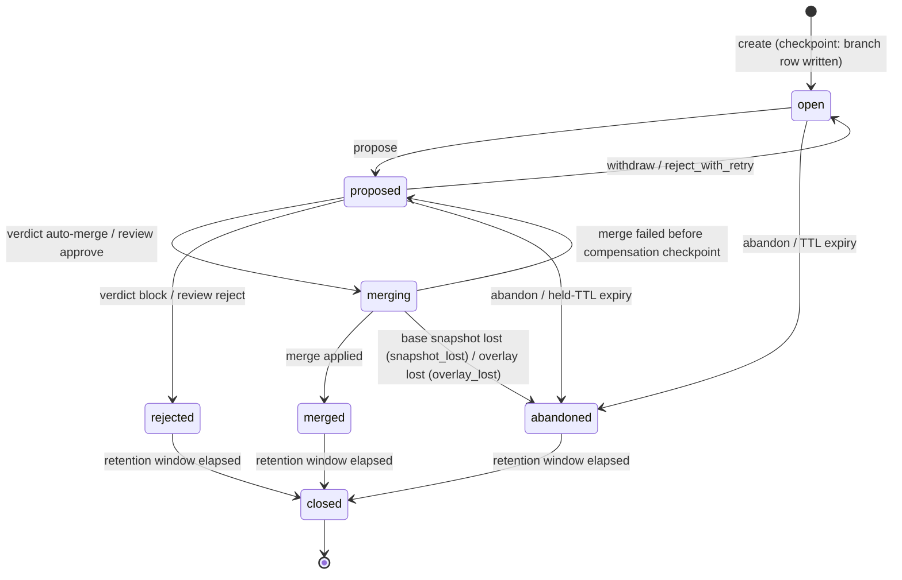
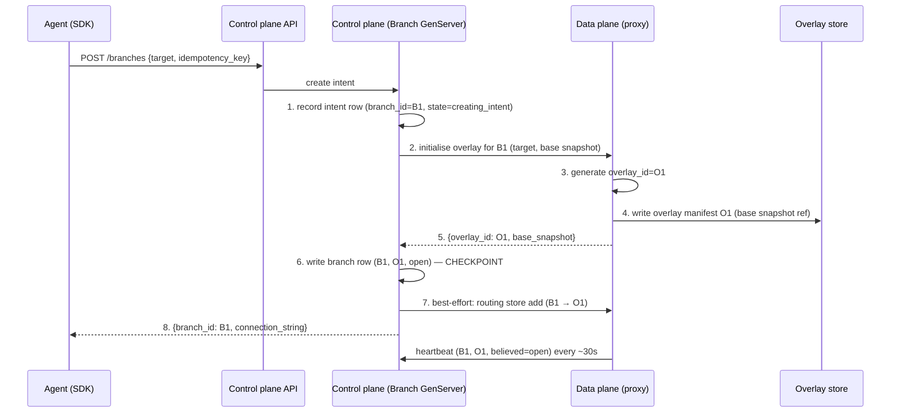
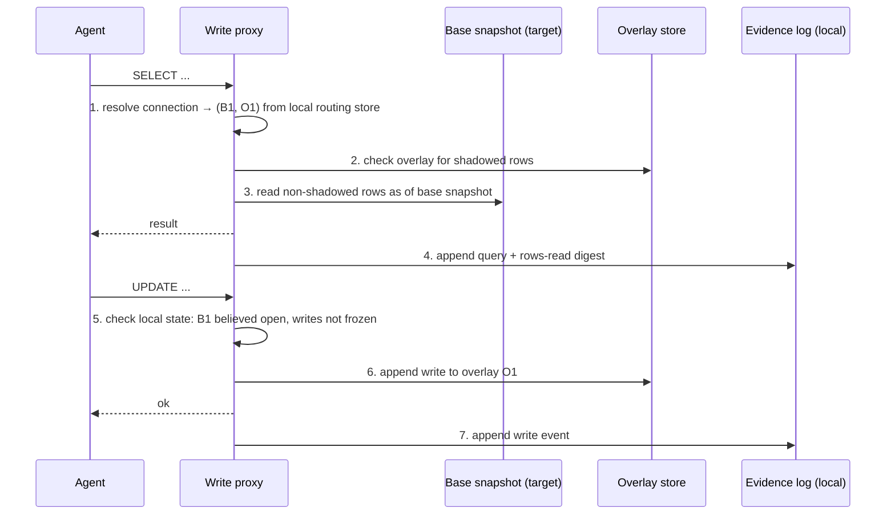
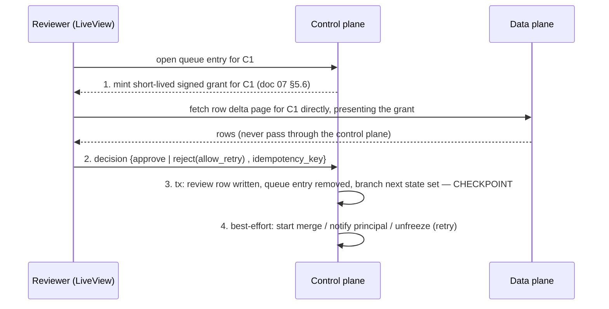

# 13 — Branch and merge lifecycle

**Status:** Draft
**Owner:** Founding team
**Last updated:** 2026-10-15

This document is the contract between the control plane and the data plane for the life of a branch: the state machine, who may move a branch between states, what happens on every step of create, write, propose, review, merge, revert, and abandon, and exactly how each flow survives a failure. The guiding rule is that the control plane's metadata Postgres is the source of truth for branch state, the data plane is the source of truth for row data, and the two reconcile through checkpoints and heartbeats rather than through distributed transactions. Engineers implementing the control plane (doc 07), the changeset engine (doc 05), the adapters (doc 08), and the compensation log (doc 09) implement from this document; where it conflicts with those, this one wins until amended.

## 1. Summary

A branch is created by a principal, written to through the write proxy, proposed as a changeset, evaluated by policy, optionally reviewed by a human, and merged through an adapter with a compensation record persisted first. Every multi-step flow names one checkpoint; before it, a failure means the flow did not happen and is retried with fresh identifiers; after it, the flow has happened and remaining steps are best-effort, repaired by the ~30-second heartbeat between each data-plane branch and the control plane. The control plane never holds a Postgres transaction open across a call to the data plane. The data plane never advances branch state on its own; it only reports what it believes and adopts what it is told.

## 2. Branch state machine

States, exactly as in doc 02: `open`, `proposed`, `merging`, `merged`, `rejected`, `abandoned`, `closed`.



| State | Meaning | Writes | Overlay |
|-------|---------|--------|---------|
| `open` | Branch exists; principal may read and write through the proxy. | Allowed | Kept |
| `proposed` | Writes frozen; a changeset has been or is being computed; a verdict is issued. | Frozen | Kept |
| `merging` | An adapter is applying the row delta to the target. | Frozen | Kept |
| `merged` | Terminal. Row delta applied and confirmed; compensation recorded. | Frozen | Kept until retention, then released |
| `rejected` | Terminal. Rejected by a reviewer or blocked by policy. | Frozen | Kept until retention, then released |
| `abandoned` | Terminal. Given up by the principal or expired by TTL. | Frozen | Kept until retention, then released |
| `closed` | Terminal. Overlay garbage-collected; only metadata, changesets, evidence, and compensation remain. | n/a | Released |

`open`, `proposed`, `merging` **must** keep the overlay. `merged`, `rejected`, and `abandoned` **must** keep it for the retention window (section 9) so a reviewer can inspect what was proposed and so a `stale_base` retry does not have to be recreated. `closed` is the only state in which the overlay is released, and a branch **must not** enter `closed` until the data plane confirms the overlay is deleted.

### 2.1 Transitions

Every transition is initiated by the control plane writing the new state to the branch row in metadata Postgres. The data plane learns of transitions either from the synchronous response to the call that triggered them or from the next heartbeat. "Initiates" below names the plane that performs the first durable action.

| From → To | Trigger | Preconditions | Side effects | Initiates |
|-----------|---------|---------------|--------------|-----------|
| `[*]` → `open` | Principal calls create branch | Target registered; principal authorised on target; overlay initialised in data plane | Branch row written with branch ID and overlay ID; routing store updated (best-effort); TTL clock starts | Control plane |
| `open` → `proposed` | Owning principal calls propose | Branch is `open`; idempotency key not seen | Writes frozen in proxy; changeset `computing` created; prior changesets `superseded` | Control plane |
| `proposed` → `open` | Owning principal withdraws; reviewer rejects-with-retry | Branch is `proposed` | Current changeset `superseded`; proxy unfreezes writes on next heartbeat or on the synchronous reply | Control plane |
| `proposed` → `merging` | Verdict `auto-merge` recorded; or review `approved` recorded | Changeset `evaluated`; verdict is not `block`; per-target merge lease acquired (section 7) | Merge row created `pending` with fresh merge ID; data plane told to merge | Control plane |
| `proposed` → `rejected` | Verdict `block` recorded; or review `rejected` recorded | Changeset `evaluated` | Queue entry removed; principal notified with reasons | Control plane |
| `proposed` → `abandoned` | Owning principal calls abandon; or held-changeset TTL expires | Branch is `proposed` and not `merging` | Queue entry removed; changeset `superseded` | Control plane |
| `open` → `abandoned` | Owning principal calls abandon; or open-branch TTL expires | Branch is `open` | Routing entry removed; writes rejected by proxy on next heartbeat | Control plane |
| `merging` → `merged` | Data plane reports merge `applied` | Merge row `pending`; compensation record persisted; every row confirmed by adapter | Merge row `applied`; target lease released; routing entry removed | Control plane, on report from data plane |
| `merging` → `proposed` | Merge fails before compensation is persisted (`stale_base`, adapter unreachable past retry budget) | Merge row `pending`, no compensation persisted | Merge row `failed`; target lease released; for `stale_base`, new changeset computed showing conflict rows | Control plane |
| `open`/`proposed`/`merging` → `abandoned` | Base snapshot lost (adapter `SNAPSHOT_LOST`, reported by heartbeat or by a failed compute/merge step) | Branch non-terminal; for `merging`, compensation not yet persisted | Reason `snapshot_lost`; merge row (if any) `failed`; lease released; changeset `superseded`; queue entry removed; principal notified | Control plane |
| `open`/`proposed`/`merging` → `abandoned` | Overlay lost while the base snapshot survives (data-plane volume loss, doc 14 §8 runbook) | Branch non-terminal; for `merging`, compensation not yet persisted | Reason `overlay_lost` (New, doc 14); otherwise as for `snapshot_lost` | Control plane |
| `merged`/`rejected`/`abandoned` → `closed` | Retention job | Retention window elapsed since terminal state; data plane confirmed overlay deleted | Overlay ID mapping marked released | Control plane |

A branch in `merging` whose compensation record has been persisted **must not** return to `proposed`; it stays `merging` until apply is retried to completion (section 6.5). A lost base snapshot moves the branch to `abandoned` from any non-terminal state with reason `snapshot_lost`; a lost overlay with an intact base snapshot does the same with reason `overlay_lost` (doc 14 §8); neither is ever a reason for `merging → proposed`. A branch **must not** move from a terminal state to any state other than `closed`.

## 3. Changeset states

A changeset is `computing` (the engine is running), `evaluated` (summary, impact, and verdict are recorded), or `superseded` (a newer changeset exists for the branch, or the branch left `proposed` without merging). Changesets are immutable; superseding never edits the old one.

Relationship to branch states:

- A branch in `open` has zero changesets that are not `superseded`.
- A branch in `proposed` or `merging` has **exactly one** changeset that is not `superseded`; it is either `computing` (briefly, in `proposed`) or `evaluated`.
- A branch in `merged` has exactly one non-superseded changeset, which is the one that was merged.
- A branch in `rejected` or `abandoned` **may** keep its last changeset non-superseded for audit; it is never re-evaluated.

A new changeset is created by: propose; re-propose after `block` with a changed policy; reviewer edit (section 5); `stale_base` on merge; revert conflict detection. In every case the previous changeset **must** be marked `superseded` in the same Postgres transaction that creates the new one.

## 4. Verdict → next state

| Verdict | Branch next state | What happens |
|---------|-------------------|--------------|
| `auto-merge` | `merging` immediately | Control plane acquires the per-target lease and kicks off merge (6.5). No queue entry. |
| `hold` | stays `proposed` | A review queue entry is created. The branch waits for a human. |
| `block` | `rejected` | No queue entry. The principal receives the firing policies. The only way forward is to change the policy and re-propose from a new branch, which creates a new changeset. |

A `block` verdict is terminal for the branch, not merely for the changeset: approving cannot override it (doc 02). Re-propose after a policy change therefore **must** start from a new branch; the rejected branch's overlay may be copied into the new branch's overlay by the data plane as a convenience, but the new branch takes a fresh base snapshot.

## 5. Review outcomes

| Review | Branch next state | Notes |
|--------|-------------------|-------|
| `approved` | `merging` | Control plane acquires the per-target lease and kicks off merge. |
| `rejected` | `rejected` | Terminal. Reasons are recorded and returned to the principal. |
| `rejected` with retry | `open` | See below. |
| `edited` | `proposed` (new changeset), then `merging` if the new verdict permits | See below. Not in M0. |

**Reject with retry** is a `rejected` review decision with a flag `allow_retry: true` and an optional reviewer note. Instead of making the branch terminal, the control plane returns the branch to `open`, marks the changeset `superseded`, and unfreezes writes. The owning principal may write further and propose again. The reviewer note is delivered to the principal as `review.note` on `GET /v1/changesets/{id}` (which the SDK surfaces) and in the `review.recorded` webhook (doc 10). The review record is still permanent; the branch simply gets another changeset. Reject with retry **should** be the default reject in the queue UI because it preserves the agent's work and base snapshot; a plain reject is for "this whole task was wrong."

**Edit** is a review decision carrying a modified row delta (a subset, or a subset with modified values, of the current changeset's row delta). The control plane creates a new changeset in `computing`, sends the edited delta to the data plane, which stores it as the branch's new overlay content and computes summary and impact. Policy is re-evaluated: an edit **may** itself be held or blocked, because the reviewer's edit is still a change to the target. If the new verdict is `auto-merge` or the editing reviewer has approve rights and the verdict is `hold`, the branch moves to `merging`; if `block`, it moves to `rejected`. The editing reviewer does not get to approve their own edit if the target requires separate approval (doc 07).

**Recommendation for M0: edit is not in M0.** M0 ships approve and reject (with and without retry). Edit requires a row-level editor in the queue UI, a delta-upload path from control plane to data plane that is otherwise unnecessary, and a second policy evaluation on human-authored data. Reject with retry covers the common case ("drop these three rows and re-propose") at agent speed. This is recorded in section 12.

## 6. Flows

Each flow names its checkpoint. Before the checkpoint, failure means the flow did not happen; the caller retries with a new idempotency key and the system regenerates every ID. After the checkpoint, the flow has happened and later steps are repaired by heartbeat or by a human.

### 6.1 Create branch



**Checkpoint:** step 6, the branch row with state `open` and the B1→O1 mapping committed to metadata Postgres.

The intent row at step 1 is not a branch; it exists so that an overlay initialised at step 4 whose branch row was never written can be identified as an orphan. The intent row carries the idempotency key.

**Retry with fresh IDs.** If the API call fails from the agent's point of view (timeout, 5xx) and the agent retries with the same idempotency key, the control plane looks up the key. If a branch row exists, it returns it. If only an intent row exists, the control plane **must not** reuse B1 or O1; it generates a new branch ID B2, asks the data plane to initialise a new overlay (which generates O2), and writes a new branch row. The intent row for B1 is marked `superseded`. Reusing IDs would risk two data-plane overlays each believing they are B1.

**Orphan cleanup.** An overlay O1 whose branch row never got written will heartbeat as `(B1, O1, believed=open)`. The control plane finds no branch row for (B1, O1) and answers `unknown`. The data plane marks the overlay dead and garbage-collects it (section 6.8). Orphans therefore cost one overlay manifest and at most a few heartbeats.

Failure analysis:

1. Step 1 fails (Postgres down): API returns 503; nothing exists; agent retries.
2. Step 2 fails (data plane unreachable): control plane marks intent `failed`, returns 503; agent retries; fresh IDs.
3. Step 3–4 fail (overlay store write fails): data plane returns an error; same as 2.
4. Step 5 fails (reply lost; overlay O1 exists): control plane times out, marks intent `failed`, returns 503. O1 is an orphan and is cleaned by heartbeat. Agent retries with fresh IDs.
5. Step 6 fails (Postgres write fails after overlay exists): same as 4. Note that the control plane **must not** have held a transaction open across step 2; the intent row and the branch row are separate transactions.
6. Step 7 fails (routing store not updated): branch exists but the proxy cannot resolve the connection string. The agent's first query fails with `branch_not_routable`; the data plane's next heartbeat for O1 receives `open` and the proxy repairs its routing entry from the heartbeat reply. Repaired by heartbeat within ~30s. The SDK **should** retry connection for up to 60s on this error.
7. Step 8 fails (response lost): branch exists; agent retries with the same idempotency key and receives B1 again. No new IDs, because the checkpoint passed.

### 6.2 Write and evidence capture



**Checkpoint:** step 6, the write appended to the overlay. A write acknowledged to the agent is in the overlay; a write not acknowledged is not. There is no cross-plane step.

Nothing in this flow touches the control plane synchronously. The proxy's routing store, frozen flag, and believed state are all local and refreshed by heartbeat. Evidence is appended to a local, per-branch log in the data plane and is referenced (by digest and location) in the changeset at propose time; evidence content never crosses to the control plane except the agent-supplied rationale, which is metadata.

Failure analysis:

1. Routing miss: proxy returns `branch_not_routable`; repaired by heartbeat (6.1 step 7).
2. Overlay store write fails: proxy returns an error to the agent; the write is not in the overlay; the agent retries. Writes within one connection are applied in order; the proxy **must not** acknowledge a write it has not durably appended.
3. Base snapshot unavailable (CoW branch dropped, Iceberg snapshot expired; adapter error code `SNAPSHOT_LOST`): reads fail with `base_snapshot_gone`; the proxy reports it to the engine, which carries it in the next heartbeat; the control plane marks the branch `abandoned` with reason `snapshot_lost` and notifies the principal. Human repair: the principal creates a new branch.
4. Evidence append fails: the write is still acknowledged (evidence is for humans, not for correctness) but the proxy increments an `evidence_gap` counter that the changeset carries, so reviewers see that evidence is incomplete.
5. Proxy believes `open` but control plane has moved the branch to `abandoned` (TTL) within the last heartbeat interval: writes land in the overlay for up to ~30s, then the proxy learns the state and rejects further writes. These writes are harmless because an `abandoned` overlay is never merged.
6. Proxy believes `open` but control plane has set `proposed` (a second SDK client proposed while the first is still writing): same window; writes that land after the control plane froze but before the proxy learned of it are excluded because the changeset engine reads the overlay up to a freeze marker that the proxy writes when it learns of the freeze. The engine **must** wait for the freeze marker before computing.

### 6.3 Propose

```mermaid
sequenceDiagram
    participant A as Agent
    participant CP as Control plane
    participant P as Write proxy
    participant CE as Changeset engine (DuckDB)
    participant PE as Policy engine

    A->>CP: POST /v1/branches/B1/propose {idempotency_key, rationale}
    CP->>CP: 1. tx: state=proposed, changeset C1=computing, prior changesets superseded
    CP-->>A: 202 {changeset_id, state: computing}
    CP->>P: 2. freeze writes for B1 (sync, short timeout)
    P->>P: 3. write freeze marker to overlay O1
    CP->>CE: 4. compute changeset C1 for (O1, base snapshot, impact queries)
    CE->>CE: 5. DuckDB: row delta, summary, impact
    CE->>CE: 6. persist row delta locally keyed by C1
    CE-->>CP: 7. {summary, impact, evidence refs, row_delta_digest}
    CP->>PE: 8. assertion results from ComputeChangeset (ChangesetReport); combine into verdict
    PE-->>CP: verdict
    CP->>CP: 9. tx: C1=evaluated, verdict recorded — CHECKPOINT
    CP->>CP: 10. best-effort: enqueue (hold) / start merge (auto-merge) / set rejected (block)
    A->>CP: GET /v1/changesets/C1 (poll) → state: evaluated, verdict, reasons
```

**Checkpoint:** step 9, the verdict recorded against changeset C1 in metadata Postgres.

Propose is asynchronous: the control plane answers `202 {changeset_id, state: "computing"}` as soon as step 1 commits, and the agent polls `GET /v1/changesets/{id}` until `state` becomes `evaluated`, when the verdict and reasons appear (doc 10 §4, doc 11). Step 2 is synchronous from the control plane's side so writes are reliably frozen before compute, but if it times out the control plane proceeds; the proxy will learn `proposed` from its next heartbeat and write the freeze marker then. The engine blocks on the marker. At step 8, ALL assertions execute in the data plane as part of `ComputeChangeset`, whose `ChangesetReport` carries the results (`RunAssertions` is only for re-evaluation; doc 05, doc 06, doc 10 §5); only per-assertion results (status, count, `sample_ref`) cross to the control plane, which combines them into the verdict. The row delta does not cross planes.

Failure analysis:

1. Step 1 fails: nothing changed; agent retries with the same key.
2. Step 2–3 fail: branch is `proposed` in Postgres; proxy still accepts writes for up to ~30s; heartbeat delivers `proposed`, proxy freezes and writes the marker. Engine waits. Repaired by heartbeat.
3. Step 4–6 fail (engine crash, DuckDB error): changeset C1 stays `computing`. The control plane's Branch GenServer retries compute with the same changeset ID up to a bounded budget (the computation is idempotent given a frozen overlay). After the budget, C1 is marked `superseded` with reason `compute_failed`, the branch returns to `open`, and the agent receives an error. Repaired by retry, then by human.
4. Step 7 fails (reply lost): same as 3; a recompute overwrites the local row delta for C1 (same input, same output).
5. Step 8 fails (policy engine error): verdict is not recorded; retried with the same C1. A policy that errors at evaluation produces `hold` with reason `policy_error` rather than silently passing. Repaired by retry.
6. Step 9 fails: same as 5.
7. Step 10 fails (queue insert or merge kickoff fails): the verdict is recorded. An Oban job reconciles: every `evaluated` changeset with verdict `hold` and no queue entry gets one; every `auto-merge` with no merge row gets a merge started; every `block` whose branch is not `rejected` is set `rejected`. Repaired by job within one minute.
8. Response to the agent lost: agent retries with the same key; receives the same `changeset_id`, and polling `GET /v1/changesets/{id}` returns the recorded verdict.

### 6.4 Review



**Checkpoint:** step 3, the review row committed together with the branch's next state (`merging`, `rejected`, or `open`).

Reviews are permanent and attributed. A decision on a changeset that is no longer the branch's non-superseded changeset **must** be refused with `changeset_superseded`; the reviewer sees the new changeset instead.

Failure analysis:

1. Step 1 fails (grant not minted, or the browser's direct fetch from the data plane fails): reviewer sees summary and impact without rows and an error banner; decision is still possible but the UI **should** warn.
2. Step 2 lost: reviewer retries; idempotency key dedupes.
3. Step 3 fails: nothing recorded; reviewer retries.
4. Step 4 fails: review is recorded. The same reconciliation job as 6.3 step 7 starts merges for `merging` branches with no merge row and unfreezes `open` branches on heartbeat. Repaired by job and heartbeat.
5. Two reviewers decide concurrently: the second transaction fails the precondition (queue entry gone) and the second reviewer sees `already_reviewed`.

### 6.5 Merge

```mermaid
sequenceDiagram
    participant CP as Control plane
    participant T as Target row (metadata)
    participant DP as Data plane (merge worker)
    participant CL as Compensation log
    participant AD as Adapter
    participant TG as Target

    CP->>T: 1. acquire per-target merge lease (tx; lease_expiry)
    CP->>CP: 2. tx: branch=merging, merge M1=pending
    CP->>DP: 3. merge {merge_id: M1, changeset: C1, base_snapshot}
    DP->>AD: 4. staleness check: read current target rows for delta keys
    AD-->>DP: current rows
    DP->>DP: 5. compare to base snapshot rows; any diff → fail stale_base
    DP->>DP: 6. compute compensation from base snapshot + row delta
    DP->>CL: 7. persist compensation record keyed by M1 — CHECKPOINT
    DP->>AD: 8. apply row delta, idempotent per row, keyed by M1
    AD->>TG: writes
    DP->>DP: 9. record per-row progress for M1
    DP-->>CP: 10. {merge_id: M1, status: applied}
    CP->>CP: 11. tx: merge=applied, branch=merged, release lease
    DP->>CP: heartbeat carries merge progress until acknowledged
```

**Checkpoint:** step 7, the compensation record persisted in the compensation log keyed by merge ID. A merge whose compensation is persisted is committed to: the system will keep retrying apply until every row is confirmed, and will never return the branch to `proposed`. A merge whose compensation is not persisted has not happened and can be retried with a fresh merge ID or abandoned back to `proposed`.

**Staleness check.** Before computing compensation, the data plane reads the current target rows for every key in the row delta (inserts: the key must not exist; updates and deletes: the row must exist) and compares them, column by column over the columns the delta touches plus the key, against the base snapshot's rows for the same keys. If any differ, the merge fails with `stale_base`. The control plane sets the merge `failed`, releases the lease, returns the branch to `proposed`, and the data plane computes a new changeset whose summary includes a `conflicts` section carrying only `conflicts_count` and `conflicts_ref`; the conflicting keys and their before/after values from the target (not from the overlay) stay in the data plane behind `conflicts_ref`. The new changeset is re-evaluated by policy and the verdict **must** be at least `hold`. There is no three-way merge: the principal withdraws and retries on a new branch, or a reviewer rejects. For CRMs whose base snapshot is a timestamp, the check compares `last_modified` of each row to the snapshot timestamp in addition to column values; see section 12.

**Partial application on non-transactional targets.** For Postgres and Snowflake the adapter applies the row delta in one transaction when the delta fits (default threshold 50,000 rows), and step 9 is trivial; above that, it is chunked in 10,000-row transactions with per-chunk progress recorded, resumable by merge ID (doc 08 §5.2). For Salesforce and HubSpot there is no transaction: the adapter **must** be idempotent per row, keyed by (merge ID, row key), using an external-ID field or a Steward-managed sidecar table where the target permits, and otherwise by re-reading the row before writing it. The data plane records per-row progress for M1 durably; a retry (after crash or rate limit) resumes from the last confirmed row. The merge is `applied` only when every row is confirmed by the adapter. Until then the merge is `pending` and the branch stays `merging`; the heartbeat carries `merge_progress` so the control plane and the UI can show "412 of 1,000 rows applied". Progress stalled past a configurable budget (default 1 hour) raises an alert for a human; the human **may** force a revert (compensation is already persisted, so revert is always possible, including for the applied subset) but **must not** mark the merge applied by hand.

Failure analysis:

1. Step 1 fails (lease held by another merge): this merge waits (section 7).
2. Step 2 fails: lease is released by expiry; nothing else happened; retried by job.
3. Step 3 fails (data plane unreachable): merge stays `pending` with no data-plane work; the GenServer retries with the same M1 (nothing durable exists on the data plane yet, and M1 is only in Postgres) up to a budget, then marks M1 `failed`, releases the lease, returns branch to `proposed` with reason `data_plane_unreachable`, and alerts. Repaired by retry then human.
4. Step 4–5 fail (adapter cannot read target; or `stale_base`): merge `failed`; branch to `proposed`; for `stale_base`, new changeset computed as described above. If the failure is `SNAPSHOT_LOST`, the branch goes to `abandoned` with reason `snapshot_lost` instead (section 2.1).
5. Step 6 fails: no compensation; same as 4 with reason `compensation_failed`. A merge **must never** proceed without compensation.
6. Step 7 fails (compensation log write fails): same as 5. If the write actually succeeded but the acknowledgement was lost, the next attempt with the same M1 finds the record and continues; with a fresh M1 the orphaned record is harmless and is GC'd as an orphaned compensation record (no merge checkpoint) after 7 days (section 9).
7. Step 8–9 fail (adapter error, crash, rate limit): compensation persisted, so the merge is committed. Data plane retries apply from recorded progress. Heartbeat reports `merge_progress`. Repaired by retry; human alerted if stalled.
8. Step 10 lost: merge is applied on the data plane but the control plane still shows `merging`. Heartbeat reports `(believed=merging, merge_progress=complete)`; control plane transitions to `merged`. Repaired by heartbeat.
9. Step 11 fails: same as 8; the heartbeat keeps reporting until acknowledged.
10. Lease expires during a long apply: the heartbeat renews the lease while `merge_progress` is advancing. If the heartbeat itself stops (data plane down), the lease expires, but the next merge for the same target cannot start until a heartbeat confirms M1's status, because the target row records `last_merge_id` and the control plane **must not** start M2 while M1 is `pending`. A stuck M1 is a human escalation, never an automatic bypass.

### 6.6 Revert

```mermaid
sequenceDiagram
    participant H as Principal with target_admin (human or service)
    participant CP as Control plane
    participant DP as Data plane
    participant CL as Compensation log

    H->>CP: POST /merges/M1/revert {idempotency_key}
    CP->>CP: 1. check M1 applied, not compensated, within revert policy
    CP->>DP: 2. create branch B2 on target (fresh IDs) with overlay = inverse ops from CL[M1]
    DP->>CL: 3. read compensation M1
    DP->>DP: 4. materialise overlay O2 from inverse ops; base snapshot = now
    CP->>CP: 5. branch row B2 (open, revert_of=M1) — CHECKPOINT
    CP->>CP: 6. propose B2 immediately (flow 6.3)
    Note over DP: changeset compares inverse ops to current target; keys touched by later merges appear as conflicts
    CP->>CP: 7. verdict: at least hold if conflicts; else per policy
    Note over CP: on merge of B2, M1 → compensated
```

**Checkpoint:** step 5, the revert branch row written with `revert_of = M1`.

A revert is a branch whose overlay is the inverse operations from M1's compensation record, taken against a base snapshot of the target now. It then goes through propose, policy, and merge exactly like any change. The changeset engine, when computing the changeset for a branch with `revert_of` set, additionally compares each inverse op's expected "current" value (the value M1 wrote) to the actual current target value; any key that differs was touched by a later merge or by an out-of-band write, and is listed in the `conflicts` section. If the conflicts section is non-empty the verdict **must** be at least `hold`, whatever the policies say; this floor is applied by the branch coordinator (doc 07) after the policy engine's verdict, with reason `revert_conflict`. When B2 merges, M1 is marked `compensated`; a compensation record is consumed by at most one *merged* revert, and a rejected or abandoned revert releases it (doc 09 §5.3).

Failure analysis:

1. Step 1 fails: nothing; retry.
2. Step 2–4 fail: same as create-branch failures (6.1); fresh IDs on retry; orphan O2 cleaned by heartbeat.
3. Step 5 fails: same as 6.1 step 5.
4. Step 6–7 fail: branch B2 exists in `open`; a reconciliation job proposes any `open` branch with `revert_of` set and no changeset. Repaired by job.
5. Later merges after B2 is proposed but before it merges: caught by the staleness check at merge time (6.5), which returns B2 to `proposed` with conflicts.

### 6.7 Abandon and TTL

Abandon is a single control-plane transaction: branch to `abandoned`, changeset (if any) `superseded`, queue entry removed, routing entry removal queued. **Checkpoint:** that transaction. The proxy learns via heartbeat and rejects further writes; a merge **must not** be in progress (abandon of a `merging` branch is refused with `merge_in_progress`).

TTL: an `open` branch that has not been proposed within its TTL is abandoned by an Oban job. Default TTL is 24 hours, configurable per target (`branch_ttl`). A `proposed` branch with verdict `hold` has a separate `held_ttl` (default: none in M0; see section 12). TTL expiry writes `abandoned` with reason `ttl_expired` and notifies the owning principal. The overlay of an abandoned branch is released after the retention window (section 9), not at abandon time, so a principal can inspect what an expired agent task had written.

Failure analysis:

1. The transaction fails: branch unchanged; job retries next tick.
2. Proxy does not learn for ~30s: writes land in a doomed overlay; harmless (6.2 failure 5).
3. Routing entry removal fails: connection string keeps resolving but every write is refused with `branch_abandoned`; repaired by heartbeat answering `abandoned`, which removes the routing entry.

### 6.8 Heartbeat reconciliation

Every ~30 seconds (with ±20% jitter so a data plane with many branches does not burst) the changeset engine (`steward-engine`, doc 05), which holds merge progress and compensation status, sends for each data-plane branch `{branch_id, overlay_id, believed_state, overlay_size, merge_progress?, evidence_gap?, compensation_status?, revert_outcome?, retention_ack?}` to the control plane. The write proxy does not heartbeat; it reports its per-branch facts (overlay size, freeze acknowledged, evidence gap) to the engine over the local socket. `compensation_status` is the compensation record's index status for the branch's merge (doc 09 §4); `revert_outcome` is set for revert branches (`merged`, `rejected`, `abandoned`) so the compensation record is consumed or released (doc 09 §5.3); `retention_ack` acknowledges the `retention_until` and legal-hold instructions last received. The control plane looks up `(branch_id, overlay_id)` together and answers `{authoritative_state, lease_renewed?, freeze: bool, retention_until?, legal_hold?}`. The Branch GenServer records `last_heartbeat_at`. Lookup is by both IDs: a branch ID with a different overlay ID is `unknown`, which is how a retry's orphan dies.

Data-plane believed states are `open`, `proposed` (frozen), `merging`, `done` (data plane finished apply or was told terminal), and `dead` (marked for GC). The control plane's authoritative states are the seven branch states plus `unknown`.

| Believed ↓ / Authoritative → | `unknown` | `open` | `proposed` | `merging` | `merged` | `rejected` | `abandoned` | `closed` |
|---|---|---|---|---|---|---|---|---|
| `open` | mark dead, GC overlay | no-op | freeze writes, write freeze marker | freeze; expect merge instruction (re-sent by CP) | freeze; set done; GC after retention | freeze; set done; GC after retention | freeze; set done; GC after retention | mark dead, GC overlay |
| `proposed` | mark dead, GC overlay | unfreeze writes; drop freeze marker | no-op | expect merge instruction (re-sent by CP) | set done | set done | set done | mark dead, GC |
| `merging` | mark dead; **alert** (compensation may exist for an unknown branch) | **alert**; stop apply if before compensation checkpoint; otherwise continue and alert | stop apply if before checkpoint; otherwise continue (CP state is stale: CP will see progress and correct) | renew lease; report progress; CP advances to `merged` if progress complete | set done | **alert** (should be impossible after checkpoint) | **alert** (abandon of `merging` is refused) | mark dead, GC |
| `done` | mark dead, GC | **alert** (CP lost a terminal transition) | **alert** | report progress complete; CP advances | no-op | no-op | no-op | mark dead, GC |
| `dead` | GC when safe | **alert** | **alert** | **alert** | GC | GC | GC | GC |

Rules:

- The data plane **must** adopt the authoritative state. It never argues.
- "Alert" rows are states the design says cannot happen; they page an operator and freeze the branch on the data plane until a human resolves them. They **must not** be auto-repaired because each one implies either a bug or a lost checkpoint.
- A branch with no heartbeat for 5 minutes is marked `heartbeat_lost` on the control plane (a flag, not a state). A `merging` branch with `heartbeat_lost` holds its target lease past expiry and alerts. An `open` branch with `heartbeat_lost` is left alone until TTL.
- `overlay_size` feeds billing and the retention job and is informational.

## 7. Concurrency rules

- **One writer per branch.** Only the owning principal may write to a branch, propose it, withdraw it, or abandon it. The proxy enforces this by connection identity; the API enforces it by principal. Two connections from the same principal to the same branch are allowed and are serialised by the overlay's append order.
- **Branches on a target are independent.** Any number of branches may be open on one target. They do not see each other's overlays. Their changesets are computed independently against their own base snapshots.
- **Merges to a target are serialised.** The control plane holds a per-target merge lease: the `targets` row has `merging_merge_id` and `lease_expires_at`. Acquiring the lease is a single Postgres `UPDATE ... WHERE merging_merge_id IS NULL OR lease_expires_at < now()`. The lease is held only in metadata; no Postgres transaction is open across the remote apply. The lease is renewed by the heartbeat of the merging branch while `merge_progress` advances (default lease 5 minutes, renewed each heartbeat). The control plane **must not** acquire a lease whose previous `merging_merge_id` is still `pending`, even if expired; it alerts instead.
- **A second merge queued behind a first** waits in `proposed` with verdict or review already recorded and a `merge_wait` flag. When the lease is released it is started in order of verdict/review time. Because it is still `proposed`, its staleness check at merge time (6.5 step 4) is what catches a conflict with the first merge; if the first merge touched any of its keys, it fails with `stale_base` and gets a new changeset showing the conflict. This is the intended behaviour: serialise, then verify, rather than merge concurrently and hope.

## 8. Idempotency and identifiers

Every mutating API call (create, propose, withdraw, abandon, review, revert, policy edit) **must** carry an idempotency key chosen by the caller. The control plane stores `(principal, key) → result` for 24 hours and returns the stored result on a repeat. A repeat with the same key and a different payload is refused with `idempotency_conflict`.

| Identifier | Generated by | When | Keys |
|------------|--------------|------|------|
| Branch ID (UUID) | Control plane | Create intent | Branch row; regenerated on retry before checkpoint |
| Overlay ID (UUID) | Data plane | Overlay initialisation | Overlay manifest, routing entry, heartbeat identity; regenerated on retry |
| Changeset ID (UUID) | Control plane | Propose / edit / stale_base / revert | Row delta location in data plane, summary, verdict, queue entry |
| Verdict ID | Control plane | Policy evaluation | Policy versions that fired |
| Review ID | Control plane | Review decision | Permanent audit record |
| Merge ID (UUID) | Control plane | Lease acquisition | Adapter apply (per row: merge ID + row key), compensation record, per-row progress, target lease |
| Compensation ID | Data plane | Compensation persist | Equal to merge ID; one-to-one |
| Idempotency key | Caller | Every mutating call | Dedupe table |

The merge ID is the identifier that makes the adapter apply idempotent: an adapter receiving the same merge ID and row key twice **must** produce the same end state as receiving it once. The compensation record is keyed by the same merge ID so that "is this merge committed?" is one lookup.

## 9. Retention and garbage collection

| Data | Default retention | Configurable | Rule |
|------|-------------------|--------------|------|
| Overlay after terminal state (`merged`, `rejected`, `abandoned`) | 7 days | Per target | Retention job moves branch to `closed` once data plane confirms deletion |
| Compensation record | 90 days | Per target | `retention_until` is set per record by the control plane from the target's policy (at merge time and whenever the policy changes) and delivered to the data plane, which only enforces it and never derives it locally. **Must never** be GC'd while its merge could still be reverted under the target's revert policy; a target with a longer revert window extends compensation retention to match |
| Evidence | Same as compensation | Follows compensation | GC'd together with the compensation record of the merge it supports; for unmerged branches, with the overlay |
| Changeset summary and impact | Indefinite (metadata) | No | Small; the audit trail |
| Row delta | Same as overlay | Per target | Lives in data plane beside overlay |
| Idempotency keys | 24 hours | No | |
| `events` (control-plane Postgres) | 90 days after the analytics export has passed the partition (doc 07 §6, doc 12 §9) | No | Monthly partition drop |
| `audit_log` (control-plane Postgres) | 2 years | Per org, 1–7 years (`orgs.audit_retention`, doc 12 §1, doc 15) | Partition drop |
| Orphaned compensation records (no merge checkpoint: merge ID with no `applied` merge) | 7 days | No | From 6.5 failure 6; GC'd by the data plane |

GC runs in the data plane, driven by `closed` transitions from the control plane and by local retention timers for compensation and evidence. The data plane **must not** delete an overlay while its branch is non-terminal; it checks the authoritative state in the heartbeat reply before deleting.

## 10. Invariants

1. The control plane's metadata Postgres is the only source of truth for branch state; the data plane's believed state is a cache.
2. A branch has at most one non-superseded changeset.
3. A branch in `proposed` or `merging` has exactly one non-superseded changeset.
4. A changeset has exactly one verdict and is never re-evaluated; re-evaluation creates a new changeset.
5. A merge in state `applied` has a persisted compensation record keyed by its merge ID.
6. A merge whose compensation record is persisted is never rolled back to `proposed`; it is applied to completion or reverted.
7. The adapter never applies a row delta for a merge whose compensation is not persisted.
8. The data plane never advances a branch to `merged` on its own; it reports progress and the control plane transitions.
9. No row data crosses to the control plane; summary, impact, digests, and counts are the only changeset content stored there.
10. No Postgres transaction in the control plane is open across a call to the data plane.
11. At most one merge per target is `pending` at any time.
12. A block verdict is never overridden by a review.
13. Two data-plane overlays never share a (branch ID, overlay ID) pair, and an overlay whose pair is unknown to the control plane is dead.
14. A compensation record is used by at most one revert, and is never garbage-collected while its merge is revertable under policy.
15. The write proxy answers every query from local state; a control-plane outage never fails a read or a write on an `open` branch.
16. Every transition into a terminal state carries a reason and a principal (or `system` with a job name).

## 11. Alternatives considered

- **Three-way merge on conflict.** Rejected (doc 01, section 6). Branches live minutes to hours and conflicts are rare; a conflict editor is a product in itself. `stale_base` with a conflict-bearing changeset and a retry on a fresh branch is simpler and keeps the reviewer's mental model to "approve or not."
- **Distributed transaction across planes (2PC) for propose and merge.** Rejected. It would put the control plane on the data plane's critical path, require the proxy to block on a remote coordinator, and still fail under partition. Checkpoints plus heartbeats give the same guarantees we actually need (a merge either has compensation or did not happen) with no coordinator.
- **Computing compensation after apply.** Rejected. If apply succeeds and compensation fails, the change is irreversible, which breaks the product promise. Computing from base snapshot plus row delta before apply is cheap and makes the compensation record the natural checkpoint.
- **Optimistic concurrent merges per target.** Rejected for M0. Concurrent merges with per-row conflict detection would be faster for high-throughput targets, but the per-target lease is simple to reason about, the staleness check catches cross-merge conflicts anyway, and merge throughput is not the bottleneck for analytics and CRM targets. Revisit if a target shows merge queueing in practice.
- **Reusing IDs on create retry.** Rejected. Saves one overlay initialisation but opens a window where two overlays claim one branch. Fresh IDs plus orphan GC is cheaper than the bug.

## 12. Open questions

| Question | Owner | Needed by |
|----------|-------|-----------|
| Is **edit** in M0? Recommendation: no; ship approve and reject-with-retry only, and revisit after three customers ask for row-level editing in the queue. | Product | Doc 07, before M0 queue UI |
| TTL defaults: 24h for `open` is a guess. Analytics agents may legitimately run overnight; CRM cleanup agents finish in minutes. Should the default differ by adapter kind? | Founding team | Doc 14 |
| Should a held changeset auto-abandon after N days (`held_ttl`)? Recommendation: no in M0, but surface "held longer than 7 days" as a queue health metric. | Product | Doc 07 |
| Stale-base policy for CRM targets where the base snapshot is a timestamp, not a true snapshot: comparing `last_modified` catches concurrent edits but not edits that revert a value to its old one; is column-value comparison alone acceptable, and what is the behaviour when a CRM does not expose `last_modified` per field? | Adapters lead | Doc 08 |
| Should the lease renewal interval and `heartbeat_lost` threshold be per target, given CRM rate limits can stall a merge legitimately for longer than 5 minutes? | Control plane lead | Doc 07 |
