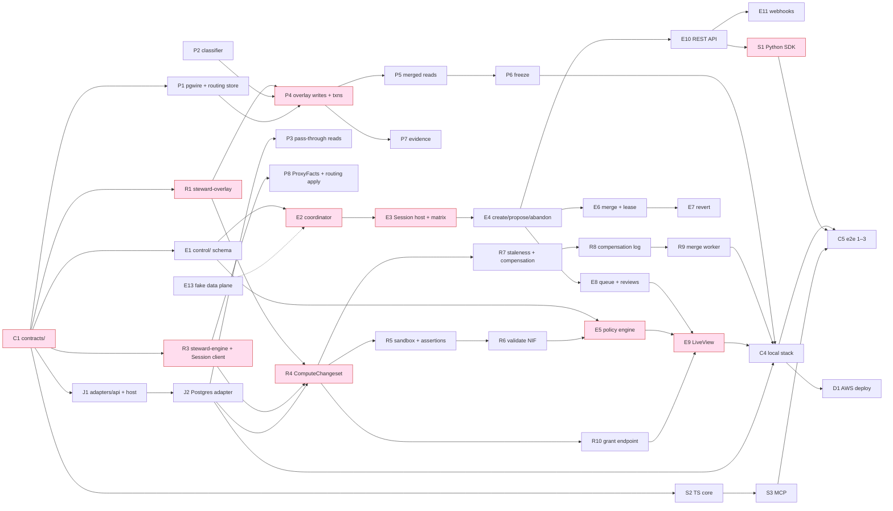

# 19 — Build roadmap

**Status:** Draft
**Owner:** Founding team
**Last updated:** 2026-10-15

This document is what engineering agents pick work from. It sequences everything docs 01–13 and 18 describe into four milestones, M0–M3, each with a one-sentence goal, the customer-visible outcome, a checklist of work items that name the spec sections and a size, what is explicitly deferred, and a definition of done. It also collects every "M0", "M1", "M2", "later" statement scattered through the specs into one list (§2), draws the M0 dependency graph (§4), proposes parallel tracks per language team with the stubs each needs (§5), and pulls every open question marked "before M0" into one table with a recommended answer (§6). Docs 14–17 are being written in parallel; where this document cites them it cites by number only. Nothing here is binding until the status is `Accepted`; scope changes are pull requests against this file (§8).

## 1. Principles

1. **Vertical slice first.** M0 ships the review loop end to end on one target kind (Postgres) before any second adapter, second wire protocol, or second SDK language. A thin loop that merges and reverts a real changeset beats five half-built components. §9 argues this against the component-complete alternative.
2. **Every milestone ends with the local stack running its e2e scenarios.** `tools/stack up` (doc 18 §8) **must** bring up every component in the milestone, and `tools/e2e` **must** pass the scenarios doc 17 assigns to that milestone. A milestone is not done on a cloud environment the local stack cannot reproduce.
3. **The spec labels are canonical here.** Where a spec says "M0", "not in M0", "M1", "M2+", or "later", §2 is the one list. If a spec and §2 disagree, fix §2 by PR and then the spec; do not let two lists drift.
4. **Checkpoints before features.** Within any milestone, the checkpoint writes of doc 13 §6 (branch row, overlay append, verdict, review row, compensation record) and the heartbeat matrix (doc 13 §6.8) are built and tested before the features that sit on them. A feature that bypasses a checkpoint is not done.
5. **Numbers come from the specs.** Definitions of done cite the requirement rows of each spec's §7; doc 16 formalises them as SLOs and doc 17 as tests. This document does not invent new numbers.
6. **Contracts first, per doc 18 §5.** `contracts/` is the first thing built in M0 and the only cross-language dependency; every later item codes against checked-in generated stubs.

## 2. Milestone statements collected from the specs

The canonical list. "Later" means after M3 or unscheduled.

| Statement | Source | Milestone |
|---|---|---|
| Postgres wire protocol front end; SQLite routing store; pass-through and merged reads; 1,000 connections per instance | doc 04 §3.1, §4, §5.2, §7 | M0 |
| DDL rejected with `SD005`; measure how often agents hit it | doc 04 §5.2, §12 | M0 reject; support decision M3 (doc 04 §12 says "M1 scope"; see §10) |
| MySQL wire protocol, with the MySQL adapter | doc 04 §3.1, doc 08 §12 | M2 |
| REST shim for Salesforce/HubSpot, with the CRM adapters | doc 04 §3.1 | M1 (Salesforce), M2 (HubSpot) |
| Spill-to-disk for large transactions instead of `SD008` | doc 04 §12 | M3 |
| Agent↔proxy mTLS may be enabled, off by default | doc 04 §8 | M0 (optional) |
| Delta Lake/Iceberg format for overlays rejected for M0 | doc 05 §11 | Later |
| 10M-row changeset figure measured under doc 17 before promotion to requirement | doc 05 §7 | M1 |
| Review features captured at every decision; suggestions mined from them | doc 06 §1, §5.6 | Capture M0; suggest M2 |
| `uncovered_changeset_verdict` default `hold`, flippable per target | doc 06 §5.1 | M0 |
| Agents must not hold `policy:write` / `policy_admin` / `merge:revert` | doc 06 §8, doc 10 §3.1 | M0 rule; relaxation unscheduled |
| Shared policy libraries: copy-and-own with `derived_from` | doc 06 §12, doc 12 §2.2 | Column M0; library UI M2 |
| Edit as a review outcome (`501 review_edit_not_supported`, `edit_not_in_m0` CHECK) | doc 13 §5, §12; doc 07 §2; doc 10 §2.1; doc 12 §2.2 | M2 |
| One queue per target, membership eligibility, no Team entity | doc 07 §5.5, §12; doc 02 §7 | M0; Team entity M3 |
| Queue ordering oldest-first, no priority bump | doc 07 §5.5 | M0; priority later |
| Oban consumers `EnqueueQueueEntry`, `CountersFromEvent`, `NotifyPrincipal`, `AnalyticsExport`; NATS JetStream only when a consumer needs fan-out | doc 07 §5.7, doc 03 §4 | M0; NATS later |
| GenServer-per-branch; switch to per-target partitioning at 500k branches/node or boot sweep > 60 s | doc 07 §4, §12 | M0; measure before M1 |
| RLS not in M0; additive migration later | doc 12 §10 | M1 (first enterprise review) |
| Postgres adapter on Neon open-source storage; exported-snapshot/replica fallback supported, not default | doc 08 §5.1, §11 | M0 |
| Iceberg, Snowflake, Salesforce adapters | doc 08 §0, §5.3 | M1 |
| BigQuery adapter alongside Snowflake | doc 08 §12 | M1 |
| MySQL and HubSpot adapters | doc 08 §12 | M2 |
| Adapter host as sidecar; one host per data plane | doc 08 §12 | M0; per-kind hosts M1 if needed |
| Compensation hash chain; headers permanent, bodies expire | doc 09 §5.2, §5.5 | M0 |
| Server-side checksum instead of read-back | doc 09 §12 | After M0 benchmarks |
| Compliance export bundle | doc 09 §5.6, §12 | M1 (first compliance customer) |
| Webhooks | doc 10 §4.10, §6 | M0 |
| Human short-lived tokens `stwt_` | doc 10 §3.2, §10 | M0 (recommended, §6) |
| Python SDK, TypeScript SDK, MCP server (TypeScript, depends on `@steward/sdk`) | doc 11 §1, §8 | Python + MCP + TS core M0; full TS surface M1 (see §10) |
| Low-latency OLTP interposition | doc 01 §6, §9 | M3 |
| "Bring your own branch" | doc 01 §9, §11 | M2 |
| Cross-system transactions, merge-conflict UI | doc 01 §6 | Never (non-goals) |
| Multi-region data planes for one customer | doc 03 §11 | M3 |
| Analytics/billing store choice | doc 03 §11, doc 12 §7 | Before M0 billing (§6) |

## 3. Milestones

Sizes: S ≤ 1 engineer-week, M 1–3 weeks, L 3–6 weeks. Item IDs are stable and become the GitHub milestone/label pair (§8). "Deps" names other item IDs.

### 3.1 M0 — "One branch, one merge"

**Goal.** An agent writes to a Postgres target through a branch, a human approves or policy auto-merges, the merge is applied with compensation, and a revert works, all with the data plane in the customer's cloud.

**Customer-visible outcome.** A RevOps team connects one Postgres database, gives one agent a connection string, and sees its changesets in a queue with summary, impact, evidence, and a verdict; approved changes land in production and can be reverted with one action.

**Scope.**

| ID | Component | Spec sections | Deliverable | Deps | Size |
|---|---|---|---|---|---|
| C1 | `contracts/` | doc 10 §1, §5, §8; doc 05 §3.1; doc 08 §3.1; doc 09 §3.1; doc 12 §3, §5, §6.1 | `session.proto`, `engine/*.proto` (incl. `ProxyFacts`), `adapter.proto`, `steward.v1.yaml`, `reasons.yaml`, event and summary/impact JSON schemas; generated stubs checked in for rust/elixir/java/python/typescript; drift check in CI | — | M |
| C2 | Build/CI | doc 18 §1, §3, §9 | Top-level build script, per-directory lint/test gates, 5 % benchmark gate for `proxy/`, `engine/` | — | S |
| C3 | `tools/fixtures` | doc 03 §7 p9; doc 18 §7; doc 05 §10; doc 06 §10 | Synthetic targets and agent write patterns at 1k/100k/1M rows; golden changesets and verdicts | — | M |
| C4 | Local stack | doc 18 §8; doc 08 §10 | `tools/stack up`: metadata Postgres, Neon-compatible pageserver + plain Postgres fallback as sample target, MinIO, proxy, engine, adapter host, control plane | C1, P1, R3, J1, E1 (stubs first, §5) | M |
| C5 | `tools/e2e` | doc 10 §7 A–C; doc 11 §13; doc 09 §10; doc 17 | Scenarios 1–3 (below) executed against the local stack as OpenAPI contract tests | C4 | M |
| C6 | `tools/loadgen` | doc 04 §10; doc 03 §7 p9 | Load driver with `replay` subcommand (`tools/loadgen replay`) feeding C3 patterns through the proxy | C3, P4 | M |
| R1 | `steward-overlay` crate | doc 05 §4.1, §5.5; doc 12 §8.2–8.4 | WAL format, segment schema, manifest with conditional PUT, freeze/unfreeze markers, async roll, net-op reader, `view()` | C1 | L |
| R2 | Engine | doc 05 §4.2 | Compaction with 10-minute segment grace | R1 | S |
| R3 | `steward-engine` process | doc 05 §5.1; doc 10 §5; doc 13 §6.8; doc 07 §5.3 | gRPC UDS server, outbound `Session` stream with jittered reconnect, heartbeat sender folding `ProxyFacts`, instruction dispatch, first-heartbeat delay 0–30 s | C1 | M |
| R4 | Engine | doc 05 §5.2, §7 | `ComputeChangeset`: freeze-marker wait, net-op collapse, keyed base reads, summary (256 KiB cap, `summary_values_allowed`), row delta persist + digest, `ChangesetReport` | R1, R3, J1 | L |
| R5 | Engine | doc 05 §5.3, §5.4, §8 | Locked-down DuckDB sandbox, impact queries, assertions with `sample_ref`, timeouts and budgets | R4 | M |
| R6 | Engine NIF | doc 06 §5.5, §8; doc 03 §8 | Rustler `validate` (one parser, one allowlist) and policy test mode on dirty schedulers | R5 | M |
| R7 | Engine | doc 05 §5.6 | `StalenessCheck`, `ComputeCompensation`, `conflicts.t`, `delta.reversible` from `describe()` | R4, J2 | M |
| R8 | Compensation log | doc 09 §5.1–5.5, §8; doc 12 §8.7 | `Persist` with segments-then-header atomicity and read-back, hash chain, index, `Open`/`Release`/`Keys`/`Status`/`Verify`/`VerifyChain`, GC, `SetRetention`/`SetLegalHold`, access log | R7 | L |
| R9 | Merge worker | doc 13 §6.5, §6.6; doc 09 §5.3 | `Merge` instruction: staleness → compensation → apply with per-row progress → `MergeOutcome`; revert overlay materialisation from `Open` | R7, R8, J2 | M |
| R10 | Data-plane grant endpoint | doc 10 §3.3; doc 07 §5.6; doc 05 §3.1; doc 09 §8 | `GetRowDelta` paging, assertion samples, compensation read; ES256 grant verification; `DataPlaneAuditEvent` | R4, R8 | M |
| R11 | Engine | doc 05 §5.7; doc 13 §9 | `CloseOverlay`, orphan sweeps, cache eviction | R1 | S |
| P1 | Proxy | doc 04 §3.1, §4, §5.1; doc 12 §8.6 | pgwire front end (simple + extended), SCRAM with API key, SQLite routing store, per-state terminal codes `SD002`/`SD003`/`SD00A`–`SD00C` | C1 | M |
| P2 | Proxy | doc 04 §5.2, §10 | AST statement classifier with fail-closed `SD005`/`SD006`; proptest grammar | — | M |
| P3 | Proxy | doc 04 §5.2; doc 08 §5.1 | Pass-through reads over the adapter's `SnapshotConnection` | P1, J2 | S |
| P4 | Proxy | doc 04 §5.2, §5.3 | Overlay writes with before/after images, transaction buffer, `SD008`, durable append before ack | R1, P2 | L |
| P5 | Proxy | doc 04 §5.2; doc 05 §5.5 | Merged reads: rewrite to `overlay_view`, pushdown, `SD009` caps | P4 | M |
| P6 | Proxy | doc 04 §5.4 | Freeze/unfreeze under the append lock; `SD001` | P4 | S |
| P7 | Proxy | doc 04 §5.5; doc 12 §8.8 | Evidence log, fingerprinting, `SET steward.rationale`, `evidence_gap` | P1 | S |
| P8 | Proxy | doc 04 §3.1, §5.6 | `ProxyFacts` to engine; apply heartbeat replies per doc 13 §6.8; `RoutingUpsert`/`FreezeWrites`/`InitialiseOverlay` relay | R3 | M |
| P9 | Proxy tests | doc 04 §10 | Driver matrix, read-your-writes, failure injection, `proxy/benches/` | P1–P8 | M |
| J1 | `adapters/api` + host | doc 08 §3.1, §5.5, §11 | `Connector`, `ConnectorException` codes, explicit-registry host over UDS, credential resolution and rotation, `-Xmx1g`/ZGC/CDS | C1 | M |
| J2 | Postgres adapter | doc 08 §5.1, §5.2, §5.4, §8 | Neon branch `openSnapshot` with ephemeral read-only role, `readRows`, `scanTableExpensive`, `currentRows`, `apply` with `steward.applied_rows`, 50k/10k chunking, schema-drift table, least-privilege grants | J1 | L |
| J3 | Postgres fallback | doc 08 §11 | Exported-snapshot/replica mode with pinned LSN; snapshot age surfaced | J2 | M |
| J4 | Conformance | doc 08 §10 | JUnit suite incl. apply-twice property; Testcontainers Postgres 16 + pageserver | J1 | M |
| E1 | `control/` schema | doc 12 §1–2, §2.4, §2.5, §10, §11; doc 07 §4 | Umbrella (4 apps), Ecto schemas and forward-only migrations from the full DDL, enums, `validate_boundary_json`, append-only grants, `prepare_query` org scope, `mix steward.reasons.export` | C1 | L |
| E2 | Branch coordinator | doc 07 §4, §5; doc 13 §2.1, §10 | Registry, `PartitionSupervisor`, `Branch` GenServer, `BootSweeper`, transition functions (`lock_version` + event + Oban in one tx), `TerminalProcessSweep` | E1 | L |
| E3 | Session host | doc 07 §3.1, §5.3; doc 10 §5; doc 13 §6.8 | elixir-grpc `Session` on 50051 with mTLS, `Heartbeat.decide/3` (40 cells), `HeartbeatFlusher`, token bucket, instruction queue with reply deadlines and re-send | E2 | L |
| E4 | Lifecycle flows | doc 13 §6.1, §6.3, §6.7; doc 07 §5.1, §5.2 | Create intent/commit, propose with compute and evaluation retry budgets, withdraw, abandon, TTL job, minute reconciliation job | E2, E3 | M |
| E5 | Policy engine | doc 06 §4, §5, §8 | YAML parse, scope filter, versions and lifecycle, `policy_admin` gate, combination `block > hold > auto-merge`, verdict insert, `ReevaluateJob`, test harness over R6, `record_review_features/1`, CI mirror | E1, R6 | L |
| E6 | Merge | doc 07 §5.4; doc 13 §6.5, §7 | Lease acquire/renew/release SQL, `StartMerge`, `MergeOutcome` handling, `stale_base` recompute, `merge_wait` ordering, `ExpiredLeaseScan`, `merge.stalled` | E3, E4 | M |
| E7 | Revert | doc 13 §6.6; doc 07 §5.2; doc 12 §4 | `POST /merges/{id}/revert`, auto-propose, `revert_conflict` floor, `reverts` and `compensation_records_meta` mirror, `SetRetention`/`SetLegalHold` delivery | E6 | M |
| E8 | Queue and reviews | doc 07 §5.5, §5.7, §5.8 | `queue_entries` consumer, `Reviews.decide/4` with `already_reviewed`/`changeset_superseded`/`verdict_block`/`self_approval`, counters and `CounterDrain`, events consumers | E4 | M |
| E9 | LiveView UI | doc 07 §5.6 | Queue (keyset, PubSub), changeset detail with grant-fetched row delta hook, policy list/editor/test runner, target settings, audit log | E5, E8, R10 | L |
| E10 | REST API | doc 10 §2, §3, §4 | Every §4 endpoint, idempotency store, rate limits, error envelope, API keys, memberships, OIDC via `ueberauth`, `stwt_` tokens | E4–E8 | L |
| E11 | Webhooks | doc 10 §6; doc 12 §2.3 | Delivery consumer, HMAC signing, retry ladder, suspension | E10 | S |
| E12 | Retention and export | doc 12 §9; doc 13 §9; doc 07 §5.7 | `RetentionJob` → `CloseOverlay` → `closed`, `IdempotencyPurge`, `AnalyticsExport` to the store chosen in §6 | E4 | M |
| E13 | Fake data plane | doc 07 §10 | `fake_data_plane.ex` with scripted failures covering every doc 13 §6 row | C1 | M |
| S1 | Python SDK | doc 11 §2–7, §9–11 | Generated layer, `Client`/`Branch`/`Changeset`, `explain` on both channels, exit semantics, error mapping, non-blocking `wait`, webhook verify, `admin` | C1, E10 | M |
| S2 | TypeScript SDK core | doc 11 §2.2, §4, §10 | Generated layer plus the hand-written error mapping, retry, and idempotency the MCP server needs | C1 | M |
| S3 | MCP server | doc 11 §8 | `steward-mcp` tools, resources, prompt, safety rules 1–6 | S2 | M |
| S4 | SDK tests | doc 11 §13 | Cassettes, proxy `SD` stub, local-stack integration, MCP conformance | S1–S3, C4 | S |
| D1 | Data-plane deploy, AWS | doc 14; doc 03 §2; doc 09 §8 | Helm chart and Terraform module: data-plane pod (proxy + engine + adapter host sidecar), persistent volume, S3 prefix with SSE-KMS, secret store refs, mTLS enrolment, egress to one hostname | C4 | M |

**E2E scenarios for M0** (numbered here; doc 17 owns their exact steps):

1. **Auto-merge.** Doc 10 §7 A: create → write via SDK → propose → `auto-merge` → `merged`, compensation `complete`.
2. **Hold, review, merge.** Doc 10 §7 B: `hold` under a `max_rows` policy → grant-fetched row delta → approve → `applied`; variant: reject-with-retry → `open` → re-propose.
3. **Revert with conflict.** Doc 10 §7 C: a later merge touches a key → revert → `conflicts_count > 0` → `hold` with `revert_conflict` → approve → `compensated`; the doc 09 §10 identity property passes.

**Explicitly deferred from M0.** Edit reviews (doc 13 §12); Team entity (doc 07 §12); multi-region (doc 03 §11); GCP and Azure data planes (doc 14); Iceberg, Snowflake, BigQuery, Salesforce adapters and the REST shim (doc 08); MySQL (doc 04 §12); policy suggestions and shared policy libraries (doc 06 §5.6, §12); compliance export (doc 09 §5.6); queue priority (doc 07 §5.5); RLS (doc 12 §10); spill-to-disk (doc 04 §12); DDL on branches (doc 04 §12); full TypeScript ergonomic surface (doc 11 §2.2); revert UI polish beyond "revert" on a merge row; `touches_revertable_merges` pre-check (doc 09 §12, opt-in only). Webhooks stay in M0 (doc 10 §4.10).

**Definition of done.**

- *Functional.* Scenarios 1–3 pass on the local stack and on one AWS data plane deployed by D1 against a Neon-backed Postgres replica; every doc 13 §6 failure row for create, write, propose, review, merge, revert, and abandon is exercised by E13 or engine/proxy failure injection; all 40 heartbeat cells are tested (doc 07 §10); the apply-twice property (doc 08 §10) and the compensation identity property (doc 05 §10, doc 09 §10) hold.
- *Tests from doc 17.* The M0 suites doc 17 names, which **must** include: proxy driver matrix and classifier proptest (doc 04 §10), engine golden and sandbox-escape tests (doc 05 §10), policy harness fixtures for the six worked examples (doc 06 §10), state-machine property test (doc 07 §10), adapter conformance (doc 08 §10), crash-injection at every doc 09 §5.2 step, SDK cassettes and MCP conformance (doc 11 §13), org-isolation and row-data tests (doc 07 §8), and the C6 load test on the doc 03 principle 9 patterns.
- *SLOs from doc 16 that must hold* (numbers as the specs state them): proxy pass-through read p99 < 5 ms added and single-row write p99 < 5 ms (doc 04 §7); 1,000 connections per instance (doc 04 §7); create branch e2e p99 ≤ 1 s and control-plane portion ≤ 150 ms, propose ≤ 200 ms, review tx ≤ 100 ms, heartbeat ≤ 20 ms (doc 07 §7); changeset 1k rows ≤ 1 s and 100k ≤ 10 s on Postgres (doc 05 §7); policy evaluation control-plane p99 < 500 ms (doc 06 §7); `openSnapshot` < 2 s, 1,000-key `readRows` p99 < 500 ms, apply ≥ 5,000 rows/s (doc 08 §7); compensation persist < 300 ms p99 at 1k rows and < 20 % of merge wall time at 100k (doc 09 §7); `compensation_corrupt_total` = 0.
- *Docs.* Docs 03, 04, 05, 06, 07, 08 (Postgres sections), 09, 10, 12, 13, 18 moved to `Accepted`; every §6 question answered; `contracts/` tagged `v1.0.0`.

### 3.2 M1 — "Warehouses and CRMs"

**Goal.** The same loop runs on Iceberg, Snowflake, BigQuery, and Salesforce targets, with `TIMESTAMP_BOUNDED` snapshots handled honestly end to end.

**Customer-visible outcome.** An analytics team and a Salesforce admin each put one agent behind Steward; the queue shows snapshot fidelity and reversibility, partial compensation is visible before approval, and the data plane can be deployed on GCP.

| ID | Component | Spec sections | Deliverable | Deps | Size |
|---|---|---|---|---|---|
| M1-J1 | Iceberg adapter | doc 08 §3.1, §6, §7, §10 | Snapshot tags `steward/<branch>`, catalog reads, `steward_applied_rows`, REST-catalog-over-MinIO fixture | M0 J1, J4 | L |
| M1-J2 | Snowflake adapter | doc 08 §5.2, §7, §8 | Time Travel snapshot, `MERGE` on staged temp table, nightly CI account | M1-J1 | L |
| M1-J3 | BigQuery adapter | doc 08 §12 | Time travel (7 days) snapshot, `MERGE` apply | M1-J2 | M |
| M1-J4 | Salesforce adapter | doc 08 §5.3, §6, §7 | `Steward_Row_Key__c`, checkpoint object, Bulk API 2.0 batches of 2,000, quota pre-flight → `RATE_LIMITED`, WireMock fixtures, nightly scratch org | M0 J1 | L |
| M1-P1 | Proxy REST shim | doc 04 §3.1 | Salesforce-shaped endpoints, `Steward-Branch` header, one statement per call | M0 P2, P4 | M |
| M1-R1 | Engine, timestamp-bounded path | doc 05 §5.6, §12; doc 13 §6.5, §12; doc 08 §12 | `last_modified` staleness rule, `staleness_check: values_only` summary flag, read-before-write before-images and `invalid_before_images` in the queue | M0 R7 | M |
| M1-R2 | Partial compensation | doc 09 §5.1, §10 | `partial` records, `partial-keys.parquet`, `delta.reversible` built-in assertion with default `hold`, revert `hold` floor on `partial_keys` | M0 R8 | M |
| M1-R3 | Engine scale | doc 05 §7, §12; doc 14 | 10M-row benchmark promoted or revised; per-target sandbox overrides | M0 R4 | M |
| M1-P2 | Read-your-writes joins | doc 04 §5.2, §12 | Merged-read support envelope widened to the join shapes and functions doc 04 §12 lists; `SD005` only outside it | M0 P5 | M |
| M1-P3 | Multi-replica proxy | doc 04 §6, §7; doc 14 | Multi-replica proxy with shared routing store; M0 is single-pod (doc 14) and scales `max_connections` vertically | M0 P1 | M |
| M1-S1 | TypeScript SDK | doc 11 §2.2, §2.3, §5–7 | Full ergonomic surface: `branch()` callback, `AsyncDisposable`, `poolConfig`, `wait`, `admin` | M0 S2 | M |
| M1-E1 | Customer-facing health | doc 16; doc 01 §9; doc 06 §9; doc 07 §9 | Queue-depth trend, auto-merge rate, `held_over_7d`, `compensation_partial_ratio` per target in the UI and API | M0 E8 | M |
| M1-E2 | Compliance export | doc 09 §5.6; doc 10 §3.3 | Signed export bundle under `compensation:export` grant | M0 R8, R10 | S |
| M1-E3 | RLS | doc 12 §10 | `ENABLE ROW LEVEL SECURITY` + policy per table, additive | M0 E1 | S |
| M1-D1 | GCP data plane | doc 14; doc 09 §12 | Terraform/Helm for GCP incl. CMEK on the `steward/` prefix | M0 D1 | M |
| M1-X1 | Capacity measurement | doc 07 §12 | GenServer memory and boot-sweep measured at 100k branches under doc 17's load test | M0 E2 | S |

**Deferred.** HubSpot, MySQL, edit, suggestions, Team entity, multi-region, Azure.

**Definition of done.** Scenarios 1–3 pass on every M1 target kind in the local stack (Iceberg over MinIO, Salesforce over WireMock) and nightly against Snowflake and a scratch org; a scenario 4 (doc 17) proves a `partial` record reverts what it can and the queue shows "not fully reversible" before approval; conformance passes for four adapters; doc 08 §7 estimate rows for the new kinds are promoted to requirements or revised; doc 16 health signals visible to a `target_admin`; docs 08, 11, 14, 16 `Accepted`.

### 3.3 M2 — "The queue shrinks itself"

**Goal.** Reviewers' past decisions become draft policies, the queue offers edit, and the loop accepts diffs that did not come through the proxy.

**Customer-visible outcome.** A customer's auto-merge rate climbs toward doc 01 §10's 80 % without hand-writing policies; MySQL and HubSpot targets are supported; a SOC 2 Type I report exists.

| ID | Component | Spec sections | Deliverable | Deps | Size |
|---|---|---|---|---|---|
| M2-E1 | Policy suggestions | doc 06 §5.6, §12 | Oban miner over `review_features` (support N ≥ 20, `hold` only), draft versions with generated tests attributed to `system:suggestions`, "create a policy from this changeset" | M0 E5 | L |
| M2-E2 | Edit reviews | doc 13 §5, §12; doc 10 §2.1; doc 12 §2.2 | Row-level editor under grant, delta upload instruction, new changeset with `trigger = 'edit'`, re-evaluation, `separate_approval`; lift `edit_not_in_m0` | M0 E9, R10 | L |
| M2-E3 | Shared policy libraries | doc 06 §12 | Templates with per-target bindings over `derived_from` | M0 E5 | M |
| M2-J1 | MySQL adapter | doc 08 §12 | Paused-replica `TIMESTAMP_BOUNDED` snapshot | M1-R1 | L |
| M2-P1 | MySQL wire protocol | doc 04 §3.1, §12 | Second front end on the shared `Statement` router | M0 P2 | M |
| M2-J2 | HubSpot adapter | doc 08 §12 | Per-10-second rate limiting and a checkpoint design without universal external-ID upsert | M1-J4 | L |
| M2-X1 | Bring your own branch | doc 01 §9, §11 | `InitialiseOverlay` from an uploaded row delta (staging table or file) so policy, review, merge, and compensation run on it; proxy not required | M0 R1, E4 | L |
| M2-S1 | SOC 2 Type I | doc 15; doc 12 §2.5, §9; doc 09 §8 | Controls evidence from `audit_log`, append-only grants, grant audit, retention | M0 E1, R8 | M |

**Deferred.** OLTP latency work, DDL, prepared-statement questions, multi-region, Team entity, Azure.

**Definition of done.** Scenario 5 (doc 17): three suggested policies activated from a seeded review history raise the fixture auto-merge rate above 80 %; scenario 6: an edited changeset is re-evaluated and merges with compensation; scenarios 1–3 pass on MySQL and HubSpot in the local stack; a bring-your-own-branch changeset completes scenarios 1–2 without a proxy; doc 15 `Accepted`; Type I report issued.

### 3.4 M3 — "Transactional path"

**Goal.** Steward sits in an OLTP write path with its own latency budget, supports DDL and prepared statements on branches, and serves customers whose targets span regions and teams.

**Customer-visible outcome.** An operational Postgres with sub-10 ms query budgets runs through the proxy; schema changes can be branched and reviewed; a customer with targets in two regions and reviewer teams across targets is onboarded; Azure is supported.

| ID | Component | Spec sections | Deliverable | Deps | Size |
|---|---|---|---|---|---|
| M3-P1 | OLTP latency | doc 01 §6, §9; doc 04 §7, §11; doc 18 §2 | Own latency budget below the 5 ms figure, allocation-free hot path, spill-to-disk for `SD008` | M0 C6 | L |
| M3-P2 | DDL and prepared statements | doc 04 §12; doc 05 §6 | Schema ops in the overlay and changeset, `PREPARE`/`EXECUTE` classification at `PREPARE`, schema-drift handling with adapters | M0 P2, R1 | L |
| M3-D1 | Multi-region data planes | doc 03 §11; doc 14 | One customer, several data-plane identities and regions; target → data plane routing | M1-D1 | L |
| M3-E1 | Team entity | doc 02 §7; doc 07 §12 | Cross-target team queues over `target_memberships` | M0 E8 | M |
| M3-D2 | Azure data plane | doc 14; doc 09 §12 | Terraform/Helm with Key Vault CMK | M1-D1 | M |

**Definition of done.** The C6 load test with OLTP patterns meets the M3 latency budget doc 16 sets; scenario 7 (doc 17) branches a `CREATE TABLE` + data load and merges it; scenarios 1–3 pass on Azure and across two regions for one org; docs 04 and 03 amended and re-`Accepted`.

## 4. M0 dependency graph

The critical path runs contracts → overlay crate → proxy writes → engine compute → session stream → coordinator → policy → queue UI → SDK. Everything else hangs off it.

## 5. Parallel tracks for M0

Four tracks start on day one after C1 lands. Each track's first deliverable is the stub the other tracks need, so nobody waits on a real component to integrate.

| Track | Items | Early stub it provides to others | Stub it needs from others | Hand-off points |
|---|---|---|---|---|
| **Rust: proxy** | P1–P9, C6 | A proxy that answers `SELECT 1` and writes to an in-memory overlay, for the SDK and local stack | `steward-overlay` crate API (R1, week 2); adapter host stub answering `OpenSnapshot`/`OpenSnapshotConnection` with a plain Postgres (J1, week 2); engine stub for `ProxyFacts` (R3) | P4 done → engine integration test on a real overlay; P8 done → first heartbeat round trip with E3 |
| **Rust: engine** | R1–R11 | `steward-overlay` crate (first, blocks P4); a `steward-engine` that heartbeats a fixed branch set so E3 can be exercised; a `ComputeChangeset` that returns a fixture `ChangesetReport` for E5 | Adapter host stub for `ReadSnapshotRows`/`ReadCurrentRows` over Testcontainers Postgres (J1/J4); fake Session server (E13's gRPC side, or a `tonic` test server inside `engine/tests`) | R4 done → golden changesets from C3 agreed with E5; R8 done → scenario 3 can be attempted |
| **Elixir: control plane** | E1–E13 | E13 fake data plane (first, so the control plane never waits on Rust); a fake `Session` *server* the Rust team can dial; OpenAPI-conformant API with fixture verdicts for S1 | `validate` NIF (R6; until then a stub NIF that parses but does not check relations); real `ChangesetReport` shapes from C1 | E3 done → real engine connects to real coordinator; E8 done → queue shows real `hold` verdicts |
| **Java: adapters** | J1–J5 | Host stub serving a plain Postgres `REPEATABLE READ` snapshot as `TRUE_SNAPSHOT` (the doc 08 §11 fallback shape) so proxy and engine integrate before Neon lands | Rust test client in `proxy/` for the gRPC surface (doc 08 §10) | J2 on Neon done → local stack switches its default sample target to the pageserver; J3 keeps the fallback path tested |
| **Cross: contracts, stack, SDK** | C1–C5, S1–S4, D1 | C1 on day one; `tools/stack up` with stubs by week 3; fixtures (C3) for every team's golden tests | Everything above, in stub form | C4 with real components → C5 scenarios run → D1 deploys the same compose shape as a pod |

Rules of the road: a track may merge against a stub but **must** replace it within the milestone; stubs live under `<area>/test/support` or `tools/stubs`, never in production code paths; a change to `contracts/` after week one goes through doc 18 §5 and notifies all four tracks.

## 6. Open questions blocking M0 start

Pulled from every doc's open-questions table where "Needed by" is before or during M0. Founders can clear these in one sitting; the recommended answer is what the roadmap assumes.

| # | Question | Source | Owner | Recommended answer |
|---|---|---|---|---|
| 1 | Postgres branching substrate: Neon open-source storage vs Ardent vs Xata; replica-fed-by-logical-replication vs migrating the target | doc 01 §11, doc 03 §11, doc 04 §12, doc 08 §12 | Architecture | Neon, replica shape, as doc 08 §11 decided; J3 fallback stays in M0 but is not default |
| 2 | Is edit in M0? | doc 02 §7, doc 13 §12, doc 06 §12 | Product | No; M2 (M2-E2). Reject-with-retry is the default button |
| 3 | Team entity in M0? | doc 02 §7, doc 07 §12 | Product | No; one queue per target; M3 |
| 4 | Evidence structured or free-form | doc 02 §7, doc 05 §12 | Architecture | Structured records per doc 12 §8.8; resolved by doc 04 §5.5 |
| 5 | Analytics/billing store | doc 03 §11, doc 07 §12, doc 12 open | Architecture | Parquet on S3 via `AnalyticsExport` for M0 (no new service); ClickHouse when a query needs it |
| 6 | Multi-region data planes at M0? | doc 03 §11 | Founding team | No; one region per customer; M3 |
| 7 | Monorepo build orchestration | doc 18 §9 | Founding team | Per-directory native builds wired by a top-level script (C2); Bazel/Nx only if cross-language caching becomes the bottleneck |
| 8 | Rust edition 2024 on the pinned toolchain | doc 18 §9 | Proxy lead | Pin the stable toolchain that supports it; confirm in C2 |
| 9 | Prepared statements: SQL-level `PREPARE`/`EXECUTE` in M0? | doc 04 §12 | Proxy lead | Extended-protocol statements yes; SQL-level `PREPARE` rejected `SD005` in M0; M3-P2 |
| 10 | Tables without a primary key | doc 04 §12, doc 05 §4.1 | Engine lead | Reject writes (`SD005`), as both docs assume |
| 11 | Merged-read support envelope for M0 | doc 04 §12 | Proxy + engine leads | Single-table predicates and equi-joins on touched tables; everything else `SD005` with the function named; widen in M1-P2 |
| 12 | `SD` SQLSTATE class collision | doc 04 §12 | Proxy lead | Keep `SD`; doc 10 §4.2 records the table; verify in P9's driver matrix |
| 13 | No-coverage default `hold` | doc 06 §12 | Product | Confirm `hold`, per target flippable |
| 14 | Policy with zero tests activatable? | doc 06 §12 | Founding team | No, as doc 06 §5.2 decides |
| 15 | `summary.*`/`impact.*` relation shapes owned by doc 05 | doc 06 §12 | Engine lead | Yes, doc 05 §5.2 owns all relations |
| 16 | `delta.reversible` built-in assertion, default `hold` | doc 09 §12 | Founding team | Confirm; the assertion ships in M0 (R7/E5), partial records themselves in M1-R2 |
| 17 | Compensation log as engine module; hash chain in M0 | doc 09 §12, doc 05 §12 | Architecture | Confirm both, as docs 05 §5.1 and 09 §2 decided |
| 18 | `sample_keys` and conflict values stay in the data plane | doc 05 §12 | Founding team | Confirm; doc 10 §5 already encodes it |
| 19 | Grant delivery: browser-direct fetch to the data plane acceptable? | doc 07 §12 | Founding team | Yes for M0, with the data-plane hostname in the customer's allow-list; a data-plane-hosted viewer frame is the M1 fallback |
| 20 | Rate-limit defaults per key vs per target | doc 10 §10 | Control plane lead | Per key as specified; per-target limits additive later |
| 21 | Human `stwt_` tokens in M0? | doc 10 §10 | Product | Yes; CI scripts (doc 11 §12.3) need them |
| 22 | Webhook event enumeration | doc 10 §10, doc 11 §15 | Control plane lead | Adopt doc 10 §6's list; doc 12 §6.1 names (`review.recorded`, `branch.returned_to_open`) win where they differ |
| 23 | `events.actor_principal_id` mandatory for principal-initiated transitions | doc 12 open | Control plane lead | Yes, with a CHECK against `payload.actor` |
| 24 | Auto-propose on clean exit | doc 11 §15 | Founding team | Yes, with `on_exit="keep"` documented |
| 25 | Split `steward_run_sql` read/write; ship PyPI MCP launcher | doc 11 §15 | Product | One tool plus a `read_only` server flag; document `npx steward-mcp` only, no PyPI launcher |
| 26 | `task_id` location | doc 11 §15 | API lead | Branch attribute (`branches.task_id text`), shown in the queue; doc 12 amendment |
| 27 | Who sends `ComputeChangeset`: coordinator (doc 07 §5.2) or policy engine (doc 06 §5.1)? | doc 06 §5.1 vs doc 07 §5.2 | Control plane lead | The coordinator sends it, carrying assertions the policy engine selects (`Policies.select_assertions/1`) and combining via `Policies.combine/2`; doc 06 §5.1 to be amended |
| 28 | Pricing tier boundaries; does evaluation count toward billing | doc 01 §11, doc 06 §12 | Founding team | Not blocking build; needed before first contract. Assume reviewed changesets only |

## 7. Risks per milestone

| Milestone | Risk | Mitigation |
|---|---|---|
| M0 | Proxy added latency misses the 5 ms p99 on real drivers | Benchmark gate and C6 replay before any hot-path optimisation (doc 03 §7 p9, doc 18 §3); doc 04 §11 keeps DuckDB off the pass-through path |
| M0 | Neon substrate harder to self-host in the customer's account than expected | J3 fallback is in scope (doc 08 §11); doc 01 §9: partner with substrates rather than build |
| M0 | Four tracks integrate late and the slice does not close | §5 stubs with hard replacement dates; C4 with stubs by week 3; scenario 1 attempted before any track's scope is "complete" |
| M0 | Agent SQL outside the merged-read envelope makes the proxy look broken | Fail closed with named reasons (doc 04 §5.2); `proxy_unsupported_statements_total{reason}` drives M1-P2's envelope |
| M0 | Row data leaks across the boundary through a summary or log | Three guards: typed protos (doc 10 §5), `validate_boundary_json` (doc 12 §2.4), row-data tests (doc 07 §10); doc 15 audits the boundary |
| M1 | Timestamp-bounded snapshots produce wrong before-images and `stale_base` noise on CRMs | `invalid_before_images` and `staleness_check` flags in the summary, `partial` records with the `hold` floor (doc 09 §5.1), UI says "as of" (doc 08 §5.3) |
| M1 | Salesforce quota consumed by merges starves the customer's own integrations | Pre-flight quota check returning `RATE_LIMITED` with `retryAfter` (doc 08 §5.3); stall alert honours it |
| M1 | BEAM memory per branch exceeds the estimate at scale | Switch criteria in doc 07 §4 measured by M1-X1; per-target partitioning kept as fallback (doc 07 §11) |
| M2 | Suggested policies encode reviewer habits that are wrong | Suggestions are drafts with generated tests, `hold` only, never activated by the job (doc 06 §5.6) |
| M2 | Queue noise from trivial changesets before suggestions bite | Queue size per customer is the health metric (doc 01 §9); M1-E1 surfaces it; `uncovered_changeset_verdict` per target |
| M2 | Customers want the loop without the proxy | M2-X1 bring-your-own-branch (doc 01 §9) |
| M3 | OLTP interposition unacceptable even after optimisation | Doc 01 §6: earned, not assumed; M3 gates on the M3-P1 budget doc 16 sets, and the milestone may ship without it |
| M3 | Substrates add their own review layer | Doc 01 §8/§9: value is policies, evidence, and the queue; partner |

## 8. How this document is maintained

- Each item ID becomes one GitHub issue labelled `milestone:M0`–`M3` and `component:<area>` (`proxy`, `engine`, `control`, `adapters`, `sdk`, `contracts`, `tools`, `deploy`), with the spec sections from the table in the issue body and the definition of done copied in. The tracker holds status; this document holds scope.
- Adding, removing, resizing, or moving an item between milestones is a PR against this file with a one-paragraph "why", reviewed by the founding team. An issue may not change milestone without the PR.
- A spec change that adds an "M*" statement **must** update §2 in the same PR (doc 18 §6 lets a `Draft` spec and this doc move together).
- When a milestone's definition of done is met, the founding team marks it `Done` here with the date and the commit of `contracts/` it shipped with; the next milestone's items move from "planned" to "open" in the tracker.
- Agents picking work: take the lowest-numbered open item in the current milestone whose Deps are closed, read its spec sections, and treat the row's deliverable plus the milestone's definition of done as the acceptance criteria (doc 18 §5 rules on when to ask).

## 9. Alternatives considered

- **Component-complete first** (finish the proxy with every protocol, the engine with every path, then integrate). Rejected. It defers the first end-to-end merge by months, so the checkpoint and heartbeat design (doc 13) would be validated last instead of first, and every component would carry M1–M3 surface area before any customer wrote a row. The vertical slice finds the cross-plane bugs (lost replies, freeze races, orphan overlays) while they are cheap, exercises doc 03's principles under real load early, and gives the first customer something to approve. The cost is rework when M1 widens the proxy's router and the engine's snapshot handling; doc 04 §3.1's protocol-independent `Statement` type and doc 08's `Fidelity` enum were designed to make that rework additive.
- **Shipping M0 without compensation and revert** (approve and merge only). Rejected: doc 01 §3 names reversibility as one of five primitives and doc 13 makes the compensation record the merge checkpoint; without it the merge flow has no checkpoint and the first incident is irreversible.
- **Shipping M0 on the Postgres fallback only, Neon in M1.** Considered to cut J2/J5. Rejected: the fallback's shared, ageing base snapshot (doc 08 §11) would make `stale_base` the common case for the first customer and misrepresent the product. J3 stays as the escape hatch.
- **Python-only SDK in M0, MCP in M1.** Rejected: doc 11 §8 makes MCP the path for tool-using models, which is where doc 01 §5 says agents are being deployed; S2 keeps the TypeScript cost to the core the MCP server needs.

## 10. Open questions

| Question | Owner | Needed by |
|---|---|---|
| Doc 11 puts the MCP server on `@steward/sdk` (TypeScript) while the brief for this roadmap places the TypeScript SDK in M1. Confirm the split here: TypeScript core (S2) in M0, full surface (M1-S1) in M1 | Founding team | M0 start |
| Doc 04 §12 says DDL support is "doc 19 (M1 scope)"; this roadmap puts it in M3-P2 because Iceberg and Snowflake schema semantics differ and M1 is already the widest milestone. Confirm | Proxy lead, Product | M1 planning |
| `openSnapshot` requirement < 2 s on Neon (doc 08 §7) versus create-branch end-to-end p99 ≤ 1 s (doc 07 §7): one of the two numbers must move before doc 16 fixes the SLO | Adapters lead, Control plane lead | Doc 16 |
| `reversible` is a string (`complete`/`partial`) in docs 09 §4 and 10 §4.3 and a boolean in doc 12 §2.2 `changesets.reversible`; pick one before C1 generates stubs | API lead | C1 |
| Doc 10 §7 example B shows propose returning `200` with an inline verdict, contradicting doc 10 §4.2 and doc 11 §5 (`202` then poll); fix the example before S1's cassettes are recorded | API lead | S1 |
| Doc 12 §2.1's `capability` enum has three values but its open question says five; doc 10 §3.1 separates API-key scopes from membership capabilities. Confirm three membership capabilities plus `api_keys.scopes` | Control plane lead | E1 |
| Routing-store policy field naming: `policy_version` (doc 04 §4), `policy_version_ids` (doc 12 §8.6), `policy_version_set_hash` (doc 10 §5). Pick one | Proxy lead | P1 |
| Should M0's definition of done require a second customer-cloud deploy (a second AWS account) to prove the D1 module is not environment-specific? | Founding team | M0 mid-point |
| Which e2e failure rows of doc 13 §6 are required for M0 versus allowed to slip to M1 (doc 17 decides; this document assumes all rows for the seven M0 flows) | Doc 17 owner | Doc 17 |
